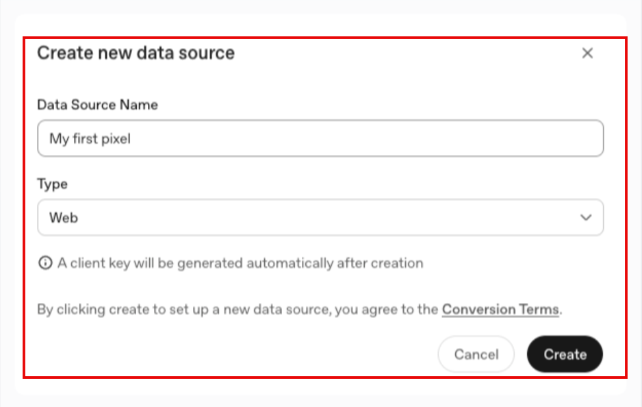
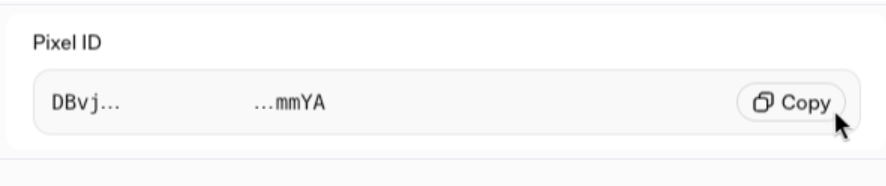
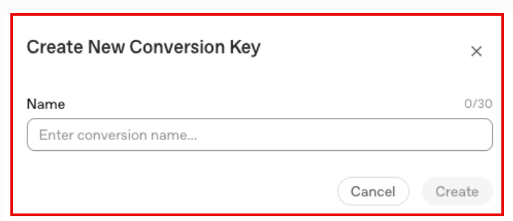
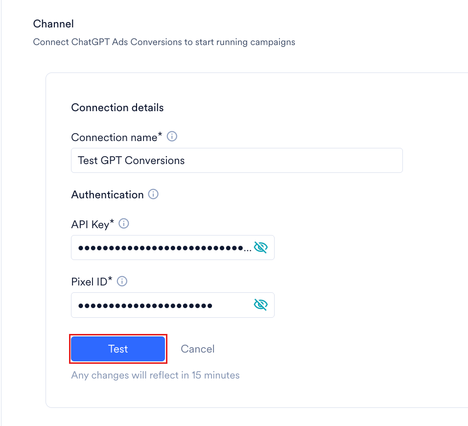
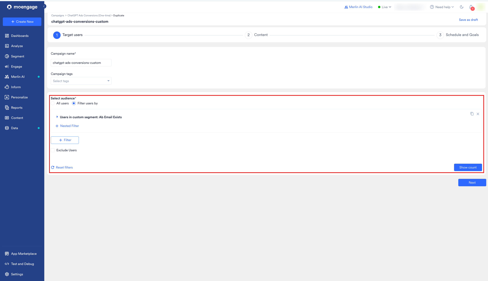
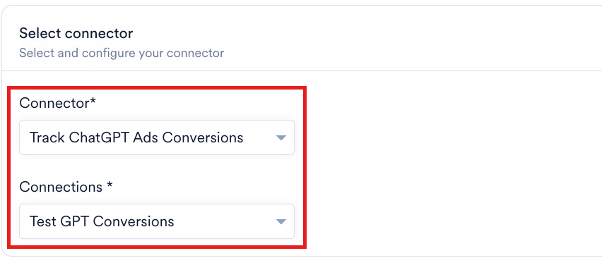
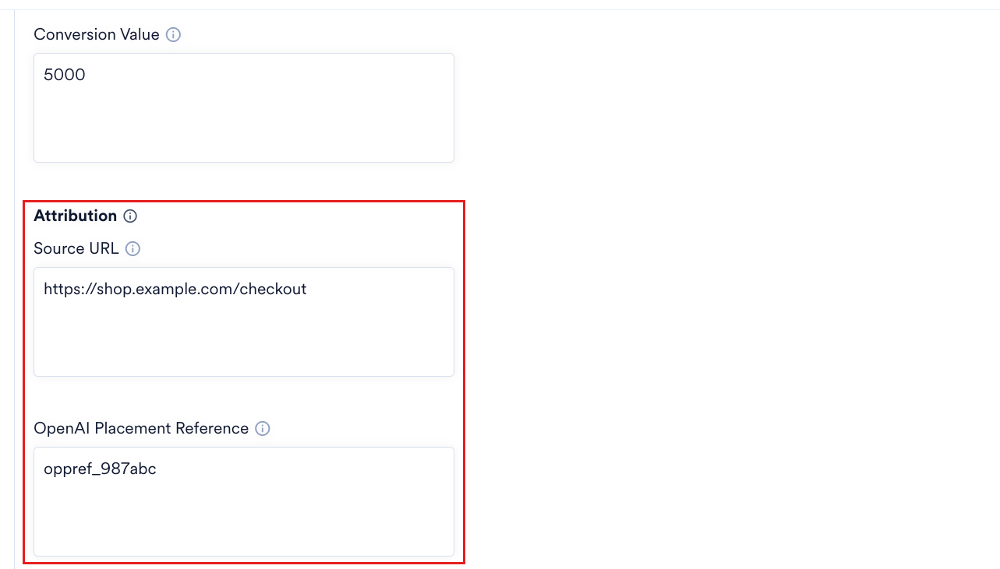
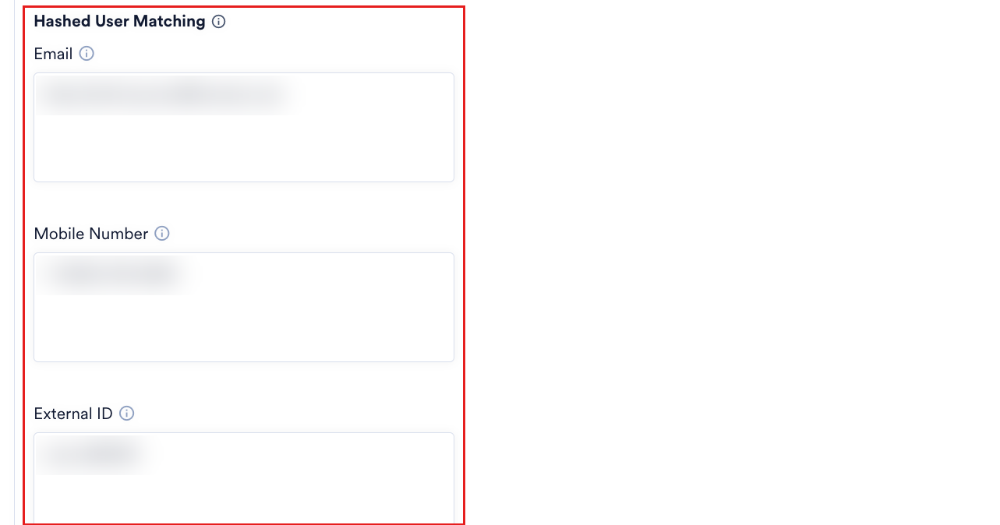
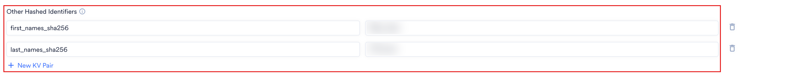
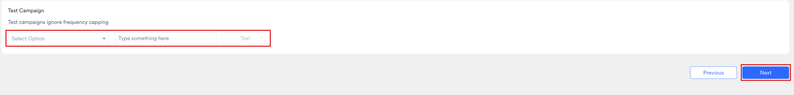

import ConnectedSegmentsAddOn from '/snippets/connected-segments-add-on.mdx';

<ConnectedSegmentsAddOn />

# Introduction

The MoEngage and ChatGPT Ads Conversions (OpenAI) integration establishes a secure, server-to-server (S2S) connection. By bypassing browser-side obstacles such as cookie restrictions, Intelligent Tracking Prevention (ITP), and ad blockers, it captures conversions that client-side tracking often misses.

MoEngage provides a single omnichannel connector for OpenAI, available through the **ChatGPT Ads Conversions** app in the MoEngage App Marketplace. It sends conversion events captured across all your environments, including your website, mobile app, and physical store, directly into your OpenAI Ads Manager.

## Use Cases

Integrating ChatGPT Ads Conversions with MoEngage allows you to sync event data to support the following use cases:

- **Signal resilience**: Recover "lost" conversions typically blocked by browser privacy settings and ad blockers.
- **Real-time attribution**: Send server-side signals directly to OpenAI to improve click-through and view-through attribution accuracy.
- **Return on Ad Spend (ROAS) optimization**: Send real-time conversion data to OpenAI to improve ad delivery, audience matching, and Cost Per Acquisition (CPA).
- **Multi-source tracking**: Capture purchases, subscriptions, sign-ups, appointments, and custom events from any channel, and attribute them to your ad clicks.
- **Conversion reporting**: Report conversion volume and value in OpenAI Ads Manager to measure return on investment.

<Info>
  **Prerequisites**

  Before setting up the connector, ensure you have the following:

  - **Access to OpenAI Ads Manager**: An account with permission to retrieve the Pixel ID and generate an API key in [Step 1: Generate Credentials in OpenAI Ads Manager](/partner-guide/retargeting-and-audience-sync/ad-conversions/openai-ads-conversions#step-1-generate-credentials-in-openai-ads-manager).
</Info>

# Integration

## Step 1: Generate Credentials in OpenAI Ads Manager

To establish the connection, retrieve your Pixel ID and generate an API key in OpenAI Ads Manager.

### Step 1.1: Retrieve Your Pixel ID

To retrieve your Pixel ID, perform the following steps:

1. Log in to your OpenAI Ads Manager account.
2. On the left navigation menu, navigate to **Settings** \> **General** \> **Manage conversion keys**.
3. In the top right corner, click **Create**, and then select **Data Source**.
4. In the **Data Source Name** box, enter a name for the data source.
5. In the **Type** list, select **Web**.
6. Click **Create**.

   

OpenAI then displays your Pixel ID. Click **Copy**, and paste the value in a safe place for use in the [Step 2: Connect ChatGPT Ads Conversions in the App Marketplace](/partner-guide/retargeting-and-audience-sync/ad-conversions/openai-ads-conversions#step-2-connect-chatgpt-ads-conversions-in-the-app-marketplace) section.

### Step 1.2: Generate a Conversions API Key

To generate a Conversions API key, perform the following steps:

1. In OpenAI Ads Manager, navigate to **Settings** \> **General** \> **Manage conversion keys**.
2. In the top right corner, click **Conversion keys**.
3. Click **Create new key**.
4. In the **Name** box, enter a name for the key.
5. Click **Create**.

   

Copy the access token that OpenAI displays.

<Note>
  Save the access token in a secure place. It cannot be retrieved after you close the dialog box, so if you lose it, you must generate a new key.
</Note>

### Step 1.3: Create Conversion Events in OpenAI Ads Manager

OpenAI Ads requires you to create each conversion event in Ads Manager before the events MoEngage sends start to populate them. Events can flow correctly from MoEngage, but if the matching conversion event does not exist in OpenAI Ads Manager, it does not appear in your reporting.

For each event you want to track, perform the following steps:

1. Log in to your OpenAI Ads Manager account.
2. On the left navigation menu, navigate to **Settings** \> **General** \> **Manage conversion keys**.
3. Click the **Conversion Events** tab.
4. In the top right corner, click **Create**, and then select **Conversion Event**.
5. In the **Base Event** list, select the event you want to track.
6. Enter a name for the conversion event.
7. Under **Data source**, select the data source you created in the [Step 1.1: Retrieve Your Pixel ID](/partner-guide/retargeting-and-audience-sync/ad-conversions/openai-ads-conversions#step-1-1-retrieve-your-pixel-id) section.
8. Click **Create**.

Repeat these steps for every event you want to track. For the events OpenAI supports, refer to [Supported Events](https://developers.openai.com/ads/supported-events) in the OpenAI documentation.

## Step 2: Connect ChatGPT Ads Conversions in the App Marketplace

To connect ChatGPT Ads Conversions in the App Marketplace, perform the following steps:

1. On the left navigation menu in the MoEngage UI, click **App Marketplace**.
2. In the search box, enter **ChatGPT**.
3. Under **Search results**, click the **ChatGPT Ads Conversions** tile.
4. Click the **Integrate** tab.
5. Click **\+ Add integration**.
6. Enter the following details:

   | Field | Required | Description |
   | --- | --- | --- |
   | Connection name | Yes | A unique internal name for the connection (for example, ChatGPT Ads - Production). |
   | API Key | Yes | The Bearer token from your OpenAI Ads Manager, generated in the [Step 1.2: Generate a Conversions API Key](/partner-guide/retargeting-and-audience-sync/ad-conversions/openai-ads-conversions#step-1-2-generate-a-conversions-api-key) section. This authorizes API calls. |
   | Pixel ID | Yes | The Pixel ID from your OpenAI Ads Manager, retrieved in the [Step 1.1: Retrieve Your Pixel ID](/partner-guide/retargeting-and-audience-sync/ad-conversions/openai-ads-conversions#step-1-1-retrieve-your-pixel-id) section. This directs conversion signals to the correct dataset. |

7. Click **Test** to validate and save the connection.

   

The **Integrate** tab lists each connection you create, with its status, integration type, and who last updated it. Use the **Status** toggle to turn a connection off without deleting it.

<Note>
  Changes to a connection take up to 15 minutes to reflect in campaigns.
</Note>

## Step 3: Create a ChatGPT Ads Conversions Campaign

To create a ChatGPT Ads Conversions campaign, perform the following steps:

1. On the left navigation menu in the MoEngage UI, click **+ Create New**, and then click **Campaign**.
2. Under **Active Apps**, click **See all**.
3. In the **Connected Apps** dialog box, search for **ChatGPT**, and then click the **ChatGPT Ads Conversions** tile.
4. Click the delivery type you need: **One Time**, **Periodic**, or **Event Triggered**.
5. In **Step 1** (Target users), select your audience.

   
6. In **Step 2** (Content), under **Select connector**, select **Track ChatGPT Ads Conversions** in the **Connector** list, and then select your connection in the **Connections** list.

   
7. Under **Conversion Goals**, enter the following:

   | Field | Required | Description |
   | --- | --- | --- |
   | Event Type | Yes | The conversion event to track, from OpenAI's standard taxonomy. Default is **Order Created**. |
   | Custom Event Name | Conditional | Required only when **Event Type** is **Custom**. Enter 1–64 characters, using lowercase letters, numbers, underscores, and dashes. The name must start and end with a letter or number, and can't be a standard event name. |
   | Action Source | Yes | The channel where the conversion originated: **Web**, **Mobile App**, **Offline**, **Physical Store**, **Phone Call**, **Email**, or **Other**. Default is **Web**. |
   | Event ID | Yes | Unique transaction, order, or event ID used for deduplication. Ensures only the first signal with this ID is recorded. |
   | Currency | Conditional | The ISO 4217 currency code for the conversion value. Required when you fill **Conversion Value**. Default is **USD**. |
   | Conversion Value | No | The total monetary value of the conversion, as an integer in the currency's minor units. |

   The **Action Source** drives omnichannel tracking, letting you attribute conversions to app interactions, web visits, or physical storefront purchases. Type `@` in any text box to personalize its value with a user or event attribute.

8. Under **Attribution**, enter the following:

   | Field | Required | Description |
   | --- | --- | --- |
   | Source URL | Conditional | The URL where the conversion occurred (for example, `https://shop.example.com/checkout/confirmation`). Required when **Action Source** is **Web**. |
   | OpenAI Placement Reference | No | The `oppref` value that OpenAI adds to the landing-page URL when a user clicks your ad. The OpenAI Pixel also stores it in the `__oppref` cookie. Capture it on your site and store it in MoEngage as a user or event attribute so you can map it here. Send it to attribute the conversion to the ad click that led to it. Sent as-is. |

   

9. Under **Hashed User Matching**, enter the following. These identifiers help OpenAI match the conversion to a user. MoEngage normalizes and SHA-256 hashes them before sending.

   | Field | Required | Description |
   | --- | --- | --- |
   | Email | No | The user's email address. Mapped to a default attribute, which you can change. |
   | Mobile Number | No | The user's mobile number. Mapped to a default attribute, which you can change. |
   | External ID | No | Your internal customer or user ID (for example, `customer_12345`). |

   Map at least one identifier. A conversion with no match signal cannot be attributed to your ads.

   

10. Under **Other Hashed Identifiers**, add more identifiers as key-value pairs. Enter a key in the **Key** box and its value in the adjacent box, and click **+ New KV Pair** to add each further pair. MoEngage normalizes these values the way OpenAI requires (lowercase, with spaces and punctuation removed) and SHA-256 hashes them before sending.

    | Key | Description |
    | --- | --- |
    | first_names_sha256 | The user's first name. |
    | last_names_sha256 | The user's last name. |

    

11. Under **Unhashed User Parameters**, in the **Unhashed User Details** block, add parameters as key-value pairs. These values are sent as-is, without hashing.

    | Key | Description |
    | --- | --- |
    | obref | The browser reference from the OpenAI Pixel cookie. |
    | ip_address | The user's IPv4 or IPv6 address. |
    | user_agent | The browser's User-Agent string. |
    | countries | Two-letter ISO 3166-1 country code (for example, `US`). |
    | cities | City name. |
    | regions | State or region name. |
    | postal_codes | Postal or ZIP code. |
    | android_advertising_id | The user's Google Advertising ID (GAID). |

    Use the key names exactly as OpenAI's [Conversions API](https://developers.openai.com/ads/conversions-api) defines them.

12. Under **Event Data**, in the **Conversion Event Data** block, enter a key in the **Key** box and its value in the adjacent box. Click **+ New KV Pair** to add each further pair.

    | Key | Applies To | Description |
    | --- | --- | --- |
    | amount | Depends on the event type | The price of one item, as an integer in the currency's minor units following ISO 4217. For example, `2599` for $25.99 USD. |
    | currency | All events with `amount` | The ISO 4217 currency code for the item, such as `USD` or `EUR`. Required whenever `amount` is present. |
    | plan_id | Subscriptions, trials, Custom | Your internal subscription or plan identifier (for example, `plan_starter`). |
    | item_id | Purchase, Subscriptions, Custom | Internal product or item identifier (for example, `sku_12345`). |
    | item_name | Purchase, Subscriptions, Custom | Product name (for example, Premium Subscription). |
    | item_quantity | Purchase, Subscriptions, Custom | Number of items, as an integer. |
    | content_type | Optional for all | Item category or type (for example, `product`). |
    | group_id | Optional for all | Product group or bundle identifier (for example, `bundle_summer_2024`). |
    | variant_dict.size | Optional for all | Product variant size (for example, `large`). |
    | variant_dict.color | Optional for all | Product variant color (for example, `blue`). |

    The `amount` key is the price of one item, not the total. Set the total value of the conversion in **Conversion Value** under **Conversion Goals**. If you fill both and the event type accepts item data, MoEngage sends both. For which event types accept each key, refer to [Event Data](https://developers.openai.com/ads/conversions-api#event-data) in the OpenAI documentation.

13. Under **Test Campaign**, select an identifier type, enter a test user's value, and then click **Test**. If the test succeeds, your setup is ready.

    

    Test campaigns ignore frequency capping.
14. Click **Next**, configure **Step 3** (Schedule and Goals), and then publish the campaign.

## Custom Events

To track a conversion outside OpenAI's standard taxonomy, perform the following steps:

1. Under **Conversion Goals**, select **Custom** in the **Event Type** list.
2. In the **Custom Event Name** box, enter a name of 1–64 characters, using lowercase letters, numbers, underscores, and dashes.
3. Under **Event Data**, map the keys that apply to the event.

The name must start and end with a letter or number, and can't be a standard event name. Spaces aren't supported. Valid custom event names include `video_completed`, `ebook_downloaded`, and `webinar_registered`.

## Supported Conversion Events

MoEngage supports direct mapping to OpenAI's standard event taxonomy. Select the event you want to track in the **Event Type** list. For the full list of supported events and the data each one accepts, refer to [Supported Events](https://developers.openai.com/ads/supported-events) in the OpenAI documentation.

<Note>
  **Order Created** is the default event type. If you are targeting top-of-funnel goals, adjust the **Event Type** in your campaign settings.
</Note>

## Usage Constraints

- **Monetary value format**: Send the conversion value as an integer in the currency's minor units. For example, $42.00 USD is `4200`, €29.99 EUR is `2999`, £1.50 GBP is `150`, and ¥100 JPY is `10000`, because JPY has no decimal sub-units. Set the **Currency** field whenever you send a conversion value.
- **Deduplication hygiene**: Map a unique **Event ID**, such as a transaction or order ID. OpenAI records only the first occurrence of an Event ID and ignores duplicates, which prevents over-reporting.
- **User matching and privacy**: Pass raw values directly to the connector, because MoEngage normalizes and SHA-256 hashes personally identifiable information (PII) natively.
- **Timestamp**: MoEngage sends the time of the API call as the event timestamp.
- **Batch processing**: MoEngage sends events to OpenAI in batches of up to 1,000. If one event in a batch fails schema validation, the entire batch fails, so verify data integrity across all events.

## FAQs

<AccordionGroup>
  <Accordion title="Can I send events from multiple channels in the same campaign?">
    Yes. Assign the appropriate **Action Source** for each event, and OpenAI attributes the conversions across channels.
  </Accordion>
  <Accordion title="What happens if I send the same Event ID twice?">
    OpenAI deduplicates events on the Event ID. Only the first instance it receives is recorded, and subsequent identical IDs are ignored.
  </Accordion>
  <Accordion title="Can I track revenue per item?">
    Yes. Set the overall value in **Conversion Value**, and add the item details, including the price of one item in the `amount` key, in the **Conversion Event Data** block. Use the `variant_dict` keys for item attributes such as size and color.
  </Accordion>
  <Accordion title="How do I handle multi-item orders?">
    Set the total order value in **Conversion Value**, and use `item_quantity` for multi-unit items. For complex multi-product orders, either send individual item events or group them under a single bundle identifier.
  </Accordion>
</AccordionGroup>
