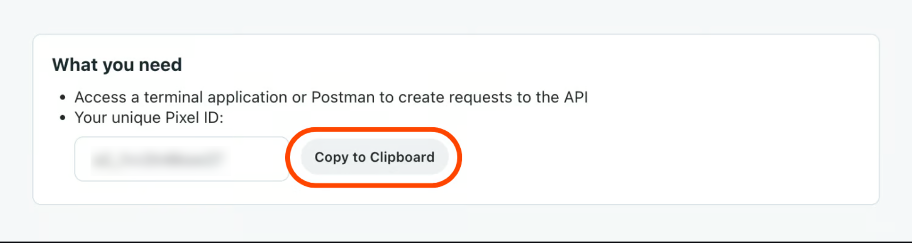
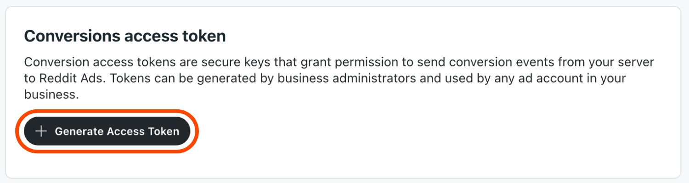
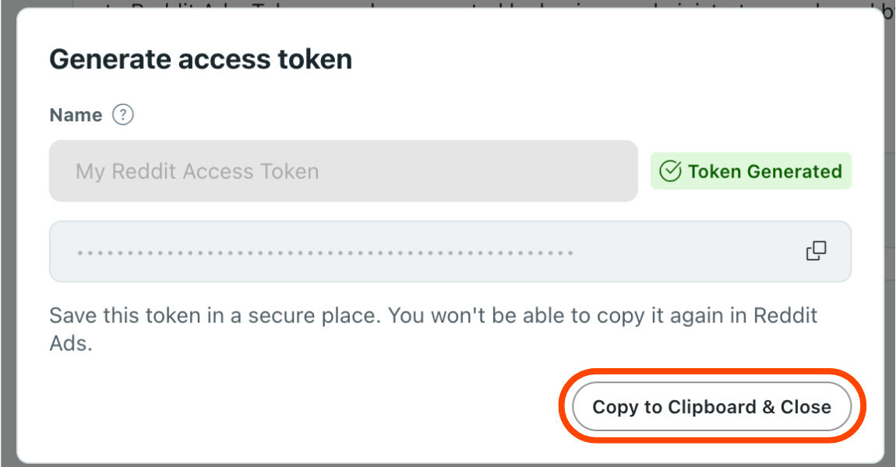
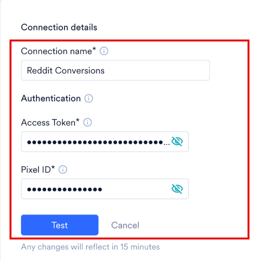
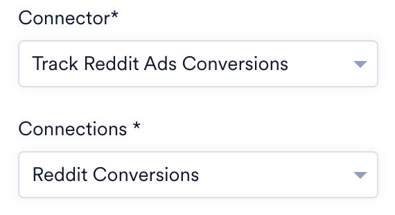
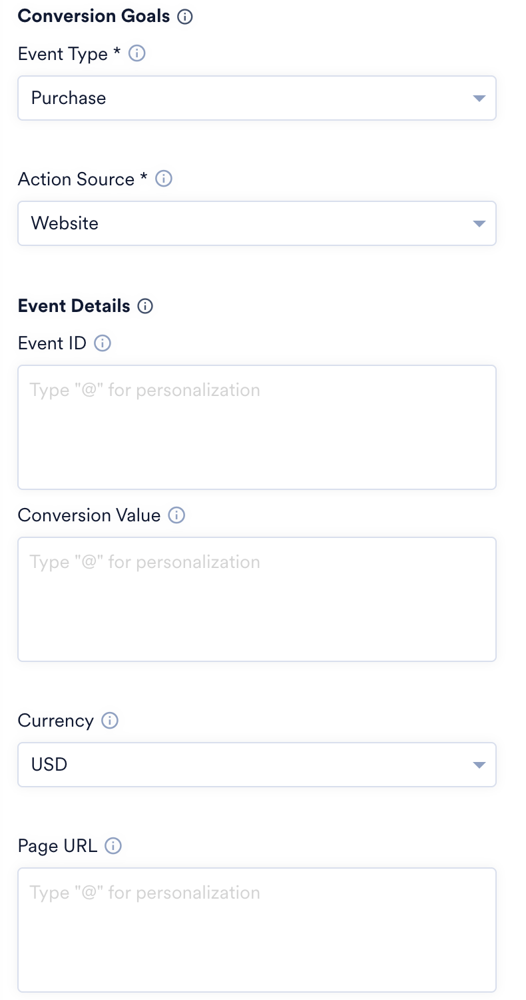
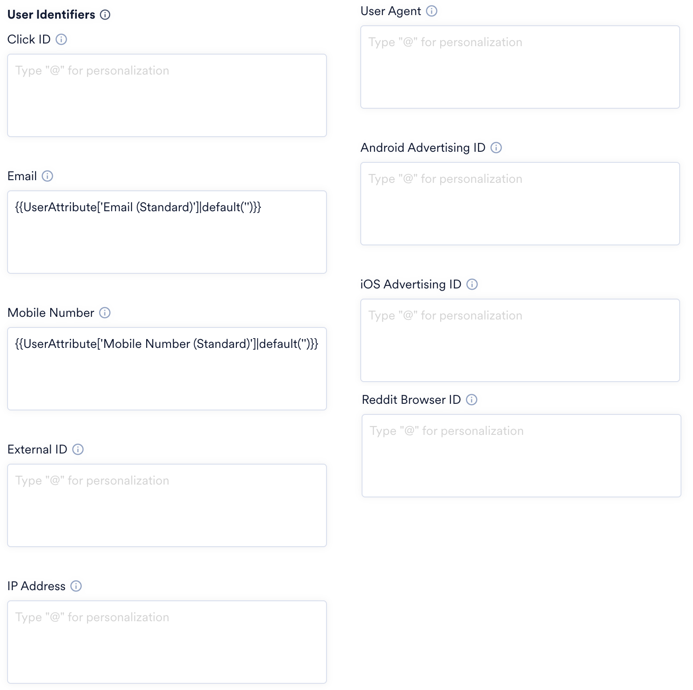
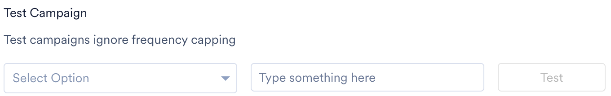

import ConnectedSegmentsAddOn from '/snippets/connected-segments-add-on.mdx';

<ConnectedSegmentsAddOn />

# Introduction

The MoEngage and Reddit Ads Conversions integration establishes a secure, server-to-server (S2S) connection. By bypassing browser-side obstacles such as cookie restrictions, Intelligent Tracking Prevention (ITP), and ad blockers, it captures conversions that client-side tracking often misses.

MoEngage provides a single omnichannel connector for Reddit — **Track Reddit Ads Conversions** — available through the **Reddit Ads Conversions** app in the MoEngage App Marketplace. It sends conversion events captured across all your environments (website, mobile app, and physical store) directly into your Reddit Ads Manager.

## Use Cases

Integrating Reddit Ads Conversions with MoEngage allows you to sync event data to support the following use cases:

- **Signal resilience**: Recover "lost" conversions typically blocked by browser privacy settings and ad blockers.
- **Omnichannel attribution**: Bridge the gap between offline transactions, in-app purchases, and web interactions to accurately attribute credit to your Reddit ad clicks.
- **Return on Ad Spend (ROAS) optimization**: Send real-time conversion data to Reddit to improve ad delivery, audience matching, and Cost Per Acquisition (CPA).

<Info>
  **Prerequisites**

  Before setting up the connector, ensure you have the following:

  - **Access to Reddit Ads Manager**: An account with permission to view Events Manager, where you generate the Pixel ID and access token in [Step 1: Generate Credentials in Reddit](/partner-guide/retargeting-and-audience-sync/ad-conversions/reddit-ads-conversions#step-1-generate-credentials-in-reddit).
  - **Connected Apps enabled**: Contact your MoEngage Customer Success Manager (CSM) if Connected Apps is not enabled for your account.

</Info>

# Integration with Reddit Ads Conversions

## Step 1: Generate Credentials in Reddit

To establish the connection, retrieve your Pixel ID and generate an access token in Reddit Ads Manager.

### Step 1.1: Retrieve Your Pixel ID

To retrieve your Pixel ID, perform the following steps:

1. In the **Events Manager**, click **Configure data source**, and then select **Conversions API** \> **Set up manually**. If you have not set up the Conversions API or the Pixel yet, select **Conversions API Only** instead.
2. Click **Copy to Clipboard** to save your Pixel ID.

Paste the value in a safe place for use in the [Connect Reddit Conversions in the App Marketplace](/partner-guide/retargeting-and-audience-sync/ad-conversions/reddit-ads-conversions#step-2-connect-reddit-conversions-in-the-app-marketplace) section.

### Step 1.2: Generate a Conversion Access Token

To generate a conversion access token, perform the following steps:

1. In the **Conversions access token** section, click **Generate Access Token**.

   

2. Enter a name for your token (for example, My Reddit Access Token).
3. Click **Generate** to create your token.
4. Click **Copy to Clipboard & Close**.

   

<Note>
  Save the access token in a secure place. It cannot be retrieved later, so if you lose it, you must generate a new token.
</Note>

## Step 2: Connect Reddit Conversions in the App Marketplace

To connect Reddit Ads Conversions in the App Marketplace, perform the following steps:

1. On the left navigation menu in the MoEngage UI, click **App marketplace**.
2. On the **App marketplace** page, search for **Reddit Ads Conversions**.
3. Click the **Reddit Ads Conversions** tile.
4. On the **Reddit Ads Conversions** page, click the **Integrate** tab.
5. Enter the following details:

   | Field | Required | Description |
   | --- | --- | --- |
   | Connection name | Yes | A unique internal name for the connection (for example, Reddit Conversions). |
   | Access Token | Yes | The static Bearer token from your Reddit account, generated in the [Generate a Conversion Access Token](/partner-guide/retargeting-and-audience-sync/ad-conversions/reddit-ads-conversions#step-1-2-generate-a-conversion-access-token) section. This authorizes API calls. |
   | Pixel ID | Yes | The Pixel ID from your Reddit Ads Manager (**Events Manager** \> **Pixels**), retrieved in the [Retrieve Your Pixel ID](/partner-guide/retargeting-and-audience-sync/ad-conversions/reddit-ads-conversions#step-1-1-retrieve-your-pixel-id) section. This directs conversion signals to the correct dataset. |

   

6. Click **Test** to validate and save the connection.

<Note>
  Changes to the connection can take up to 15 minutes to reflect.
</Note>

## Step 3: Create a Reddit Conversions Campaign

To create a Reddit Conversions campaign, perform the following steps:

1. On the left navigation menu in the MoEngage UI, click **+ Create New**, and then click **Campaign**.
2. Under **Active Apps**, click **See all**.
3. In the **Connected Apps** dialog box, search for **Reddit**, and then click the **Reddit Ads Conversions** tile.
4. Click the delivery type you need: **One Time**, **Periodic**, or **Event Triggered**.
5. In **Step 1** (Target Users), select your audience.
6. In **Step 2** (Content), select your connector (**Track Reddit Ads Conversions**) and your created connection.

   
7. Under **Conversion Goals** and **Event Details**, enter the following fields:

   | Field | Required | Description |
   | --- | --- | --- |
   | Event Type | Yes | A Reddit standard event (for example, Purchase, Lead, or Sign Up). Default is **Purchase**. For the full list, refer to [Supported Conversion Events](/partner-guide/retargeting-and-audience-sync/ad-conversions/reddit-ads-conversions#supported-conversion-events). |
   | Action Source | Yes | The channel where the conversion happened: Website, App, Store, or Other. Default is **Website**. |
   | Event ID | No | A unique transaction or order ID, used for deduplication. Reddit records only the first conversion with this ID. |
   | Conversion Value | No | The monetary value of the conversion, used to measure ROAS and revenue. |
   | Currency | No | The ISO code of the transaction currency. Default is **USD**. |
   | Page URL | No | The URL of the page where the conversion happened. |

   
8. Under **User Identifiers**, enter the identifiers Reddit uses to match the conversion to a Reddit user:

   | Field | Required | Description |
   | --- | --- | --- |
   | Click ID | No | The `rdt_cid` parameter that Reddit adds to your landing-page URL. Used for deterministic attribution of web conversions. |
   | Email | No | The user's email address. Mapped to **Email (Standard)** by default. MoEngage normalizes it and hashes it with SHA-256. |
   | Mobile Number | No | The user's mobile number. Mapped to **Mobile Number (Standard)** by default. MoEngage normalizes it to E.164 and hashes it with SHA-256. |
   | External ID | No | Your internal user ID. MoEngage hashes it with SHA-256. |
   | IP Address | No | The user's IP address. |
   | User Agent | No | The User-Agent string of the user's browser. |
   | Android Advertising ID | No | The user's Android advertising ID (AAID). MoEngage hashes it with SHA-256. |
   | iOS Advertising ID | No | The user's iOS advertising ID (IDFA). MoEngage hashes it with SHA-256. |
   | Reddit Browser ID | No | The value of the first-party `_rdt_uuid` cookie on your domain. |

   
9. Under **Test Campaign**, select an identifier, enter the value of a test user, and then click **Test**.

   
10. Click **Next**, set the schedule in **Step 3** (Schedule and Goals), and then publish the campaign.

## Supported Conversion Events

MoEngage supports direct mapping to Reddit's standard event taxonomy.

| MoEngage Label | Reddit Key |
| --- | --- |
| Purchase | PURCHASE |
| Page Visit | PAGE_VISIT |
| View Content | VIEW_CONTENT |
| Search | SEARCH |
| Add to Cart | ADD_TO_CART |
| Add to Wishlist | ADD_TO_WISHLIST |
| Lead | LEAD |
| Sign Up | SIGN_UP |

<Note>
  Purchase is the default event type. If you are targeting top-of-funnel goals, adjust the **Event Type** in your campaign settings.
</Note>

## Usage Constraints

- **Deduplication hygiene**: Mapping a unique Event ID (such as a transaction ID) prevents over-reporting by ensuring Reddit counts only unique event occurrences.
- **Signal requirements**: Successful API transmission requires at least one match key (Mobile Number, Email, or Click ID). Without these signals, conversions cannot be attributed to Reddit ads.
- **Automated normalization**: Pass raw PII directly to the connector. The system handles all cryptographic requirements natively, including whitespace stripping and SHA-256 hashing.
