import ConnectedSegmentsAddOn from '/snippets/connected-segments-add-on.mdx';

<ConnectedSegmentsAddOn />

[LinkedIn Ads](https://business.linkedin.com/marketing-solutions/ads) lets businesses reach professional audiences on LinkedIn, using targeting such as job title, company, and industry.

## MoEngage × LinkedIn Ads

The MoEngage and LinkedIn Ads integration lets you send MoEngage segments to LinkedIn Ads as matched audiences. You can then target or exclude these audiences in your LinkedIn campaigns.

## Use Cases

Integrating MoEngage with LinkedIn Ads helps you solve the following use cases:

- **Account-based retargeting**: Target users who engaged with your product or website with ads on LinkedIn.
- **Optimized advertising spend**: Exclude existing customers from acquisition campaigns, so you don't pay to reach users you already have.
- **Predictive audiences**: Use a segment of high-value users as the source for a LinkedIn predictive audience, which finds members likely to act like them.

# Integration

<Info>
  **Prerequisites**

  To use this feature, you must have a [LinkedIn Campaign Manager](https://www.linkedin.com/campaignmanager) account with permission to manage the ad account and its audiences. The LinkedIn user who signs in from MoEngage must have one of these ad account roles: Account Billing Admin, Account Manager, Campaign Manager, or Creative Manager.
</Info>

## Step 1: Find Your LinkedIn Ad Account ID

To find your Ad Account ID, perform the following steps:

1. Log in to [LinkedIn Campaign Manager](https://www.linkedin.com/campaignmanager).
2. In the top left, copy the Ad Account ID shown under your ad account name.

   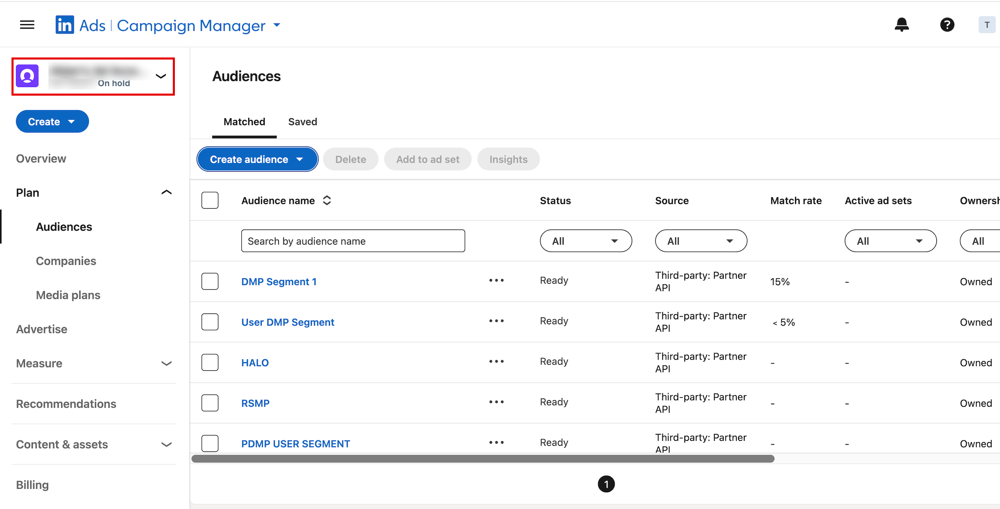

If you have more than one ad account, click the account name to see the ID of each one. For more information, refer to [Find LinkedIn Ads account details](https://www.linkedin.com/help/lms/answer/a424270) in LinkedIn Help.

## Step 2: Connect LinkedIn Ads Audience on the App Marketplace

LinkedIn Ads Audience has three integration types:

- **Create Audience**: Creates a new audience.
- **Update Users to Audience**: Adds or removes users in an existing audience.
- **Get Audience**: Lists your audiences and their IDs.

In these connectors, **Segment** means the LinkedIn audience, not a MoEngage segment. For example, **Segment Name** is the name of the audience that MoEngage creates in LinkedIn.

<Note>
  **Create Audience** and **Update Users to Audience** support only the **Contact** type. The **Company** type isn't supported.
</Note>

Add one connection for each type you use. To connect LinkedIn Ads Audience, perform the following steps:

1. In MoEngage, click **App Marketplace**.
2. Search for **LinkedIn Ads Audience**, and then click the **LinkedIn Ads Audience** tile.
3. Click the **Integrate** tab.
4. Click **\+ Add integration**, and then click the integration type you need.

   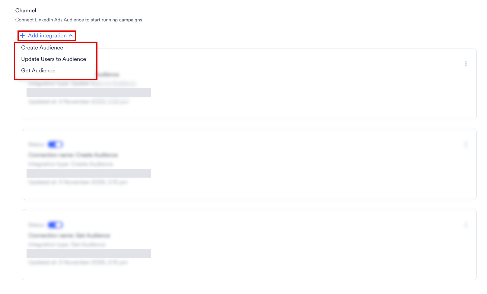
5. Enter the following details:

   <Tabs>
     <Tab title="Create Audience">
       | Field | Required | Description |
       | --- | --- | --- |
       | Connection name | Yes | A name for this connection. |
       | Ad Account ID | Yes | The Ad Account ID from [Step 1](/partner-guide/retargeting-and-audience-sync/audience-sync/linkedin-ads-audience#step-1-find-your-linkedin-ad-account-id). |

       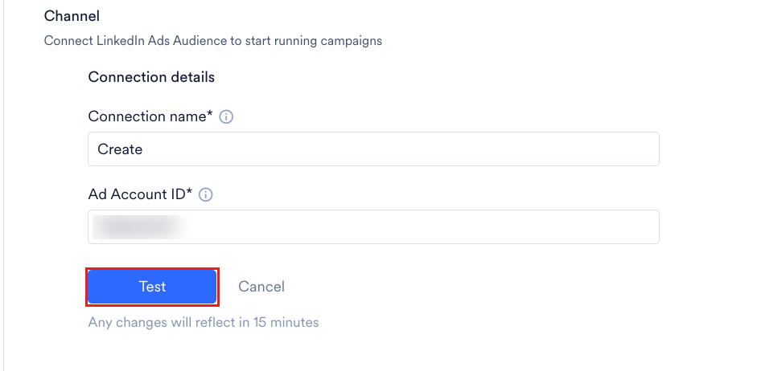
     </Tab>
     <Tab title="Update Users to Audience">
       | Field | Required | Description |
       | --- | --- | --- |
       | Connection name | Yes | A name for this connection. |

       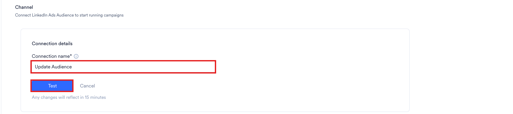
     </Tab>
     <Tab title="Get Audience">
       | Field | Required | Description |
       | --- | --- | --- |
       | Connection name | Yes | A name for this connection. |
       | Ad Account ID | Yes | The Ad Account ID from [Step 1](/partner-guide/retargeting-and-audience-sync/audience-sync/linkedin-ads-audience#step-1-find-your-linkedin-ad-account-id). |

       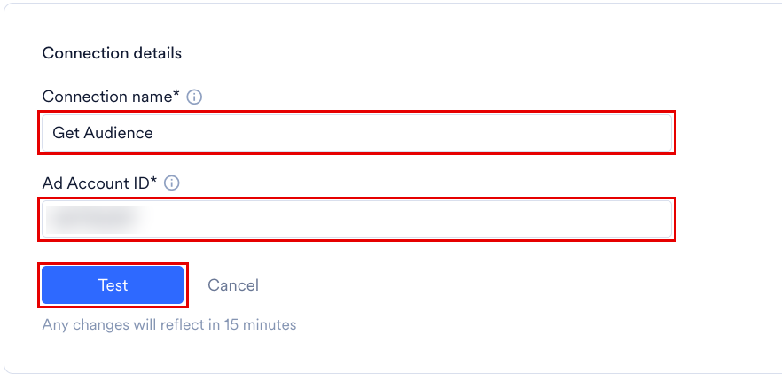
     </Tab>
   </Tabs>
6. Click **Test**. MoEngage opens the LinkedIn sign-in page.
7. Sign in to LinkedIn, and then click **Allow**.

   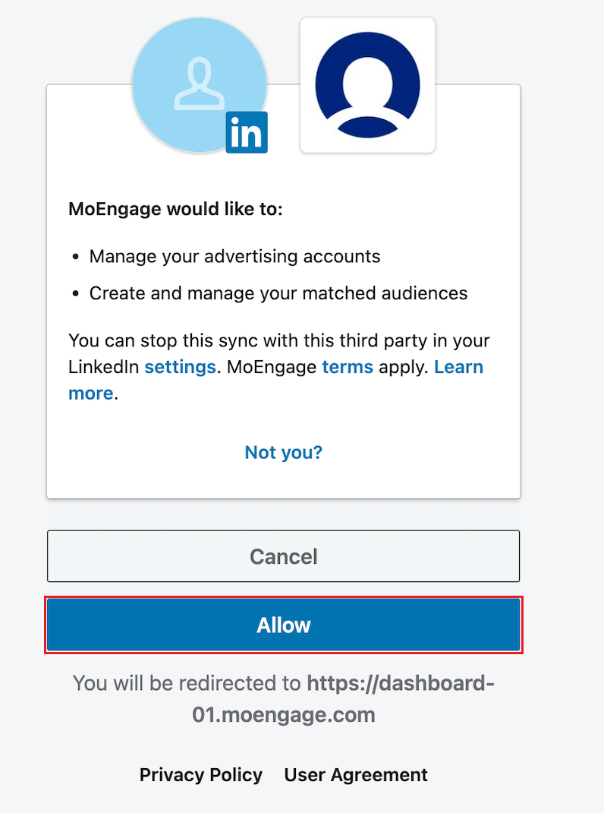

The connection appears on the **Integrate** tab. Changes take up to 15 minutes to show in campaigns.

## Step 3: Create a Campaign on MoEngage to Update Audiences to LinkedIn

To create a LinkedIn Ads Audience campaign on MoEngage, perform the following steps:

1. On the left navigation menu in the MoEngage UI, click **+ Create New**, and then click **Campaign**.
2. Under **Active Apps**, click **See all**.
3. In the **Connected Apps** dialog box, search for **LinkedIn**, click the **LinkedIn Ads Audience** tile, and then click the delivery type you need: **One Time**, **Periodic**, or **Event Triggered**.
4. In **Step 1** (Target users), select the segment you want to sync to LinkedIn.

   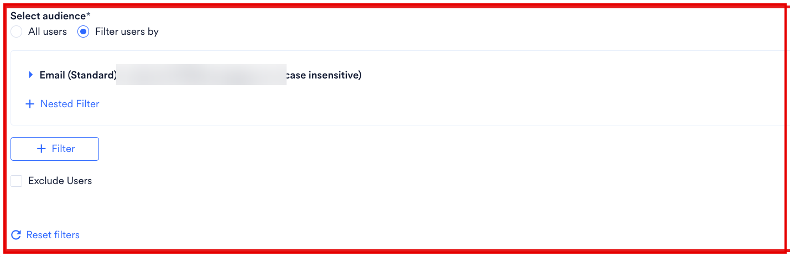
5. In **Step 2** (Content), select the **Connector** and the **Connections** you created.

   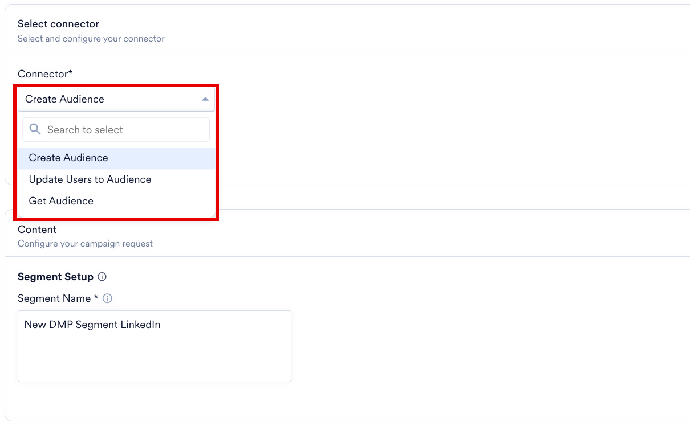
6. Enter the following details:

   <Tabs>
     <Tab title="Create Audience">
       | Section | Field | Required | Description |
       | --- | --- | --- | --- |
       | Segment Setup | Segment Name | Yes | The name of the audience to create in LinkedIn. |
     </Tab>
     <Tab title="Update Users to Audience">
       | Section | Field | Required | Description |
       | --- | --- | --- | --- |
       | Audience Configuration | Segment ID | Yes | The audience `id`. See [Find the Segment ID](/partner-guide/retargeting-and-audience-sync/audience-sync/linkedin-ads-audience#find-the-segment-id). |
       | Audience Configuration | Action Type | Yes | **Add Users** to add users to the audience, or **Remove Users** to remove them. |
       | Identifiers | User Email | Yes | The user's email address, used to match the user. MoEngage hashes it with SHA-256 before sending. |
       | Identifiers | Google Advertising ID | No | The user's Google Advertising ID (GAID), used to match the user. |
       | Contact Attributes | First Name | No | The user's first name. Improves matching. |
       | Contact Attributes | Last Name | No | The user's last name. Improves matching. |
       | Contact Attributes | Job Title | No | The user's job title. Improves matching. |
       | Contact Attributes | Company Name | No | The user's company. Improves matching. |
       | Contact Attributes | Country Code | No | The user's country code. Improves matching. |

       Type `@` in a field to personalize its value with a user attribute.

       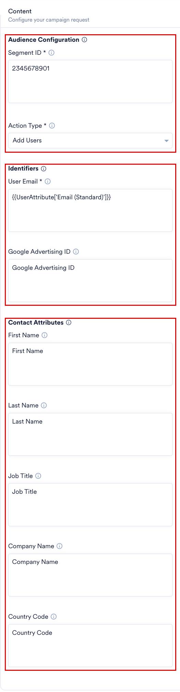
     </Tab>
     <Tab title="Get Audience">
       | Section | Field | Required | Description |
       | --- | --- | --- | --- |
       | Content | Source Platform | Yes | Who created the audience. For audiences MoEngage created, select **Integration (or Partner App)**. |

       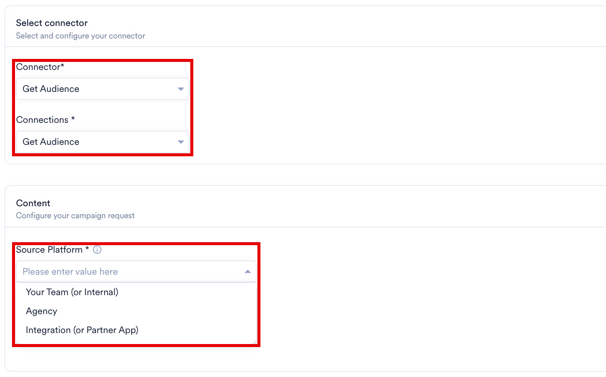
     </Tab>
   </Tabs>
7. Under **Test Campaign**, select an identifier type, enter a test user's value, and then click **Test**. If the test succeeds, your setup is ready.

   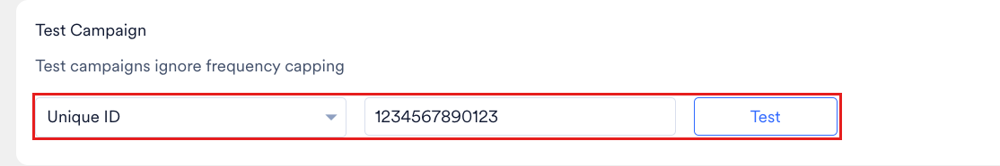
8. For **Update Users to Audience**, click **Next**, configure **Step 3** (Schedule and Goals), and then publish the campaign.

For **Create Audience**, clicking **Test** creates the audience in LinkedIn, so you don't publish the campaign. Then find the audience's Segment ID, as described in [Find the Segment ID](#find-the-segment-id), and add users to it with an **Update Users to Audience** campaign. Publish that campaign so it keeps the audience up to date.

<Warning>
  Don't publish a Create Audience campaign. Clicking **Test** already creates the audience, and each published run creates another audience with the same name.
</Warning>

### Find the Segment ID

The Segment ID is the audience `id` from the **Get Audience** response. The ID shown in LinkedIn Campaign Manager doesn't work. The response lists all the audiences for the **Source Platform** you select. To find the Segment ID, perform the following steps:

1. In a LinkedIn Ads Audience campaign, select the **Get Audience** connector and connection.
2. In **Source Platform**, select who created the audience.
3. Under **Test Campaign**, select an identifier type, enter a test user's value, and then click **Test**.
4. In **Test campaign stats**, copy the response under **REASON**.

   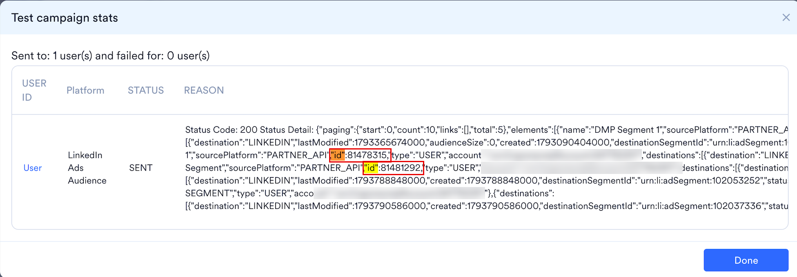
5. Paste the response into a JSON formatter.
6. Find your audience by its `name`, and then copy its `id`.

## Step 4: View Your Audiences in LinkedIn

In LinkedIn Campaign Manager, go to **Plan** > **Audiences** > **Matched** to see your audiences and their status.

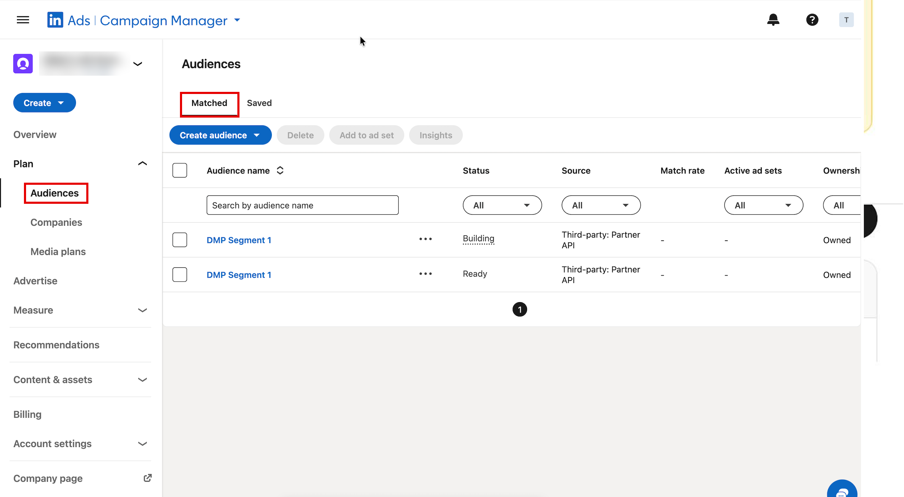

<Info>
  - LinkedIn takes up to 48 hours to match users to a new audience, and up to 24 hours to apply later updates.
  - The audience shows **Building** while LinkedIn matches users, and **Ready** when matching is complete. You can add a Building audience to campaign targeting.
  - An audience needs at least 300 matched members before it can serve ads.
  - An ad account can have up to 1,000 audiences, including archived and expired ones.

  For more information, refer to [Matched Audiences](https://learn.microsoft.com/en-us/linkedin/marketing/matched-audiences/matched-audiences) and the [Matched Audiences FAQ](https://learn.microsoft.com/en-us/linkedin/marketing/matched-audiences/matched-audiences-faq) in the LinkedIn documentation.
</Info>
