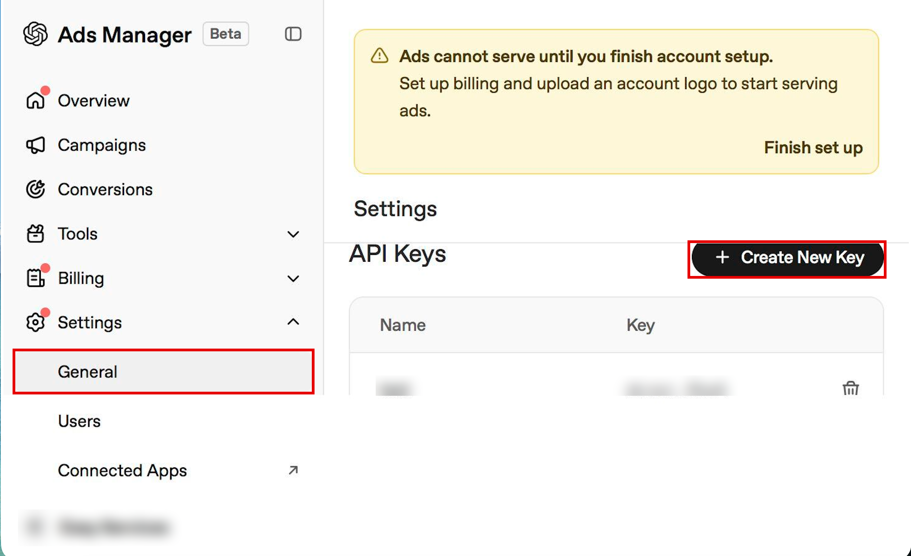
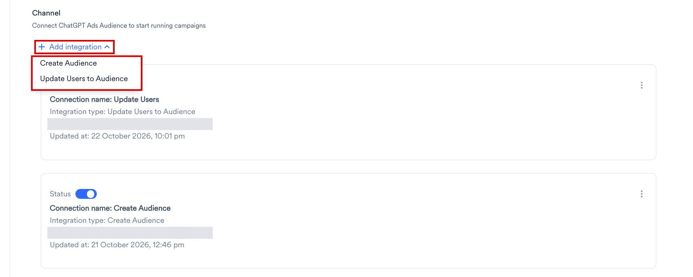
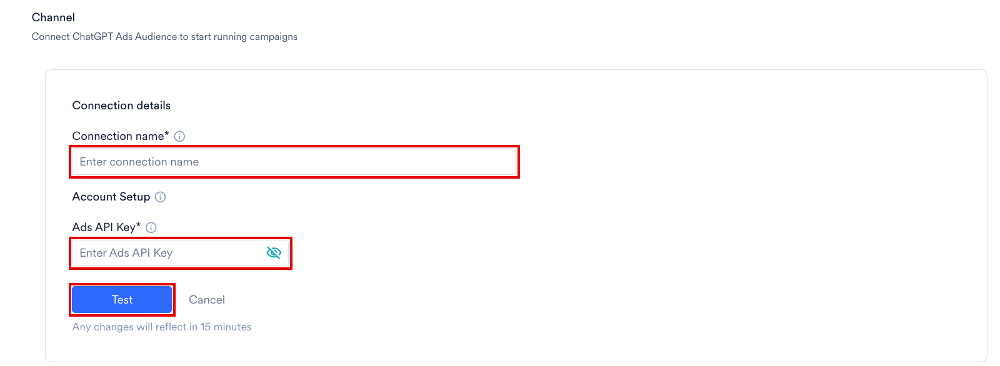
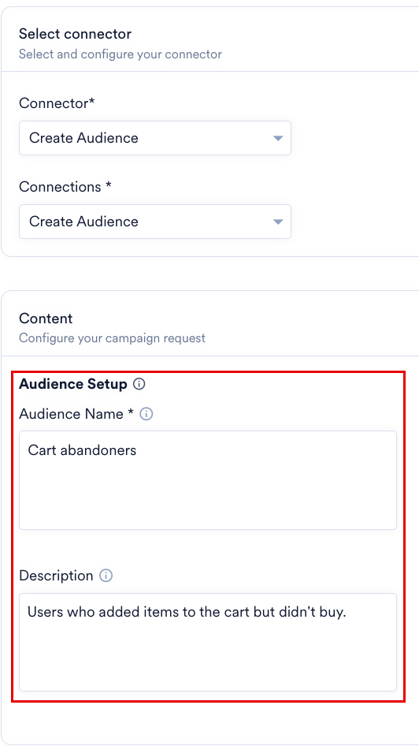
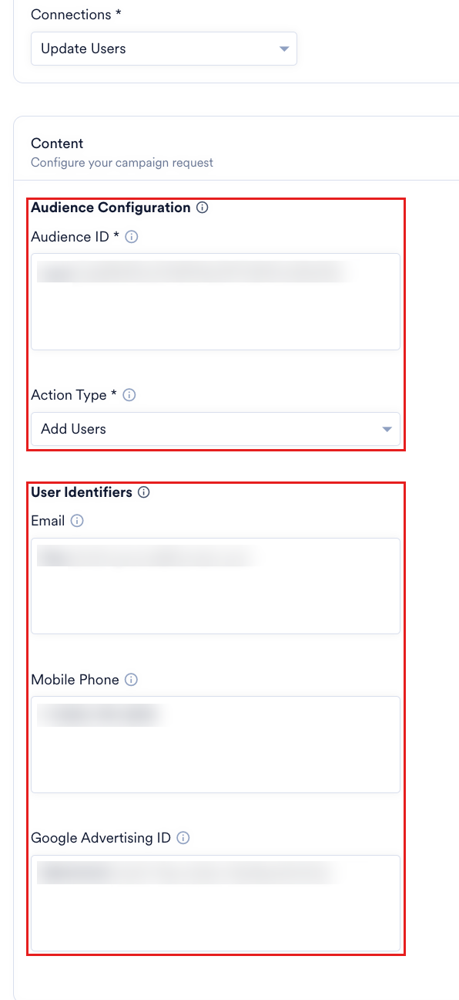
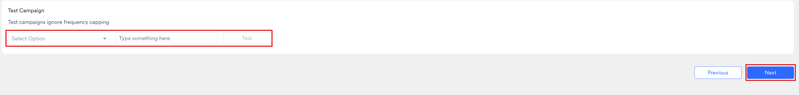

import ConnectedSegmentsAddOn from '/snippets/connected-segments-add-on.mdx';

<ConnectedSegmentsAddOn />

ChatGPT Ads (OpenAI) lets businesses show ads to people using ChatGPT.

## MoEngage × ChatGPT Ads (OpenAI)

The MoEngage and ChatGPT Ads (OpenAI) integration lets you send MoEngage segments to ChatGPT Ads as audiences. You can then use these audiences to target or exclude users in your ChatGPT Ads campaigns.

## Use Cases

Integrating MoEngage with ChatGPT Ads helps you solve the following use cases:

- **Retargeting**: Reach users who engaged with your product but didn't convert.
- **Optimized advertising spend**: Exclude existing customers from acquisition campaigns.
- **Lifecycle refresh**: Keep audiences current by adding and removing users as they enter or leave a MoEngage segment.

# Integration

<Info>
  **Prerequisites**

  To use this feature, you must have an OpenAI Ads Manager account.
</Info>

<Note>
  OpenAI doesn't support custom audiences in campaigns that target the European Economic Area (EEA) or Switzerland. For more information, refer to [Custom Audiences](https://developers.openai.com/ads/custom-audiences) in the OpenAI documentation.
</Note>

## Step 1: Generate an API Key in OpenAI Ads Manager

To generate an API key, perform the following steps:

1. Log in to OpenAI Ads Manager.
2. Navigate to **Settings** \> **General**.
3. Under **API Keys**, click **Create New Key**.

   
4. Enter a name for the key, and then click **Create**.
5. Copy the API key.

OpenAI shows the key only once, so save it in a secure place. This Ads API key is different from the conversion key that [ChatGPT Ads Conversions (OpenAI)](/partner-guide/retargeting-and-audience-sync/ad-conversions/openai-ads-conversions) uses.

## Step 2: Connect ChatGPT Ads Audience on the App Marketplace

To connect ChatGPT Ads Audience, perform the following steps:

1. In MoEngage, click **App Marketplace**.
2. Search for **ChatGPT**, and then click the **ChatGPT Ads Audience** tile.
3. Click the **Integrate** tab.
4. Click **\+ Add integration**, and then click **Create Audience** or **Update Users to Audience**.

   
5. In **Connection name**, enter a name for the connection.
6. In **Ads API Key**, paste the API key from [Step 1](/partner-guide/retargeting-and-audience-sync/audience-sync/openai-ads-audience#step-1-generate-an-api-key-in-openai-ads-manager).
7. Click **Test**.

   

To use both integration types, add one connection for each. Changes take up to 15 minutes to show in campaigns.

## Step 3: Create a ChatGPT Ads Audience Campaign

To create a ChatGPT Ads Audience campaign, perform the following steps:

1. On the left navigation menu in the MoEngage UI, click **+ Create New**, and then click **Campaign**.
2. Under **Active Apps**, click **See all**.
3. In the **Connected Apps** dialog box, search for **ChatGPT**, click the **ChatGPT Ads Audience** tile, and then click the delivery type you need: **One Time**, **Periodic**, or **Event Triggered**.
4. In **Step 1** (Target users), select the segment you want to sync to ChatGPT Ads.
5. In **Step 2** (Content), select the connector and the connection you created, and then enter the fields for that connector.

<Tabs>
  <Tab title="Create Audience">
    | Section | Field | Required | Description |
    | --- | --- | --- | --- |
    | Audience Setup | Audience Name | Yes | The name of the audience to create in ChatGPT Ads. |
    | Audience Setup | Description | No | A description of the audience. |

    
  </Tab>
  <Tab title="Update Users">
    | Section | Field | Required | Description |
    | --- | --- | --- | --- |
    | Audience Configuration | Audience ID | Yes | The ID of the ChatGPT Ads audience to update. For an audience you created with the Create Audience connector, the ID is in the test response. For any other audience, copy it from the address bar when you open the audience in OpenAI Ads Manager. |
    | Audience Configuration | Action Type | Yes | Whether to add users to the audience or remove them from it. One connector handles both. |
    | User Identifiers | Email | No | The user's email address. MoEngage hashes it with SHA-256 before sending. |
    | User Identifiers | Mobile Phone | No | The user's mobile phone number. MoEngage hashes it with SHA-256 before sending. |
    | User Identifiers | Google Advertising ID | No | The user's Google Advertising ID (GAID). Sent unhashed. |

    Fill at least one field under **User Identifiers**. Type `@` in a field to personalize its value with a user attribute.

    
  </Tab>
</Tabs>

6. Under **Test Campaign**, select an identifier type, enter a test user's value, and then click **Test**. If the test succeeds, your setup is ready.

   
7. For **Update Users to Audience**, click **Next**, configure **Step 3** (Schedule and Goals), and then publish the campaign.

For **Create Audience**, clicking **Test** creates the audience in ChatGPT Ads, and the test response shows its Audience ID, so you don't publish the campaign. Then add users to the audience with an **Update Users to Audience** campaign, and publish that campaign so it keeps the audience up to date.

<Warning>
  Don't publish a Create Audience campaign. Clicking **Test** already creates the audience, and each published run creates another audience with the same name.
</Warning>

## Step 4: View Your Audience

To find your audience and its ID, open the audience in OpenAI Ads Manager. The Audience ID is in the address bar. For an audience created with the Create Audience connector, the ID is also in the response when you click **Test** in Step 2 of the campaign.
