import { AcademyCourse } from "/snippets/academy-course.jsx";

<AcademyCourse
  title="Custom Agents Learning Path"
  href="https://academy.moengage.com/student/path/3637990-custom-agents-learning-path" />

## Overview

Merlin AI enables your team to build and deploy custom AI agents within MoEngage, without writing code or needing engineering support. These agents automate repetitive, time-consuming campaign tasks, allowing your team to focus on strategy.

<Note>
 Custom Agents is an Early Access feature. For how to request access, refer to [Feature Enablement](/user-guide/ai-and-intelligence/merlin-ai/agents/agent-permissions-and-security#feature-enablement).
</Note>

For exploratory work, use the Global Agent instead, a ready-to-use agent that MoEngage builds and maintains. Both agent families share the same task list. For more information, refer to [Global Agent](/user-guide/ai-and-intelligence/merlin-ai/agents/global-agent).

## Use Cases

Common use cases for Custom Agents include:

- **Quality Control (QC):** Auditing campaign drafts for errors or inconsistencies.
- **Localization:** Executing bulk language translations.
- **Data Analysis:** Acting as an automated marketing analyst to process campaign data.
- **Campaign Drafting:** Generating new campaign drafts based on creative briefs.
- **Performance Auditing:** Reviewing past campaign metrics to surface top and bottom performers.

## Capabilities of Custom Agents

Integrating Custom Agents into your marketing strategy provides the following capabilities:

- **Automate Workflows:** Execute routine, cross-campaign tasks (for example, QA, drafting, localization) to eliminate manual effort.
- **Native Integration:** Process live campaign and segment data directly within MoEngage, bypassing third-party AI security risks.
- **Plain-Text Configuration:** Define agent behaviors using plain text. Start from a predefined template, or use the Merlin Agent Builder for custom use cases.
- **Secure Execution:** Enforce strict read/write boundaries. Write-enabled agents are restricted to drafting and cannot auto-publish campaigns.
- **Workspace Collaboration:** Share agent configurations publicly with your team. Run history on a public agent is visible workspace-wide; only continuing a task you didn't start is restricted.
- **Asynchronous Execution:** Run complex, data-heavy tasks in the background without keeping the active task window open.
- **Persistent Tasks:** Pause and resume a workflow at any time. Each task retains the full context of prior prompts, tool outputs, and attached files, and an agent also keeps facts between runs in its own and your workspace's memory stores. Refer to [Agent Memory](/user-guide/ai-and-intelligence/merlin-ai/agents/run-and-manage-agent-tasks#agent-memory).
- **Scheduled Execution:** Set an agent to run automatically on a recurring schedule (daily, weekly, or monthly) and receive an email when a scheduled run finishes or fails. The email gives the run's outcome, Task ID, run date, duration, and next run time, and you turn it off with the **Email** toggle on the agent. Refer to [Set a Trigger](#set-a-trigger).
- **Summary Emails:** Request a summary email of what a task produced, with up to 5 attachments, so that an unattended task can report its outcome to your inbox. Refer to [Send Summary Emails](#send-summary-emails).
- **Flexible Model Tiers:** Select a model capability tier (Fast, Balanced, or Expert) matching the complexity of each agent's task. Refer to [Choose a Mode](/user-guide/ai-and-intelligence/merlin-ai/agents/run-and-manage-agent-tasks#choose-a-mode).
- **Multi-Agent Delegation:** Attach existing agents to one coordinator agent as sub-agents, so a single task distributes a multi-step workflow across specialists and consolidates the result. Refer to [Build Multi-Agent Workflows](/user-guide/ai-and-intelligence/merlin-ai/agents/build-multi-agent-workflows).
- **External Applications:** Connect applications outside MoEngage so the agents you run work with them alongside your campaign data in a single run. The **Connectors** page lists the applications available to your workspace. Refer to [Connect External Apps to Custom Agents](/user-guide/ai-and-intelligence/merlin-ai/connectors/connect-external-apps) and, for a worked example, [Import Figma Designs into MoEngage with Custom Agents](/user-guide/ai-and-intelligence/merlin-ai/connectors/figma).
- **Creative Generation:** Generate campaign creatives from a text prompt during a run, and review them using a separate image analysis tool. Refer to [Generate and Analyze Images](#generate-and-analyze-images).

## Agent Scope

Each Custom Agent is designed for a specific, single-purpose task. The scope of an agent's capabilities is strictly defined by the tools and permissions you assign to it during configuration. The actions an agent performs follow from the tools you assign. For details on assigning tools, refer to [Assign Tools](#assign-tools).

## Limitations

### Configuration Limits

| Setting | Limit |
| :--- | :--- |
| Agent name | 120 characters |
| Agent description | 500 characters, generated by MoEngage |
| Instructions | 50,000 characters |
| Tools per agent | 128 |
| Sub-agents per agent | 20 |
| Reference files on the agent | 5 files, 5 MB each |
| Schedules per agent | 1 |

### Behavioral Limits

- **Only the creator manages an agent.** Editing, publishing, pausing, resuming, deleting, and scheduling are restricted to the user who created the agent. A colleague runs or duplicates a public agent instead.
- **Deleting an agent is permanent.** MoEngage provides no recovery flow. To retire an agent you may need later, turn the **Private** toggle on rather than deleting the agent.
- **A scheduled run uses a standard prompt.** MoEngage sends the agent a fixed prompt when a schedule fires, and the prompt cannot be customized.
- **A scheduled run uses no memory.** The run neither reads what an earlier run stored nor stores anything for a later run. Refer to [Agent Memory](/user-guide/ai-and-intelligence/merlin-ai/agents/run-and-manage-agent-tasks#agent-memory).
- **Test runs are not a sandbox.** A test run reads and writes real workspace data, and an agent with write tools makes real changes during a test.
- **The description is generated.** MoEngage writes the agent's description from your instructions, and provides no manual description editor.

## Best Practices

- **Give each agent one well-defined job.** An agent performs most reliably when its instructions cover a single task. For a workflow with several stages, attach specialists to a coordinator agent rather than building one agent that does everything. Refer to [Build Multi-Agent Workflows](/user-guide/ai-and-intelligence/merlin-ai/agents/build-multi-agent-workflows).
- **Assign only the tools the agent needs.** Granting unnecessary tools increases the risk of unintended actions, and write tools let the agent change real workspace data.
- **Write instructions with exact parameters.** Precise instructions produce consistent output, so state the data to fetch, the window to cover, and the format to return instead of a general direction such as "analyze data".
- **Review what Merlin AI drafts for you.** The Agent Builder's assistant generates instructions and tool selections that you confirm before publishing.
- **Test before you publish, and treat the test as live.** A test run verifies that the agent reads its instructions correctly and calls the tools you expect.
- **Duplicate a colleague's agent rather than asking them to change it.** A duplicate is an independent Draft that you own and edit.
- **Ask a scheduled agent to report back.** Adding a request for a summary email to the agent's instructions sends each run's outcome to your inbox. Refer to [Send Summary Emails](#send-summary-emails).

## The All Custom Agents Page

Reach the **All custom agents** page in either of the following ways:

- Hover over **Merlin AI** in the left menu and click **Custom Agents**.
- Click **View all** beside **Custom agents** in the left pane of the **Merlin AI Agents** hub.

From this page, you create, search, manage, and open every Custom Agent in your workspace.

<Frame>
 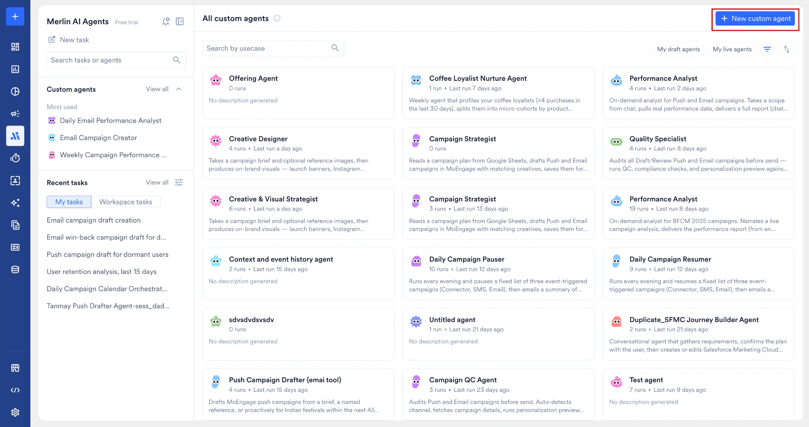
</Frame>

### Page Interface Elements

The page provides the following features for locating and evaluating agents:

- **Search by usecase:** Find an agent by its name.
- **My draft agents:** Show your own agents that are still under construction and not yet published.
- **My live agents:** Show your own agents that are published and ready to run.
- **More filters:** The filter icon opens a panel holding **Triggers**, with **Manual** and **Scheduled**, and **Visibility**, with **Public** and **Private**. Click **Apply** to apply your selection, or **Reset all** to clear the panel.
- **Sort:** The sort icon orders the cards by **Newest first**, **Oldest first**, or **Most runs**.
- **Agent Cards:** Each card shows the agent's icon, name, and a short description, which reads **No description generated** when the agent has none. A live agent also shows its run count and, once it has run, how long ago it last ran. A draft agent shows **Draft** in place of the run details.
- **+ New custom agent:** Opens the template gallery, where you pick a template or select **Create from scratch** to open the builder.

## Create a Custom Agent

When building a new Custom Agent, you can choose from the following methods. Both start in the template gallery.

### Open the Template Gallery

1. On the left navigation menu in the MoEngage dashboard, go to **Merlin AI** > **Custom Agents**.
2. On the Custom agents page, click **+ New custom agent**. MoEngage opens the template gallery.

### Kickstart Using Templates
Use this option to select a pre-configured template as your starting point. Templates are not shared agents; they are configurations, and nothing is created until you act on a template. MoEngage presents templates in a dedicated template gallery.

MoEngage provides the following templates to help you get started:

- **Segmentation Assistant**
- **Push Campaign Drafter**
- **Analytics Agent**
- **Template Marketing Analyst**
- **Email Campaign Creator**
- **Campaign QC Agent**
- **Jinja Generator (Personalization Writer)**
- **Template_Language Translation (Bulk)**
- **Daily Segment Report Generator**
- **Segment Discovery & Recommendation**
- **Channel Funnel Reporter**
- **Day/Channel Report**
- **Daily Campaign Calendar Orchestrator**
- **Failure Reports Aggregator**

 <Frame>
 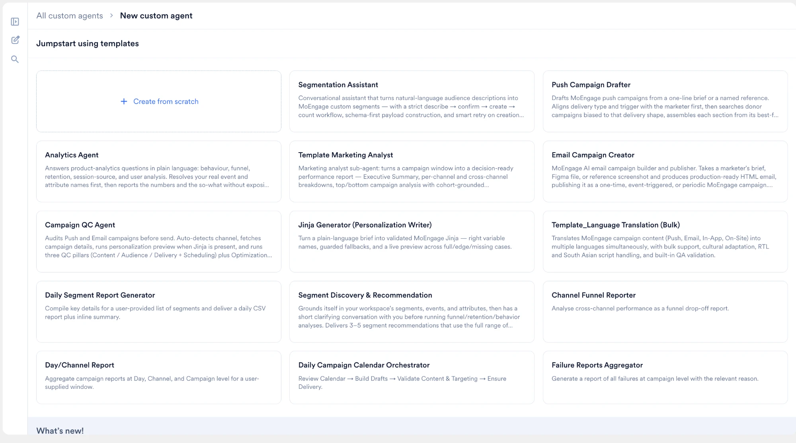
 </Frame>
As you browse the template gallery, the detail panel displays a summary of what the template does, along with a sample conversation, so you can assess whether the template suits your use case before you select it. MoEngage lists the available templates under a single **Recommended** heading.

To create a custom agent from a template, [open the template gallery](#open-the-template-gallery) and then:
  1. Select a template from the gallery. The detail panel describes what the template does and shows a sample conversation.
  2. Click **Try now**. MoEngage prompts you to name the agent.
  3. Name the agent and confirm. MoEngage creates the agent, publishes the agent, and opens the Run panel so you can start using the agent immediately.

<Note>
 After you create an agent from a template, you can still edit its configuration at any time. See [Edit an Agent](#edit-an-agent). The created agent keeps no ongoing link to the source template, so later changes to the template don't affect your agent.
</Note>
      
### Create from Scratch
Use this option to manually author the agent's instructions and select the required tools, or use Merlin AI to draft the configuration from your prompts.
  <Frame>
  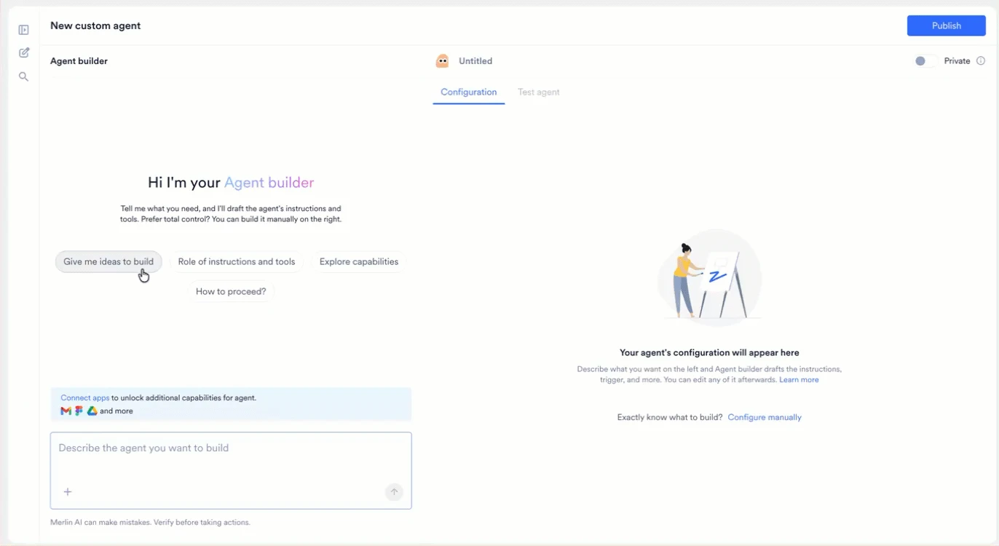
  </Frame>
To create a custom agent from scratch, [open the template gallery](#open-the-template-gallery) and click **Create from scratch**. MoEngage opens the Agent Builder with an empty **Configuration** tab. Describe the agent in the **Agent builder** chat on the left to have it draft the configuration, or click **Configure manually** to fill in the fields yourself.

Starting from a template gets your agent running immediately; starting from scratch opens the Agent Builder so you can author the agent's configuration before publishing.

## Configure Your Custom Agent

Both creation paths open the unified Custom Agent Builder. Whether you are starting from a blank canvas or modifying a template, use the following interface and steps to finalize your agent's configuration.

<Note>
 MoEngage creates the agent's draft the first time you make a change in the builder. Opening the builder alone doesn't create anything. From that point, MoEngage autosaves your progress as a draft, so you don't need to manually save while configuring the agent.
</Note>

* **Name the agent:** Click the agent name field located at the top of the configuration screen. By default, this field displays *Untitled* or the name of your selected template. Give the agent a clear, action-oriented name that states its purpose to your team (for example, `Pre-send Push QA` or `EMEA Email Translator`). The agent name supports up to 120 characters.
* **Agent description:** MoEngage generates the agent's description automatically from your instructions, using the AI builder or the selected template. The description supports up to 500 characters. MoEngage does not provide a manual description editor.
The builder shows the agent's name and the **Private** toggle above the right panel, and **Publish** at the top right. The builder consists of the following components:
    <Frame>
    
    </Frame>
* **Agent builder:** An AI chat interface on the left that drafts instructions and recommends tools from your plain-text prompts.
* **Configuration tab:** The right panel, where you assign tools, set a trigger, choose an agent mode, attach sub-agents and reference files, and write the agent's instructions in the **Instructions** editor.
* **Test agent tab:** The tab beside **Configuration**, where you run the agent before you publish it. Refer to [Test Agent](#test-agent).

## Define Agent Parameters

Using the three components described above, configure the specific behaviors and permissions for your agent:

* [Configure your Agent's Instructions](#configure-your-agents-instructions)
* [Assign Tools](#assign-tools)
* [Generate and Analyze Images](#generate-and-analyze-images)
* [Assign Sub-Agents](#assign-sub-agents)
* [Select an Agent Mode](#select-an-agent-mode)
* [Set a Trigger](#set-a-trigger)
* [Attach Files](#attach-files)
* [Set Visibility](#set-visibility)
* [Configure Notifications](#configure-notifications)

### Configure Your Agent's Instructions

The Instructions editor serves as the agent's operational playbook. Written in plain English, these instructions define exactly how the agent behaves and executes tasks. The Instructions editor supports up to 50,000 characters. Instructions are required; assign the tools your agent needs to act on them. You can populate the instructions editor using three different approaches:
    <Frame>
    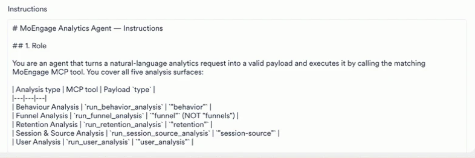
    </Frame>
* **By Template**: If you started with a template, the editor is pre-filled with a tested playbook. You can edit it or leave it as is.
* **[By Merlin AI Agent Builder](#use-the-merlin-ai-agent-builder-optional)**: Use the chat assistant to automatically draft the instructions and assign tools based on a plain-English prompt.
* **By Hand**: Write or edit the instructions manually directly within the text editor.

#### Core Components of a Well-Structured Agent
Whether you use a template, Merlin AI, or write them from scratch, your instructions must explicitly define the following elements to ensure the agent performs consistently:

* **Role:** Who the agent is and its specific area of expertise.
* **Objective and Workflow:** The primary goal of the task and a numbered, ordered list of steps the agent must follow to complete the job.
* **Rules and Guardrails:** Strict operational boundaries, detailing exactly what the agent must always do and what it must never do.
* **Output Format:** The exact structure the agent should use when returning its final response (for example, a formatted table, a bulleted list, or a summarized report).

#### Example Instruction Structure
Use the following structural framework as a baseline when authoring your agent's instructions:

```plaintext wrap
## Role
You are a [description] agent that specializes in [core capability].

## Objective
In each run, you will [state the primary goal].

## Rules
- Always [mandatory action].
- Never [restricted action].

## Steps
1. [First action]
2. [Second action]
3. [Third action]

## Output format
[Describe the expected output structure, e.g., "Return the findings in a two-column table."]
```

<Note>The more precise your instructions, the more reliably the agent performs. Avoid vague directions such as "analyze data." Instead, provide exact parameters and expected actions, such as "fetch all Push campaigns from the last 30 days and compute the Click-Through Rate (CTR) for each."</Note>

#### Use the Merlin AI Agent Builder (Optional)
<Note> Using the Merlin AI assistant is optional. If you prefer, you can skip this step and manually author your agent's configuration directly in the Instructions Editor.</Note>

If you are unsure where to begin, use the **Agent builder** chat in the left panel to generate a baseline configuration for your agent.
To generate configurations using Merlin AI:
1. **Provide a Prompt**: In the text input field at the bottom of the left panel, type a sentence or two describing what you want your agent to accomplish using plain English.
  <Note> You can attach reference files directly to your message to help Merlin AI generate the initial instructions (for example, uploading an example output format you want the agent to mimic). However, these files are not persisted. Only the resulting text instructions are saved to the agent's core knowledge for future tasks.</Note>
2. **Generate Draft**: Submit your prompt. Merlin AI processes the request and populates the **Configuration** tab with drafted instructions and recommended tools.
3. **Review and Refine**: Manually edit the generated instructions and tool selections to ensure they align perfectly with your exact use case.

**Quick-Action Prompts** 

If you need inspiration or immediate guidance, you can select one of the predefined quick-action chips located in the chat panel:
- Give me ideas to build
- Role of instructions and tools
- Explore capabilities
- How to proceed?

<Note>Merlin AI is a generative tool and can occasionally make mistakes. You must always thoroughly review the generated instructions and tool selections for accuracy before saving your configuration or making the agent Live.</Note>

### Assign Tools
Tools are pre-built capabilities that grant the agent specific permissions to access MoEngage data and perform actions. Based on your provided instructions and description, Merlin AI automatically assigns tools relevant to the task. However, you can manually adjust these assignments at any time. Each agent supports up to 128 tools. The tool picker lists each tool's name and description inline. For details on how tool permissions interact with your MoEngage role, refer to [Agent Permissions and Security](/user-guide/ai-and-intelligence/merlin-ai/agents/agent-permissions-and-security).
  <Frame>
  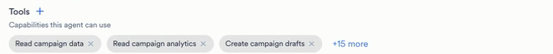
  </Frame>

The **Tools** panel and the tool picker cover MoEngage tools only. To reach an application outside MoEngage, use a connector instead. Refer to [Connectors](#connectors).

Beyond assigned tools, every agent also has access to MoEngage's built-in document skills (reading and generating spreadsheets, documents, slides, and PDFs) without requiring an explicit tool assignment. Built-in skills apply automatically and require no configuration.

<Note> Only assign the tools that the agent strictly needs to complete its objective. Granting unnecessary tools increases the risk of unintended actions.</Note>

#### Add and Remove Tools

To grant your agent specific capabilities, you must assign tools using the tool picker. An agent you create from scratch starts with every available tool pre-selected; an agent you create from a template starts with that template's own tool selection.
        <Frame>
        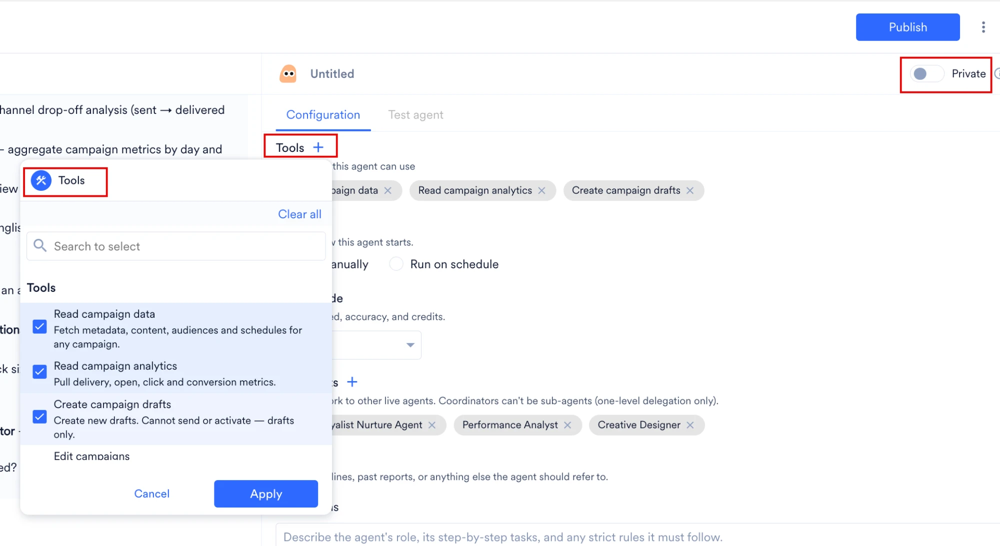
        </Frame>
1. Click the + icon next to the **Tools** heading in the **Configuration** tab to open the tool picker dialog box.
2. Uncheck any tool the agent doesn't need, or select the checkbox next to a tool to add it (for example, ```Read campaign data``` or ```Read campaign analytics```).
  - Use the **Search to select bar** at the top of the dialog to quickly locate specific tools.
  - To remove every tool at once, click **Clear all**.
3. Click **Apply** to confirm and save your tool assignments. After selection, tools appear as individual chips within the Tools section of the configuration panel.
4. To remove an assigned tool, click the × icon on its corresponding chip. If you select a tool you don't have permission to use, MoEngage removes the tool from the agent silently when you save, so your agent's tool access always matches your own MoEngage permissions.

<Warning>If you assign any tools that perform write operations, a warning banner appears in the configuration panel. This indicates that the agent has permission to modify real workspace data. Even in Test mode, an agent with write tools can create real drafts or alter existing campaigns. Review your tool selections carefully and only grant write access when it is strictly required for the agent's designated task.</Warning>

#### Connectors

Connectors give an agent access to applications outside MoEngage. You connect an application once on the **Connectors** page, and every agent you run reaches it, so a connector never forms part of an agent's tool assignment. Enable or disable a connector's individual tools in its **Connection details** dialog on the **Connectors** page rather than in the builder.

<Note>
 The Agent Builder knows which applications your workspace offers and which ones you connected. When an agent needs an unconnected application, the builder prompts you to connect it and links to the **Connectors** page.
</Note>

If an application is not connected when a run starts, or its connection drops mid-task, connect or reconnect it on the **Connectors** page and send your next message in the same task. The agent continues with the restored connection, and a new task is not required.

For the full setup, per-connector tool controls, run-time authentication, and terms of usage, refer to [Connect External Apps to Custom Agents](/user-guide/ai-and-intelligence/merlin-ai/connectors/connect-external-apps).

### Generate and Analyze Images

An agent generates campaign creatives from a text prompt during a run. Image generation and image analysis are separate tools with separate permission levels, so assign each one explicitly in the tool picker:

* **Image generation** produces creatives from the prompt that you or the agent's instructions supply. Request more than one creative in a single prompt, and specify the aspect ratio or size you require.
* **Image analysis** reads an image, which allows an agent to review a creative against your requirements or to work from an image you attach to a run.

MoEngage displays generated images in the task transcript and lists them in the task's session outputs, where you download them. Refer to [Session Outputs Panel](/user-guide/ai-and-intelligence/merlin-ai/agents/run-and-manage-agent-tasks#session-outputs-panel).

<Note>
 Image generation and image analysis are enabled per workspace. Refer to [Feature Enablement](/user-guide/ai-and-intelligence/merlin-ai/agents/agent-permissions-and-security#feature-enablement).
</Note>

### Send Summary Emails

An agent emails you a summary of a task, so that you can review the outcome from your inbox instead of returning to the dashboard. Every agent can send a summary email without any setup, on both manual and scheduled tasks, when you ask for one in the agent's instructions or in the prompt that starts the task. MoEngage sends each summary email to the person who ran the task, and to no one else. The email typically arrives within a few minutes of the agent finishing the requested work.

<Note>
 Summary emails are separate from the **Email** toggle under [Configure Notifications](#configure-notifications). The Email toggle confirms that a scheduled task finished. A summary email reports what the agent found or produced during the task, in the sections you specified, and carries the files the agent attached.
</Note>

#### Request a Summary Email

Every summary email follows a request that you make in one of two places:

* **The agent's instructions**, which cover every task the agent performs. Instructions suit a scheduled agent, because each scheduled task then reports back without further input from you.
* **The prompt that starts a task**, which covers that single task.

An agent does not email on its own initiative. A task that completes a long piece of work or encounters a blocker records the outcome in the task transcript, and the agent emails you only where your request covers that outcome.

Describe the email you want in plain language. You control the subject line and the section titles the agent fills in, and each section title you request becomes a heading in the email. When you specify neither a subject line nor section titles, the agent applies a default structure covering the work completed, the agent's findings, and any open items. The level of detail follows the scope of the task: a narrowly scoped task produces a detailed summary, and a broad or exploratory task produces a short one.

The section names **Title** and **Ready** are reserved. **Title** becomes the outcome line at the top of the email, and **Ready** sets the status banner.

To make every task of a scheduled agent report back, state the request in the agent's instructions. Refer to [Configure your Agent's Instructions](#configure-your-agents-instructions).

```text Instruction Snippet
After you complete the weekly report, email me a summary with the subject "Weekly Campaign Review".
Use these sections: What I checked, Key metrics, Issues found, and Recommended actions.
Attach the report as a spreadsheet.
If you cannot complete the report, email me what blocked you instead.
```

The final line of the snippet is what produces an email when the agent cannot finish the work. Without that line, the agent records the blocker in the task transcript and sends no email.

For a single task, state the request in your prompt:

* "Mail it to me."
* "Email me the results when you are done."
* "QC yesterday's push campaigns and email me the findings with the subject 'Daily Push QC'."
* "Export the segment overlap to a spreadsheet and email it to me with a one-paragraph summary."

An agent sends as many emails as your request asks for. A request for a closing summary produces one email, and instructions that ask the agent to report at several points produce an email at each of those points.

<Note>
 An agent can send a summary email even when the agent's instructions limit the agent to a specific set of tools.
</Note>

#### What the Summary Email Contains

Each summary email contains the following elements:

* **Status banner:** **Task complete**, **Needs review**, or **Update**, with the agent's name below it. The agent sets the banner at the time of sending, and applies **Update** in the absence of a status.
* **Subject line:** The subject you specified in your instructions or prompt.
* **Outcome:** A one-line statement of what the task achieved, under an **Outcome** label at the top of the email body.
* **Summary sections:** The sections you defined, such as the work completed, the agent's findings, key metrics, and open items. Each section title you requested appears as a heading above its content.
* **Task details:** A table listing the **Task ID**, the time the task **Finished**, and the address the email was **Sent to**.
* **Open this run:** A button that opens the task that produced the email.
* **Attachments:** The files the agent attached, delivered as standard email attachments.

A summary email from a test run opens with the line "Test run for" and the agent's name, and closes with a footer that states you ran a test of the agent. Both separate test output from live output in your inbox. Refer to [Test Agent](#test-agent).

<Frame>
  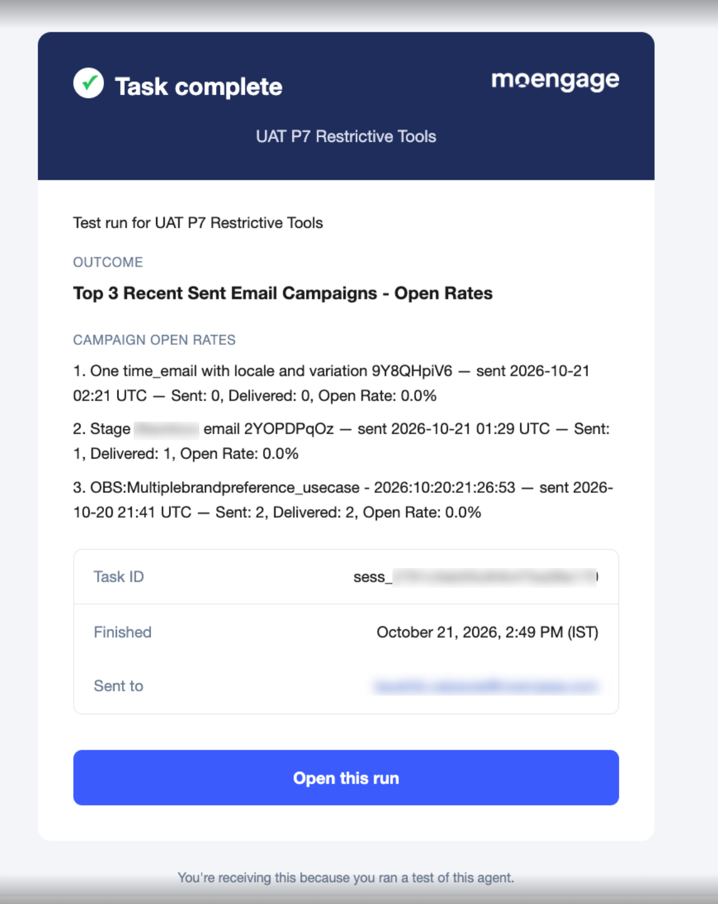
</Frame>

#### Attachments in a Summary Email

Attachments follow these limits:

* An agent attaches up to 5 files to a single summary email.
* The 3.5 MB limit applies to all attachments combined, rather than to each file individually.
* Attachments support document and spreadsheet formats, including PDF, DOCX, XLSX, CSV, Markdown, and TXT.
* An agent attaches only the files it created during the same task.
* Request attachments in the same instruction or prompt that requests the email.
* When the attachments exceed the file count or the combined size limit, the agent sends no email and names the file that caused the problem in the task transcript.

The email body does not list the attached files. Your email client shows them as it shows any other attachment.

<Frame>
  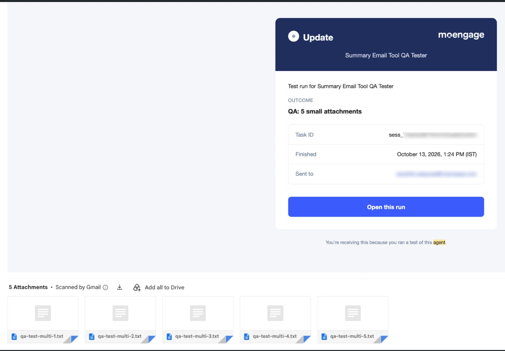
</Frame>

MoEngage also lists every file a task produces in the [Session Outputs Panel](/user-guide/ai-and-intelligence/merlin-ai/agents/run-and-manage-agent-tasks#session-outputs-panel), whether or not the agent attaches that file to a summary email.

#### Summary Email Recipients and Limits

Account for the following boundaries when you plan a workflow around summary emails:

* **Fixed recipient:** MoEngage sends each summary email to the person who ran the task, and to no one else. You cannot add recipients, a distribution list, or an external address.
  * **Public agents:** When a teammate runs your public agent, that teammate receives the summary for their own task, and you receive no copy. Refer to [Set Visibility](#set-visibility).
  * **Scheduled tasks:** The agent's creator receives every summary the schedule produces, because the task executes under the creator's credentials. Refer to [Scheduled Run Behavior](/user-guide/ai-and-intelligence/merlin-ai/agents/run-and-manage-agent-tasks#scheduled-run-behavior).
* **English template text:** Banners, button labels, and footers appear in English, regardless of your dashboard language.

### Assign Sub-Agents

Use the **Sub-agents** section in the **Configuration** tab to attach other agents to the agent you are configuring. During a run, the agent delegates parts of the task to those sub-agents and consolidates their output into a single response. You can attach up to 20 sub-agents, and each one must be a **Live** agent that you can see: a public agent or one of your own private agents. Each sub-agent executes with the permissions of the user who starts the run.

For eligibility rules, visibility restrictions, and how a delegated task behaves, refer to [Build Multi-Agent Workflows](/user-guide/ai-and-intelligence/merlin-ai/agents/build-multi-agent-workflows).

### Select an Agent Mode

Use the **Agent mode** section in the **Configuration** tab to control the balance between response speed, cost, and analytical depth for your agent. Instead of choosing a specific AI model, you select from three capability tiers: **Fast**, **Balanced**, and **Expert**. For what each tier suits, refer to [Choose a Mode](/user-guide/ai-and-intelligence/merlin-ai/agents/run-and-manage-agent-tasks#choose-a-mode).

A Custom Agent carries its tier on the agent, so every run of the agent uses the same tier. The **Agent mode** dropdown lists tiers from lowest to highest cost. If you don't select a tier, your agent runs on **Balanced** by default.

### Set a Trigger

In the **Trigger** section of the **Configuration** tab, choose how the agent runs:

- **Run manually (Default):** The agent only runs when you or a teammate starts a run.
- **Run on schedule:** The agent runs automatically on a recurring schedule you define.

Configure a schedule using the following steps:
1. Select **Run on schedule**.
2. Choose a recurrence: **Daily**, **Weekly**, or **Monthly**. For a Daily recurrence, set the repeat interval from 1 to 999 days. Weekly and Monthly recurrences repeat every 1 week or 1 month; MoEngage does not support a longer repeat interval for these recurrences.
3. Set a start date and an end condition (never, on a specific date, or after a set number of occurrences).
4. Set the timezone for the schedule. The schedule's timezone defaults to your dashboard's timezone.

Each agent supports one schedule. After you set a schedule, the Trigger section displays a summary of the start date, end condition, and a **Next run on ‹date›** preview.

When a scheduled run fires, MoEngage sends the agent a standard prompt to start the run. MoEngage does not provide an option to customize the scheduled prompt.

Only the agent's creator can view and configure the agent's Trigger and Notifications settings. Because scheduled runs execute using the creator's own MoEngage credentials and permissions, teammates viewing a public agent see the Trigger and Notifications controls disabled.

<Warning>
 Publishing a scheduled agent requires ready workspace credentials supporting scheduled execution. MoEngage blocks publishing until you resolve any credential issues.
</Warning>

### Attach Files

Use the **Files** section in the **Configuration** tab to attach reference files that MoEngage includes with every run. Attached files support common document, spreadsheet, and image formats.

Attach a file using the following steps:
1. Click the **+** icon in the Files section.
2. Select a file from your device.

Each agent supports up to 5 files, with a 5 MB limit per file. MoEngage attaches every configured file to each Test and Live run automatically.

<Note>
 Files you attach in the Files section persist across every run. Files you attach directly to an **Agent builder** prompt or a Test agent message apply only to that single conversation.
</Note>

### Set Visibility

Use the **Private** toggle at the top right of the builder, beside the agent's name, to control who can locate and execute the agent. You can modify this access level at any time.
       <Frame>
       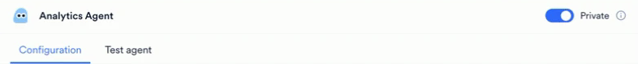
       </Frame>
- **Private OFF (Default):** The agent is visible to all users in your workspace. To list public agents, open **More filters** on the **All custom agents** page and set **Visibility** to **Public**. Any teammate can run or duplicate the agent. Only you (the creator) can edit, pause, resume, or delete the agent.
- **Private ON:** The agent is restricted. Only you can view, access, and run the agent. MoEngage does not show the agent to any other user, or reveal that the agent exists.

<Note>
 The Private toggle applies only after you publish the agent. A draft agent remains visible only to the agent's creator regardless of the Private toggle setting. A public agent (Private toggle OFF) grants access only to users within your specific MoEngage workspace, never to anyone outside your organization.
</Note>

### Configure Notifications

In the **Notifications** section, toggle **Email** on or off to control whether you receive an email when a scheduled run finishes or fails. The Email toggle defaults to on, and only the agent's creator can edit it. Teammates viewing a public agent see the setting, disabled.

Each notification email includes the run's outcome, Task ID, start time, duration, and the next scheduled run. The notification email excludes the run's transcript and output content. MoEngage delivers notification emails on a best-effort basis, so a missed notification email never blocks or delays the underlying scheduled run.

<Note>
 The Email toggle controls only the completion notice for a scheduled task. To receive what the agent found or produced during the task, request a summary email in the agent's instructions as well. A single scheduled task delivers both emails. Refer to [Send Summary Emails](#send-summary-emails).
</Note>

<Note>
 Browser notifications are a separate feature from the Email toggle above. If you grant notification permission when prompted in an active task, your browser notifies you when that run finishes while its tab isn't focused. Browser notifications aren't tied to your Email setting, and MoEngage doesn't provide an in-app way to turn them off once granted. Manage them through your browser's site settings instead.
</Note>

## Test Agent

Before making an agent live and sharing it with your team, run it in **Test agent** mode. A test run verifies that the agent interprets its instructions correctly, uses the right tools, and produces the expected output.

<Warning>
Test runs execute against your real MoEngage workspace data; there is no sandbox environment. Read-only agents query your actual campaigns and segments. An agent with write tools assigned (such as Create campaign drafts or Edit campaigns) makes real changes to your workspace during a test run. A test run also sends a real summary email, labelled as a test, when the agent's instructions request one. Treat a test run with the same caution as a Live task.
</Warning>

### Initiate a Test Run

To start a test run from the builder:
   <Frame>
   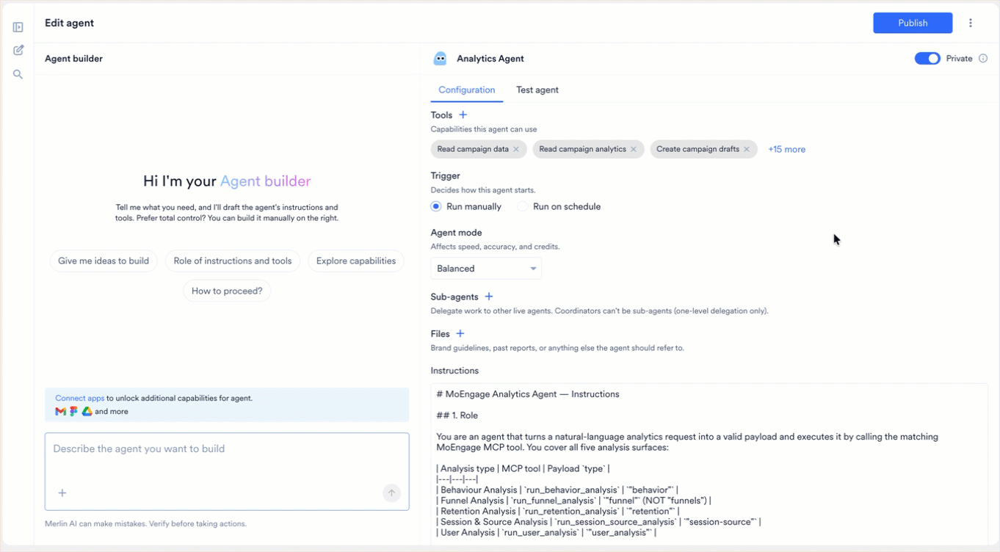
   </Frame>
1. Click the **Test agent** tab beside **Configuration**.
2. In the text box at the bottom of the tab, type a test scenario or select one of the suggested quick-start prompts:
   * **Run now:** Executes the agent immediately using its default instructions.
   * **Show capabilities:** Prompts the agent to summarize what it is configured to do.
   * **What tools can you access?:** Lists the tools currently assigned to the agent.
   * **Walk me through a scenario:** Asks the agent to narrate a sample execution.
   <Frame>
   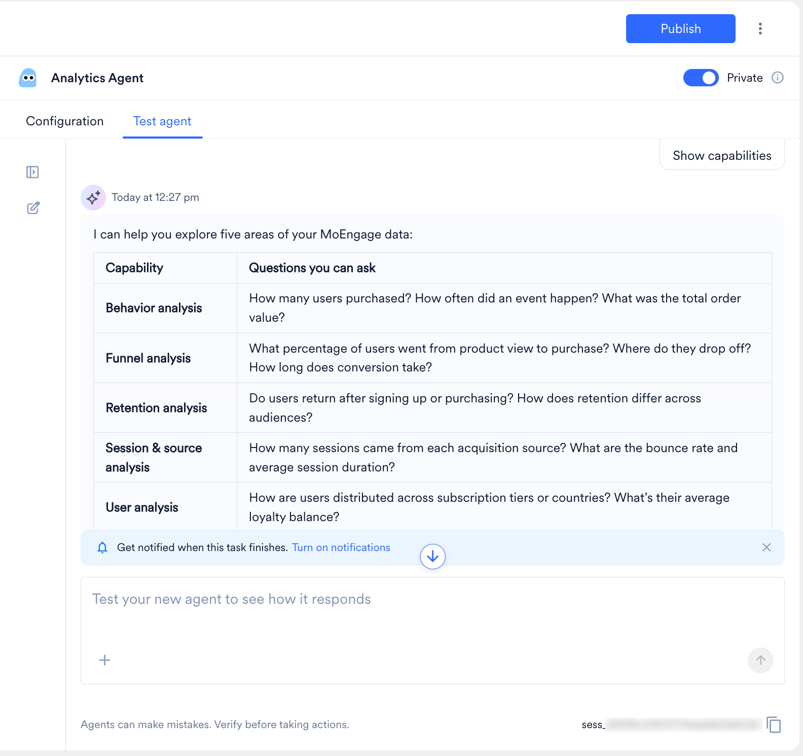
   </Frame>
3. Press **Enter** or click the send button to initiate the task.

  Beyond sending prompts, the Test agent tab provides the following features for managing and reviewing test runs:
      <Frame>
      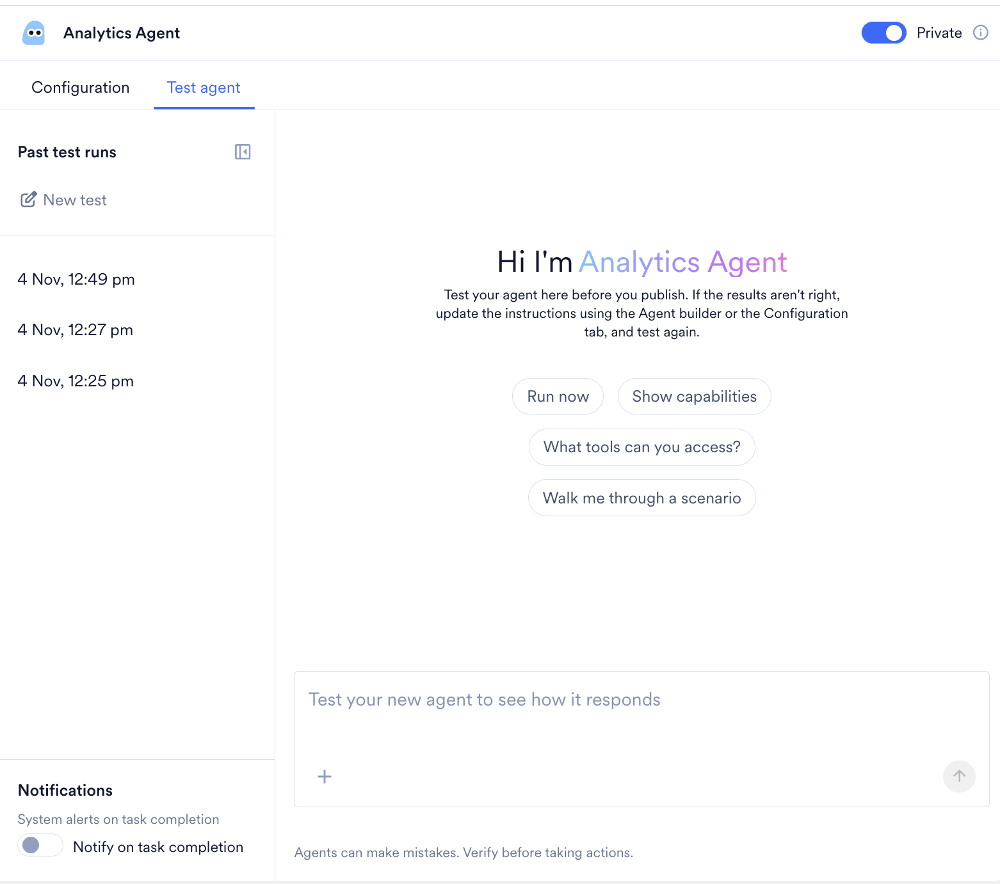
      </Frame>
  - **Start a New Test:** Click **New test** under **Past test runs** in the left sidebar to clear the current chat window and initiate a fresh test run.
  - **Cancel a Running Test:** Click **Cancel** while a test is in progress to stop the run immediately.
  - **Review Past Test Runs:** The left sidebar logs your testing history under the **Past test runs** section, organized by date and time (for example, *4 Nov, 12:49 pm*). Click on any timestamp to reopen that specific test run and review the agent's previous responses or tool calls.
  - **Attach Test Files:** Click the **+** icon located inside the message input box at the bottom of the screen to attach up to 5 files to your test prompt. Use this to give the agent sample data, specific documents, or reference files to process during the test run.
  - **Get Notified When a Test Finishes:** Under **Notifications** at the bottom of the left sidebar, turn on **Notify on task completion** to receive a system alert when the test run completes.
  - **Return to the Configuration:** To leave the test and edit the agent, click the **Configuration** tab.

### Interpret Test Results

The test run functions exactly like a normal back-and-forth conversation. As the agent processes your request, the panel displays:

  - **Tool calls:** Each time the agent uses a tool, the interface displays the tool name, the context parameters (e.g., `get_campaign_meta context="Finding all sent/active campaigns"`), and the execution time.
  - **Agent reasoning:** Intermediate messages explaining the agent's logic as it works through the assigned steps.
  - **Final output:** The structured result returned upon completing the task.
  - **Iterate on Feedback:** If the agent calls the wrong tools or misinterprets your prompt, switch to the **Configuration** tab, return to the Instructions editor, and clarify the steps. Be highly specific about what data the agent should fetch and how it should format it.


## Publish the Agent

After you successfully test and confirm the agent's behavior, click **Publish** at the top right of the builder to publish the agent to your workspace.
   <Frame>
   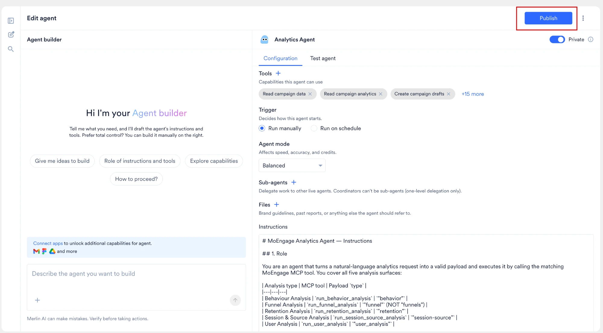
   </Frame>

Publishing an agent requires a name and instructions. MoEngage warns you if you attempt to publish an agent with untested changes.

When an agent transitions to a Live state, MoEngage makes the agent available on the **All custom agents** page. Locate the agent with the **My live agents** filter. To find a public agent that a colleague created, open **More filters** and set **Visibility** to **Public**.
 <Note>
  You can continue to modify a live agent's configuration. MoEngage holds your edits as pending changes until your next publish, so a live agent never changes for other users mid-task. Click **Publish** again to apply pending changes.
</Note>
To learn how to initiate test runs, interpret the transcript, and understand the functional differences between Live and Test modes, refer to [Run and Manage Agent Tasks](/user-guide/ai-and-intelligence/merlin-ai/agents/run-and-manage-agent-tasks)

## Manage Custom Agents

Once a Custom Agent is published, manage it from the **Manage** dropdown on its detail page. The options in the dropdown depend on whether you created the agent:

- **The agent's creator:** [Edit](#edit-an-agent), [Pause or Resume](#pause-or-resume-an-agent), [Duplicate](#duplicate-an-agent), [Delete](#delete-an-agent), and **Pin to sidebar**.
- **Every other user:** **Pin to sidebar** and [Duplicate](#duplicate-an-agent).

   <Frame>
   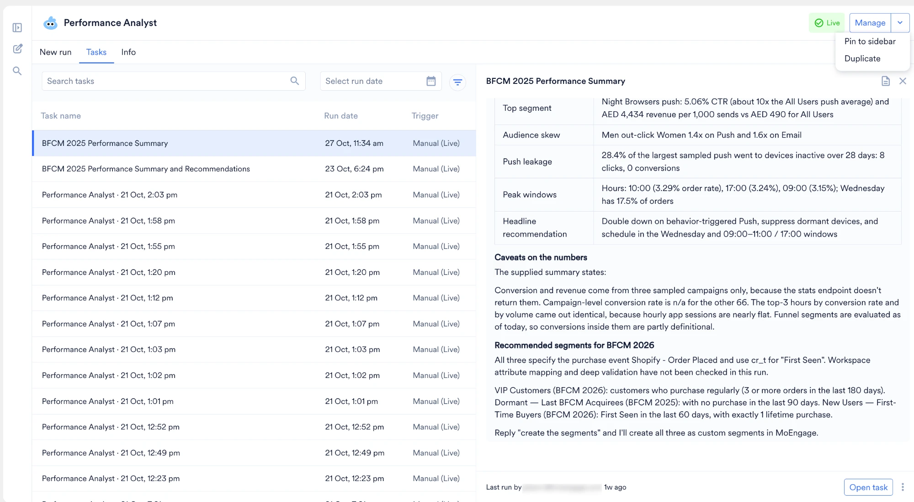
   </Frame>

<Note>
 The **Manage** dropdown sits on an agent's detail page, which a published agent has. A Draft agent has no detail page: clicking its card opens the builder directly, so edit a Draft there rather than through **Manage** > **Edit**.
</Note>

### Edit an Agent

To update a published agent's configuration (including its status, instructions, assigned tools, name, or visibility):

1. From the **All custom agents** page, click anywhere on the agent's card to open its detail page.
2. Click the **Manage** dropdown menu located in the top-right corner and select **Edit**.
3. The configuration builder opens with all existing fields pre-populated. Make your required updates.
4. Review the instructions and start a **Test agent** run to verify its behavior.
5. Click **Publish** to save and deploy the changes.

<Note>
  * Modifications only apply to new tasks initiated after you save. Any task that is actively running when you save continues and completes using the agent's previous configuration.
  * Only the original creator of an agent has permission to edit it. If you need to modify an agent created by a colleague, you must duplicate it first.
</Note>

#### Make a Draft Agent Operational

Agents currently in a **Draft** state cannot be executed for production tasks directly from the dashboard. To make a draft agent operational:

1. From the Custom Agents dashboard, click the Draft agent's card to open the builder.
2. Run a test run to verify the agent's behavior.
3. Click **Publish** to publish the agent for production use.

The agent moves from **My draft agents** to **My live agents**, and its status updates to enable you and your team to run production tasks.

### Pause or Resume an Agent

Pause a live agent to stop the agent from running while keeping the agent's configuration intact. Only the agent's creator can pause or resume an agent. To pause or resume an agent:

1. Open the agent's detail page.
2. Click the **Manage** dropdown menu and select **Pause** (or **Resume** for a paused agent).

Pausing a live agent stops scheduled runs; manual runs stay available even while the agent is paused. Resuming a paused agent returns the agent to a Live state.

<Note>
 Pausing does not cancel a configured schedule. The schedule persists, and each scheduled fire is skipped for as long as the agent stays paused. Resuming picks the existing schedule back up with no reconfiguration required.
</Note>

### Duplicate an Agent

Duplicating an agent opens the builder pre-filled with the source agent's configuration as a new, independent Draft. Duplicate an agent to customize one that another user built, or to fork an existing configuration for a similar task.

1. Open the published agent's detail page.
2. Click the **Manage** dropdown menu and select **Duplicate**.

### Characteristics of a Duplicated Agent:
  - **Draft Status:** The duplicate opens in the builder as a Draft named `Duplicate_<Original name>`. Rename it before you publish, if you'd like.
  - **Inheritance:** The duplicate inherits the source agent's instructions, assigned tools, visibility setting, and trigger configuration.
  - **Run History:** It begins with a fresh, empty task history.
  - **Eligibility:** Duplicate is a **Manage** action, so it applies to any published agent you can open. A Draft has no detail page and therefore no **Manage** dropdown: publish the Draft first if you need a copy of it. Deleted agents cannot be duplicated.

### Delete an Agent

If an agent is no longer required, you can retire the agent from your workspace to keep your dashboard organized. Only the agent's creator can delete an agent.

1. Open the agent's detail page.
2. Click the **Manage** dropdown menu and select **Delete**.

<Note>
 You cannot delete an agent while another agent uses it as a sub-agent. MoEngage blocks the deletion and names the coordinators that list the agent on their roster. Ask each coordinator's creator to remove the agent from that roster, and then delete the agent. Refer to [Build Multi-Agent Workflows](/user-guide/ai-and-intelligence/merlin-ai/agents/build-multi-agent-workflows#update-a-roster).
</Note>

### Characteristics of a Deleted Agent:
  - **Visibility:** MoEngage immediately removes the agent from the **All custom agents** page. MoEngage also removes the agent from every user's pinned list, and its tasks stop appearing in task lists.
  - **Restrictions:** It can no longer be executed, edited, or duplicated.
  - **Audit Trail:** MoEngage preserves its task history for auditing, but the history is no longer accessible through the standard gallery interface.
  - **Memory:** MoEngage archives the agent's own memory store along with its task history. Anything that agent contributed to workspace memory stays in place and remains readable by your other agents. Nothing records which agent contributed a given fact, so those contributions cannot be removed selectively.

<Note>
  - Deleting an agent permanently cancels any of its scheduled or queued tasks. MoEngage displays a warning prompt so that you confirm the cancellation before the delete completes.
  - Currently, there is no recovery flow to restore a deleted agent. If there is a chance you may need to use the agent again in the future, do not delete the agent. Instead, edit the agent and turn the Private toggle ON. Turning Private ON hides the agent from your colleagues while keeping the agent safely accessible for your own use.
</Note>

## FAQs

<AccordionGroup>
  <Accordion title="Why am I unable to run an agent I see on the dashboard?">
    If the agent appears under the My draft agents filter, it has not yet been published for production use. To activate it, click the agent card to open the builder directly, verify its behavior using the **Test agent** tab, and then click **Publish**.
  </Accordion>

  <Accordion title="Do Test runs operate in a safe sandbox environment?">
    No. Test runs execute against your real MoEngage workspace data. An agent with write tools assigned (such as Create campaign drafts) makes real changes to your workspace during a test run. Always verify tool configurations and instructions before initiating a test.
  </Accordion>

  <Accordion title="Can my teammates edit, pause, resume, or delete an agent that I created?">
    No. Only the original creator of an agent can edit, pause, resume, or delete the agent. If a colleague needs to modify an agent you built, they must open the agent's detail page and select Manage > Duplicate to create an independently editable copy. Any teammate with access to a public agent can still run or duplicate it.
  </Accordion>

  <Accordion title="Can I delete an individual task or an entire agent?">
    Individual tasks cannot be deleted; they are permanently logged in the agent's history for auditing purposes. You can remove an agent from the dashboard by deleting it, but this action is permanent and cannot be undone. If you are unsure whether you need an agent again, open the agent's configuration and turn the Private toggle ON instead of deleting the agent.
  </Accordion>
    <Accordion title="Do I need to know how to code to build an agent?">
    No. You instruct the agent in plain English, as you would write a brief for a new marketing hire. If you get stuck, you can use the built-in Merlin AI chat assistant to automatically generate the right instructions and tool settings based on a simple description of what you want to achieve.
  </Accordion>

  <Accordion title="How do I share a great agent I built with the rest of the marketing team?">
    By default, a new agent is visible to your entire workspace once published, and no action is required to share the agent. If you previously marked the agent Private, open the agent's configuration and turn the Private toggle OFF to make the agent visible again. Any teammate can run or duplicate a public agent, but only you (the creator) can edit, pause, resume, or delete the agent.
  </Accordion>

  <Accordion title="Can an agent automatically publish a campaign?">
    No. Custom Agents do not possess auto-publish capabilities. Even if an agent has write tools assigned, it is strictly restricted to creating, editing, or pausing campaign drafts. Final approval and deployment must always be executed manually through the standard MoEngage campaign builder.
  </Accordion>

  <Accordion title="Who receives a summary email, and can I add my team?">
    The person who ran the task receives the summary email, and you cannot add recipients, a distribution list, or an external address. When a teammate runs your public agent, that teammate receives the summary. For a scheduled task, the agent's creator receives the summary, because the task executes under the creator's credentials. Refer to [Summary Email Recipients and Limits](#summary-email-recipients-and-limits).
  </Accordion>

  <Accordion title="Can I change the subject line and the sections in a summary email?">
    Yes. Specify the subject line and the section titles in the agent's instructions or in the prompt that starts the task, and each section title becomes a heading in the email. For example: "Email me the findings with the subject 'Daily Push QC', using the sections What I checked, Issues found, and Recommended actions." When you specify neither a subject line nor section titles, the agent applies a default structure covering the work completed, the agent's findings, and any open items. The section names **Title** and **Ready** are reserved for the outcome line and the status banner.
  </Accordion>

  <Accordion title="Which file types can an agent attach to a summary email, and how large can the files be?">
    An agent attaches up to 5 files that the agent created in the same task, in document and spreadsheet formats, including PDF, DOCX, XLSX, CSV, Markdown, and TXT. The 3.5 MB limit applies to all attachments combined, rather than to each file individually. Refer to [Attachments in a Summary Email](#attachments-in-a-summary-email).
  </Accordion>

  <Accordion title="Why did my agent not send a summary email?">
    Check whether the agent's instructions or the prompt that started the task requested an email, because an agent sends a summary email only when you ask for one. A task that completes a long piece of work or encounters a blocker sends no email unless the agent's instructions ask for one. Open the task transcript to confirm whether the agent attempted a send. When the transcript shows a completed send and the email has not arrived, check your spam folder, then share the Task ID with MoEngage support. Refer to [Request a Summary Email](#request-a-summary-email).
  </Accordion>
</AccordionGroup>

## Next Steps

<CardGroup cols={3}>
  <Card title="Build Multi-Agent Workflows" icon="sitemap" href="/user-guide/ai-and-intelligence/merlin-ai/agents/build-multi-agent-workflows">
    Attach existing agents to a coordinator agent so one task spans several specialists.
  </Card>
  <Card title="Run and Manage Tasks" icon="play" href="/user-guide/ai-and-intelligence/merlin-ai/agents/run-and-manage-agent-tasks">
    Follow a running task, read a transcript, review outputs, and understand agent memory.
  </Card>
  <Card title="Connect External Apps" icon="plug" href="/user-guide/ai-and-intelligence/merlin-ai/connectors/connect-external-apps">
    Give your agents access to applications outside MoEngage.
  </Card>
</CardGroup>

Each run of this agent, including every scheduled run, draws on your workspace's MoEngage Credits. Refer to [Merlin AI Usage](/user-guide/settings/account/billing/merlin-ai-usage).

For single-purpose generators such as the Copywriter, Designer, and Segmentation Assist, refer to [Merlin AI Studio](/user-guide/ai-and-intelligence/merlin-ai/merlin-ai-studio).
