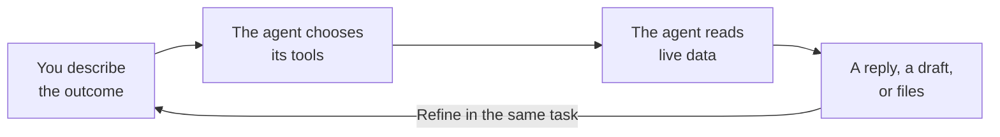
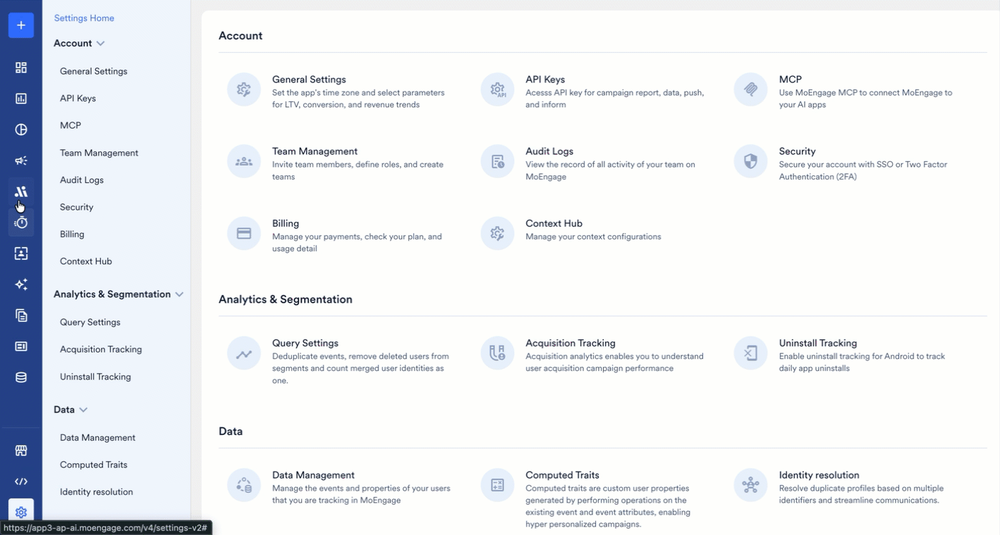
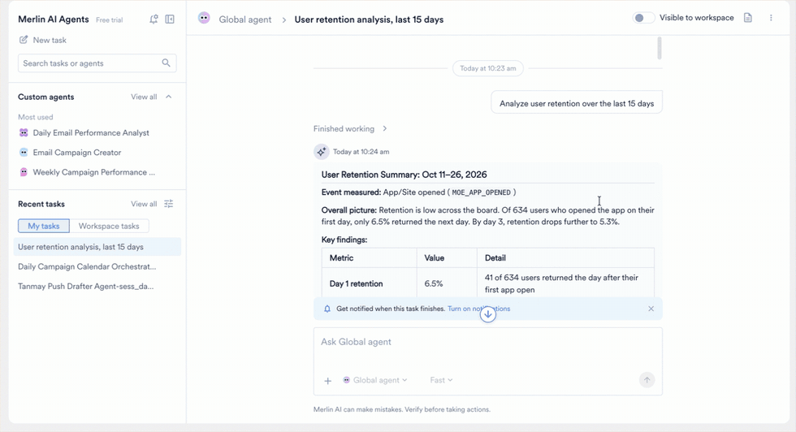

The Global Agent is a Merlin AI agent that MoEngage builds and maintains. The Global Agent serves the entire platform as one shared agent, is available to every user in your workspace, and requires no configuration before your first task.

The Global Agent accepts a plain-language description of the outcome you want. From that description, the Global Agent selects the MoEngage data to read, chooses the tools to run, and produces the output. Each task the Global Agent runs is scoped to your own workspace's campaigns, segments, content, and analytics.

This article covers the work the Global Agent handles, how the Global Agent processes a task, and the limitations and best practices specific to it.

<Note>
 The Global Agent is an Early Access feature. For how to request access, refer to [Feature Enablement](/user-guide/ai-and-intelligence/merlin-ai/agents/agent-permissions-and-security#feature-enablement).
</Note>

<Info>
 The Global Agent shares the hub, the task list, transcripts, output files, and workspace memory with your Custom Agents. For those shared procedures, refer to [Merlin AI Agents Home](/user-guide/ai-and-intelligence/merlin-ai/agents/merlin-ai-agents-home) and [Run and Manage Agent Tasks](/user-guide/ai-and-intelligence/merlin-ai/agents/run-and-manage-agent-tasks). For a comparison of the two agent families, refer to [Agent Families](/user-guide/ai-and-intelligence/merlin-ai/agents/merlin-ai-agents-home#agent-families).
</Info>

## Capabilities and Use Cases

The Global Agent suits work that crosses more than one screen in the dashboard, and work you are still shaping into a repeatable process.

- **Audience and segmentation:** Turns a targeting question into a saved segment, and reports the segment's size and reachability. You can check how many users match a condition before you commit to a campaign, and save the segment when the size matches your plan.
- **Campaign creation:** Builds push and email drafts, including one-time, periodic, event-triggered, and business-event-triggered, with A/B variants and locales. You can describe the audience, channel, and message, then review the draft in the campaign builder.
- **Content and creative:** Writes personalized copy, email HTML, Jinja tokens with fallbacks, locales, and content blocks. You can produce push copy in your house style, or the same message across every locale you send to.
- **Quality control:** Audits a campaign, draft, or flow, and returns a go, go with fixes, or no-go verdict. You can check audience, links, locale parity, and delivery settings before you send the campaign.
- **Campaign discovery and reporting:** Finds campaigns across channels and reports on a window, a period-over-period comparison, or a repeatable digest. You can pull last week's push and email results against the week before, and read the numbers in one reply instead of one campaign report at a time.
- **Analysis and diagnosis:** Runs behavior, funnel, retention, and user analyses. You can ask why open rates fell after a send, and the agent works down the funnel, from sent to impressions to clicks to conversions, and reports where the number changed.
- **Flows:** Reads flow structure and reports trips, engaged versus control, and conversions. You can review how a live flow is performing before you change the flow.

To start your first task, refer to [Start a Task](/user-guide/ai-and-intelligence/merlin-ai/agents/merlin-ai-agents-home#start-a-task).

## How the Global Agent Works

Each task follows the same cycle, and you repeat the cycle by sending another message in the same task.

1. **You describe the outcome.** State what you want, the time window, and the channels or campaigns involved.
2. **The agent chooses its tools.** The agent reads your request and decides which MoEngage data to query, so you describe the outcome rather than choosing a feature or a report type.
3. **The agent reads live data.** The agent looks up campaign status, audience counts, and performance figures when you ask, so a reply reflects the current state of your workspace.
4. **The agent returns the work.** A reply in the task, a campaign draft in the builder, or files you download from the task.

<Frame>
  
</Frame>

## Example: Improving Day 1 Retention

The following walkthrough shows how one Global Agent task develops across four turns. The values are illustrative.

| Turn | You ask | The agent does | You get |
| :--- | :--- | :--- | :--- |
| 1 | "Analyze user retention over the last 15 days." | Runs a retention analysis across the window and breaks the numbers down by day | A retention curve for the period, with the drop-off at each day |
| 2 | "Why is Day 1 retention only 6.5%?" | Compares the users who returned on Day 1 against the users who did not, across onboarding steps, first-session activity, and channel reachability | The points where the two groups diverge, with the figures behind each point |
| 3 | "What should we be aiming for, and what would move the number?" | Sets out the levers that affect Day 1 retention, such as onboarding completion and push opt-in, and asks which target you want to work toward | A set of target options, and the levers ranked for your app |
| 4 | "Map the onboarding lever to work we can run." | Works back from the target you chose to the change that closes the gap, then builds the segment and writes a push draft for the users who stall | The change to make, a saved segment, and a campaign draft you open in the campaign builder |

<Frame>
  
</Frame>

Each turn builds on the previous turn, so you refine the question rather than restating the background.

## Limitations

The following boundaries are specific to the Global Agent:

- **No scheduling.** Global Agent tasks are always **Manual (Live)**. To run a job on a recurring schedule, build a Custom Agent instead. Refer to [Set a Trigger](/user-guide/ai-and-intelligence/merlin-ai/agents/custom-agents#set-a-trigger).
- **No test runs.** The Global Agent runs live tasks only, so every task reads and writes real workspace data.
- **No configuration.** You cannot change the Global Agent's instructions or restrict its tool set. The Global Agent carries the tools MoEngage enables for your workspace.
- **The mode locks once a task starts.** To run the same work in a different mode, start a new task. Refer to [Choose a Mode](/user-guide/ai-and-intelligence/merlin-ai/agents/run-and-manage-agent-tasks#choose-a-mode).
- **No delegation.** The Global Agent does not delegate work to sub-agents. Refer to [Build Multi-Agent Workflows](/user-guide/ai-and-intelligence/merlin-ai/agents/build-multi-agent-workflows).
- **Flow authoring stays in the flow builder.** The Global Agent reads flow structure and reports flow performance, and does not build a flow.

## Best Practices

- **State the outcome, the time window, and the channels or campaigns involved.** The Global Agent chooses its own tools from your description, so the detail in your first message shapes the result. The agent asks you for any missing detail.
- **Verify any figure that drives a decision.** The agent is instructed to compute counts and rates in code, then check the draft reply against those figures before sending the reply. The check reduces wrong numbers rather than removing them.
- **Refine within the same task rather than starting again.** The agent keeps every earlier message and result in the task, so a follow-up question builds on the earlier replies.
- **Review a draft in the campaign builder before you publish.** The Global Agent prepares campaigns as drafts and is instructed not to publish. Refer to [Steps That Stay With You](/user-guide/ai-and-intelligence/merlin-ai/agents/agent-permissions-and-security#steps-that-stay-with-you).
- **Approve a generated creative deliberately.** Approval publishes the image to your workspace library, which is a step that stays with you. Refer to [Steps That Stay With You](/user-guide/ai-and-intelligence/merlin-ai/agents/agent-permissions-and-security#steps-that-stay-with-you).

## FAQs

<AccordionGroup>
  <Accordion title="Why does the Global Agent not appear in my agent list?">
    The Global Agent is an Early Access feature that MoEngage enables one workspace at a time. Refer to [Feature Enablement](/user-guide/ai-and-intelligence/merlin-ai/agents/agent-permissions-and-security#feature-enablement).
  </Accordion>

  <Accordion title="Do I need to configure anything before my first task?">
    No. The Global Agent is ready as soon as your workspace has access. Select **Global agent** in the composer and describe the outcome you want. Build a Custom Agent instead when you want fixed instructions, a fixed tool set, or a schedule.
  </Accordion>

  <Accordion title="Can the Global Agent publish a campaign for me?">
    No. The agent prepares campaigns as drafts and is instructed not to publish. Publishing stays a step you complete in the standard MoEngage campaign builder.
  </Accordion>

  <Accordion title="Can I run the Global Agent on a schedule?">
    No. Build a Custom Agent and set a trigger on it instead. Refer to [Limitations](#limitations).
  </Accordion>

  <Accordion title="Can I restrict which tools the Global Agent uses?">
    No. The Global Agent carries the tools MoEngage enables for your workspace, and its tool set is not configurable. To control an agent's tools yourself, build a Custom Agent and assign them. Refer to [Assign Tools](/user-guide/ai-and-intelligence/merlin-ai/agents/custom-agents#assign-tools).
  </Accordion>

  <Accordion title="Can I rely on the figures the agent reports?">
    Verify any figure that drives a decision. The agent's own accuracy check reduces wrong numbers rather than removing them. Refer to [Best Practices](#best-practices).
  </Accordion>

  <Accordion title="Can the Global Agent build a flow for me?">
    No. The Global Agent reports on flows rather than authoring them. Refer to [Limitations](#limitations).
  </Accordion>
</AccordionGroup>

## Next Steps

<CardGroup cols={3}>
  <Card title="Run Your First Task" icon="play" href="/user-guide/ai-and-intelligence/merlin-ai/agents/merlin-ai-agents-home#start-a-task">
    Open the composer, select the Global Agent, choose a mode, and send your first message.
  </Card>
  <Card title="Follow a Running Task" icon="list-check" href="/user-guide/ai-and-intelligence/merlin-ai/agents/run-and-manage-agent-tasks">
    Monitor a run, read a transcript, review output files, and understand agent memory.
  </Card>
  <Card title="Build a Custom Agent" icon="wrench" href="/user-guide/ai-and-intelligence/merlin-ai/agents/custom-agents">
    Turn a job you repeat into an agent with its own instructions, tools, and schedule.
  </Card>
</CardGroup>
