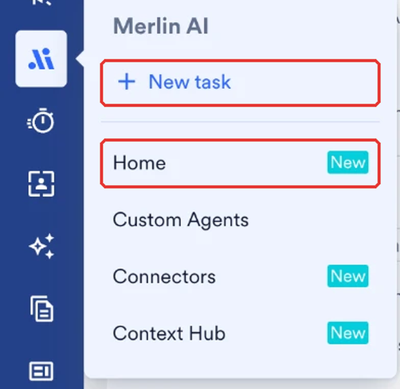
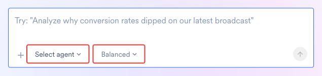
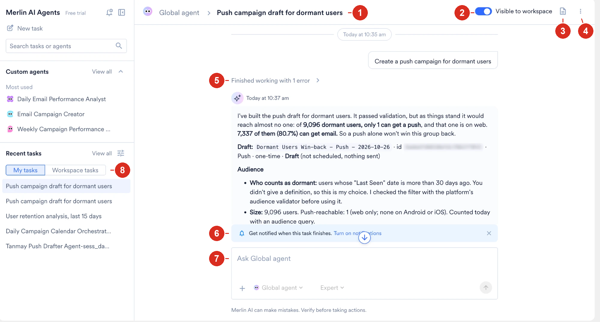
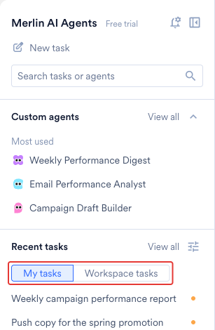
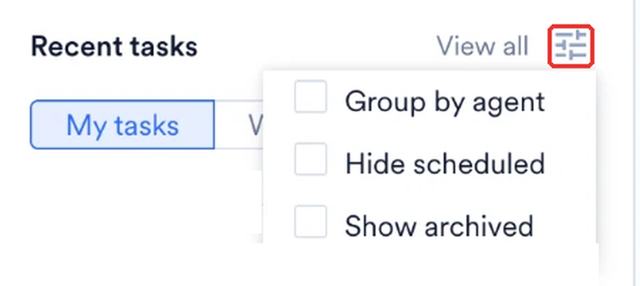
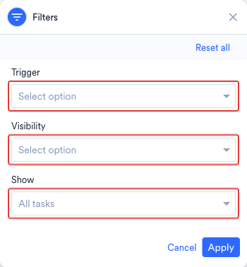

The **Merlin AI Agents** hub is where every agent in your workspace runs. The Global Agent and your Custom Agents appear in the same agent list and share the same task list, so you start, find, and manage all your agent work from one place.

## Agent Families

Two families of agent run in the hub. Both read live MoEngage data, run in the background, and record every task in the same list.

| | Global Agent | Custom Agents |
| :--- | :--- | :--- |
| **Who builds the agent** | MoEngage builds and maintains it | You or a teammate builds it in the Agent Builder |
| **Setup before the first task** | None | Instructions, tools, and a model tier |
| **Tools** | The tools MoEngage enables for your workspace | The tools the agent's creator assigns, up to 128 per agent |
| **Where the mode is set** | On each task, in the composer | On the agent, and applied to every run |
| **Trigger** | Manual only. Global Agent tasks are always **Manual (Live)** | Manual, or a recurring daily, weekly, or monthly schedule |
| **Run types** | Live tasks only | Live, Test, and Scheduled runs |
| **Who sees a task** | Set per task, and visible to your workspace by default | Follows the visibility set on the agent |
| **Delegation** | Not available | A coordinator agent delegates to up to 20 sub-agents |
| **Suits** | Exploratory work that crosses more than one screen, and work you are still shaping into a process | A job you repeat, with fixed instructions and a fixed tool set |

For what each family covers in depth, refer to [Global Agent](/user-guide/ai-and-intelligence/merlin-ai/agents/global-agent) and [Custom Agents](/user-guide/ai-and-intelligence/merlin-ai/agents/custom-agents).

The rest of this page applies to both families except where a callout marks a section as specific to one.

## Reach the Hub

Hover over **Merlin AI** in the left menu. Two items open the **Merlin AI Agents** hub:

- **New task** opens the composer, where you describe the work.
- **Home** opens the hub, which lists your custom agents, your recent tasks, and the templates available to you.

<Frame>
  
</Frame>

## Start a Task

<Info>
**Prerequisites**

Before you begin, ensure the following:

- The agent family you want to run is enabled for your workspace. Refer to [Feature Enablement](/user-guide/ai-and-intelligence/merlin-ai/agents/agent-permissions-and-security#feature-enablement). A Custom Agent must also be in a **Live** state, so refer to [Publish the Agent](/user-guide/ai-and-intelligence/merlin-ai/agents/custom-agents#publish-the-agent).
- You have access to the MoEngage data your request depends on, such as campaigns, segments, or analytics.
</Info>

<Steps>
  <Step title="Open the composer">
    Hover over **Merlin AI** in the left menu and click **Home**, or click **New task** to open the composer directly.
  </Step>
  <Step title="Select the agent">
    Click **Select agent** and choose **Global agent** or one of your Live Custom Agents. Every task runs on one agent, so select the agent before the task starts.
  </Step>
  <Step title="Select a mode">
    Choose **Fast**, **Balanced**, or **Expert**. **Balanced** is the default mode, and the mode locks once the task starts, so to use a different mode, start a new task.

    The Global Agent sets the mode for each task. A Custom Agent sets the mode on the agent instead, so the control does not appear when you select a Custom Agent before the task starts. After the task starts, the control shows the agent's mode and stays locked. For what each mode does, refer to [Choose a Mode](/user-guide/ai-and-intelligence/merlin-ai/agents/run-and-manage-agent-tasks#choose-a-mode).
  </Step>
  <Step title="Describe the work">
    Write what you want in plain language, and then send the message.
  </Step>
</Steps>

<Frame>
  
</Frame>

Each task is a separate conversation. The agent keeps every instruction, tool result, and generated file from the task. You build on your request turn by turn, and the agent carries the earlier detail forward.

State the outcome you want, the time window, and the channels or campaigns involved. The agent asks you for any missing detail.

<Note>
The first message starts the run: the agent begins work as soon as the message arrives.
</Note>

<Info>
Agents rely entirely on your instructions and the context you provide. Supplying necessary IDs, dates, or reference briefs in your first message prevents unnecessary back-and-forth and improves output accuracy.
</Info>

Custom Agents also start from an agent's own detail page and from the Agent Builder. For those entry points, and for Test and Scheduled runs, refer to [Where a Task Starts](/user-guide/ai-and-intelligence/merlin-ai/agents/run-and-manage-agent-tasks#where-a-task-starts).

### Attach Files to a Task

Select the plus icon in the composer to attach files to any message, including the first message. The agent reads each attachment as part of the same turn. Send a CSV of campaign IDs or a brand guideline document, and the agent works from the attached file.

| Limit | Value |
| :--- | :--- |
| **Files per message** | 5 |
| **Size per file** | 5 MB |
| **Accepted formats** | .csv, .doc, .docx, .gif, .jpeg, .jpg, .json, .md, .pdf, .png, .txt, .webp, .xls, .xlsx |

<Note>
Files you attach to a message apply to that conversation alone. To attach reference files that MoEngage includes with every run of a Custom Agent, refer to [Attach Files](/user-guide/ai-and-intelligence/merlin-ai/agents/custom-agents#attach-files).
</Note>

### Parts of a Task View

<Frame>
  
</Frame>

1. **Agent and task name.** The breadcrumb names the agent the task runs on, followed by the task name. To change the name, refer to [Rename a Task](#rename-a-task).
2. **Visible to workspace.** Switches whether your colleagues find the task under **Workspace tasks**. For more information, refer to [Change Task Visibility](#change-task-visibility).
3. **Output files.** Opens the panel that lists every file the run produced. For more information, refer to [Review Task Outputs](/user-guide/ai-and-intelligence/merlin-ai/agents/run-and-manage-agent-tasks#review-task-outputs).
4. **Task menu.** Pins, renames, copies a link to, and archives the task. For more information, refer to [Task Menu](#task-menu).
5. **Finished working.** Expands the steps the agent took, including any error the agent encountered.
6. **Notification banner.** Turns on a browser notification for when the task finishes. For more information, refer to [Notifications](/user-guide/ai-and-intelligence/merlin-ai/agents/run-and-manage-agent-tasks#notifications).
7. **Composer.** Sends your next message in the same task. The agent picker and the mode control sit below the message box.
8. **My tasks and Workspace tasks.** Switches the **Recent tasks** list between your own tasks and the tasks shared with your workspace. For more information, refer to [Recent Tasks](#recent-tasks).

## The Left Pane

### Recent Tasks

Under **Recent tasks** in the left pane of the hub, switch between two tabs. Each task appears under exactly one tab.

| | My tasks | Workspace tasks |
| :--- | :--- | :--- |
| **What the tab lists** | Every task you start, whether the task is visible to your workspace or only to you | Tasks your colleagues start that you have permission to read |
| **Agent families covered** | Global Agent and Custom Agent runs | Global Agent and Custom Agent runs |
| **State on arrival** | Unread until you open the task | Read, because a colleague has already run the task |
| **Actions in the task menu** | **Copy link**, **Rename**, **Pin**, **Archive**, and the **Visible to workspace** switch | **Copy link** and **Pin** |

**Copy link** becomes available once the task is visible to your workspace.

A colleague's task appears under **Workspace tasks** in either of the following cases:

- The task is a Global Agent task, and the task owner leaves the task visible to the workspace.
- The task is a run of a Custom Agent that your workspace publishes publicly. For a Custom Agent run, the agent's visibility decides whether colleagues see the run.

<Frame>
  
</Frame>

For what each column in the list shows, refer to [All Tasks Columns](#all-tasks-columns).

### Change the Task List View

<Note>
 **Custom Agents only.** **Hide scheduled** affects scheduled Custom Agent runs. Global Agent tasks are always manual, so the option does not change a list of Global Agent tasks.
</Note>

Select the view options icon beside **Recent tasks** to change what the left pane shows:

| Option | Effect |
| :--- | :--- |
| **Group by agent** | Groups the list under the agent that ran each task. Each agent group collapses. |
| **Hide scheduled** | Removes scheduled Custom Agent runs from the list. |
| **Show archived** | Switches the list to your archived tasks. Turn the option off to return to active tasks. |

<Frame>
  
</Frame>

The view options icon carries a marker while any option is on. **Reset** at the top of the menu turns every option off, and MoEngage remembers your choices in this browser. With **Group by agent** on, each agent group shows five tasks, and **View all** opens the **All tasks** page for that agent.

### Search Tasks and Agents

Press Enter in **Search tasks or agents**, or select the magnifier, to open search. The results carry **Tasks** and **Agents** tabs, and a search needs at least two characters.

<Warning>
The **Tasks** tab covers the last 30 days by default, so an older task stays out of the results until you widen the time range.
</Warning>

Narrow the **Tasks** tab by time range, by run type, and by whether a task is active or archived. To open a specific task, paste the task's Session ID into the search field.

### The Custom Agents Section

<Note>
 **Custom Agents only.** This section of the left pane lists Custom Agents. The Global Agent is not listed here, and you select it from the agent picker in the composer.
</Note>

The left pane also has a **Custom agents** section. The section lists your pinned agents, and a **Most used** group of your three most-run live agents. Select **View all** in the section header to open the **All custom agents** page. Point at an agent under **Most used** to see the agent's description, how many times the agent has run, and how long ago the agent last ran.

For what the **All custom agents** page offers, refer to [The All Custom Agents Page](/user-guide/ai-and-intelligence/merlin-ai/agents/custom-agents#the-all-custom-agents-page).

## Find a Task

### Filters Above the Table

Click **View all** next to **Recent tasks** to open the **All tasks** page, which carries the filters. Three filters sit above the table:

| Filter | Description |
| :--- | :--- |
| **Search tasks** | Matches the start of each word in a task title. The term `revi` matches "Review". |
| **All agents** | Limits the list to one agent, including the Global Agent. Search the dropdown to find an agent by name. |
| **Select run date** | Limits the list to runs within a date range. |

**Select run date** offers **Today**, **Yesterday**, **Last 7 Days**, **Last 30 Days**, **This Month**, and **Custom Range**. Pick the dates on the calendar for a custom range, then click **Done**. **Reset** clears the range.

### Filters in the Filters Panel

Click the filter icon to open the **Filters** panel, which holds three more filters:

| Filter | Options |
| :--- | :--- |
| **Trigger** | **Manual (Live)** or **Scheduled**. Global Agent tasks are always **Manual (Live)**, and **Scheduled** applies to Custom Agent runs. |
| **Visibility** | **All tasks**, **My tasks**, or **Workspace tasks**. |
| **Show** | **Pinned only** or **Archived only**. Leave the filter empty to show all tasks. |

<Frame>
  
</Frame>

Click **Apply** to apply the filters, or **Reset all** to clear the filters. The **All tasks** page lists the most recent runs first, and **Load more** extends the list with no limit on how far back you go. **New task** sits at the top of the page, so you start a task without leaving the list.

<Note>
The **Visibility** filter switches between the same views as the **My tasks** and **Workspace tasks** tabs. To set whether your workspace sees a task, refer to [Change Task Visibility](#change-task-visibility).
</Note>

### All Tasks Columns

The **All tasks** page lists every task with the following columns:

| Column | Description |
| :--- | :--- |
| **Task name** | The title of the task, which the task owner renames at any time. A scheduled run is titled with the agent's name and the run's scheduled time in UTC. |
| **Agent** | The agent that runs the task. |
| **Run by** | The user who starts the task. A scheduled run shows no user. |
| **Run date** | The date and time the run starts. |
| **Trigger** | How the run started. The values match the **Trigger** filter described in [Filters in the Filters Panel](#filters-in-the-filters-panel). |

When a scheduled run finishes or fails, MoEngage emails the agent's creator the run's outcome, Task ID, run date, duration, and next run time. The email leaves out the run's output. The creator turns the email off with the **Email** toggle on the agent. For more information, refer to [Configure Notifications](/user-guide/ai-and-intelligence/merlin-ai/agents/custom-agents#configure-notifications).

## Open a Task

On the **All tasks** page, select a task row to open a preview panel beside the list. The panel shows:

- The transcript of the task, including what the agent returned.
- **Finished working**, which expands the steps the agent took.
- Who last ran the task, and when.

The panel's button depends on the task. On a manual task you started, the panel offers **Continue task**. On a colleague's task, and on scheduled, test, and archived tasks, the panel offers **Open task** with a note that the task is view only. Select the file icon to open the task with the task's output files. An archived task has no file icon.

An open task shows the agent and the task name as a breadcrumb, along with the **Visible to workspace** switch, which only the task owner changes. The task menu holds **Copy link**, **Copy session ID**, and **Pin to sidebar**. On a task you own, the menu also holds **Rename** and **Archive**.

## Task Menu

Each task in the left pane carries a task menu. On a task you own, the menu holds the following actions:

- **Copy link**
- **Rename**
- **Pin** and **Unpin**
- **Archive** and **Unarchive**
- The **Visible to workspace** switch

On a colleague's task under **Workspace tasks**, the left-pane task menu offers **Copy link** and **Pin** only, and the **Visible to workspace** switch does not appear. On a Custom Agent run, the switch is inactive, with a note that the task follows the agent's visibility. For the full split, refer to [What a Colleague Does on Your Task](#what-a-colleague-does-on-your-task).

Rows on the **All tasks** page have no menu. Open the task to use **Copy link**, **Copy session ID**, and **Pin to sidebar** from the task's header menu, along with **Rename** and **Archive** on a task you own.

### Pin a Task

Pin a task to find the task quickly in the task list:

- Your pins are yours alone, and your sidebar holds up to 50 pinned items.
- You pin any colleague's Global Agent task that you can see.
- When the task owner archives a task, the task leaves every user's pins.

To list your pinned tasks, open the **Filters** panel on the **All tasks** page and set **Show** to **Pinned only**.

### Rename a Task

Each task starts with a title that MoEngage writes for the task. A scheduled run is titled with the agent's name and the run's scheduled time in UTC. Rename a task to describe the task in your own words. Only the task owner renames a task.

Select **Rename** in the task menu, enter a title of up to 120 characters, and click **Save**. The dialog counts the characters as you type.

<Warning>
A task title is visible to every user who can view the task. Review the title before you make a task visible to your workspace.
</Warning>

### Change Task Visibility

Who can open a task depends on the agent family:

<Tabs>
  <Tab title="Global Agent">
    Global Agent tasks are visible to your workspace by default. As the task owner, you control a task's visibility with the **Visible to workspace** switch:

    - **Switch on:** Any user in your workspace finds the task under **Workspace tasks**, opens the task transcript, and reads the task outputs.
    - **Switch off:** The task leaves **Workspace tasks**, and only you open the task from the task list.

    Turning the switch on opens a confirmation, because everyone in your workspace can then read the task, including any customer data the task contains.
  </Tab>
  <Tab title="Custom Agents">
    A Custom Agent run follows the visibility set on the parent agent, so the **Visible to workspace** switch stays inactive on the run, including on a run you started yourself. To change who sees a Custom Agent run, change the visibility on the agent. Refer to [Set Visibility](/user-guide/ai-and-intelligence/merlin-ai/agents/custom-agents#set-visibility).
  </Tab>
</Tabs>

Sharing a task shares the whole transcript, including every message you send and every tool result the agent returns. Turn the switch off when the task handles information meant for you alone.

### Copy a Task Link

Select **Copy link** in the task menu to copy the address of the open task. The option becomes available once the task is visible to your workspace, and the link works only for users who have permission to view the task.

### Archive and Restore a Task

Archive a task to take the task off your active list. Only the task owner archives or restores a task.

Archiving a task has the following effects:

- MoEngage keeps the transcript and the output files.
- The task leaves every user's pins.
- The task opens again once the owner restores the task.

To restore an archived task:

<Steps>
  <Step title="Show archived tasks">
    Select the view options icon beside **Recent tasks** and turn on **Show archived**. On the **All tasks** page, open the **Filters** panel and set **Show** to **Archived only** instead.
  </Step>
  <Step title="Find the task">
    Locate the task in the list.
  </Step>
  <Step title="Restore the task">
    Select **Unarchive** in the task menu, or open the task and select **Unarchive and open**.
  </Step>
</Steps>

If you open an archived task that you did not start, a notice says that only the person who started the task can restore the task.

MoEngage keeps every task and its output files, and archives nothing automatically. A task stays in your list until you archive the task, or until someone deletes the Custom Agent that ran the task. MoEngage does not offer task deletion.

## What a Colleague Does on Your Task

When a colleague opens a task that you own, a notice replaces the message box, so the conversation stays yours to continue. A colleague can:

- Read the full transcript and the output files.
- Copy the task link.
- Copy the session ID.
- Pin the task to their own sidebar.

For the boundaries that apply inside a task, refer to [Agent Permissions and Security](/user-guide/ai-and-intelligence/merlin-ai/agents/agent-permissions-and-security).

## FAQs

<AccordionGroup>
  <Accordion title="Who can see the tasks I run?">
    Global Agent tasks are visible to your workspace by default, and the task owner changes a task's visibility at any time. A Custom Agent run follows the visibility set on the agent. For more information, refer to [Change Task Visibility](#change-task-visibility).
  </Accordion>

  <Accordion title="Can I continue a task that a colleague started?">
    You read a colleague's task in full, including the transcript and the task outputs. The task owner continues the conversation.
  </Accordion>

  <Accordion title="Why can't I find an older task in search?">
    The **Tasks** tab in search covers the last 30 days by default. Widen the time range to reach an older task, or open the **All tasks** page and use **Select run date**.
  </Accordion>
</AccordionGroup>

## Next Steps

<CardGroup cols={3}>
  <Card title="Run and Manage Tasks" icon="play" href="/user-guide/ai-and-intelligence/merlin-ai/agents/run-and-manage-agent-tasks">
    Follow a running task, read a transcript, review outputs, and understand agent memory.
  </Card>
  <Card title="Global Agent" icon="globe" href="/user-guide/ai-and-intelligence/merlin-ai/agents/global-agent">
    See the categories of work the ready-to-use Global Agent handles.
  </Card>
  <Card title="Build a Custom Agent" icon="wrench" href="/user-guide/ai-and-intelligence/merlin-ai/agents/custom-agents">
    Turn a job you repeat into an agent with its own instructions, tools, and schedule.
  </Card>
</CardGroup>
