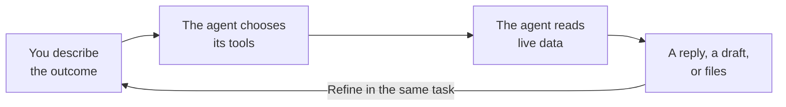
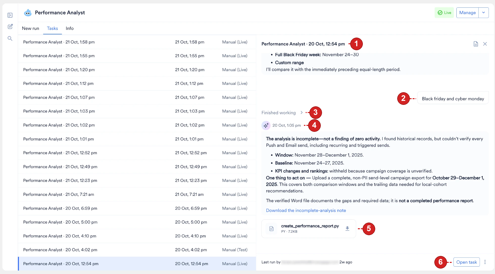
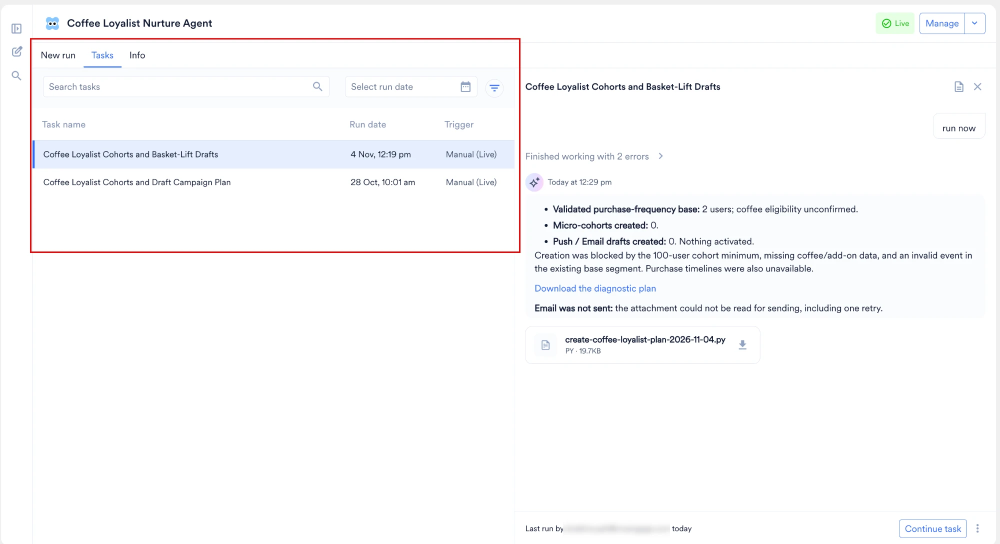

A task is a single, conversational interaction with an agent to complete a specific job. Every time you start a run, MoEngage opens a new task, assigns the task a unique Session ID (for example, `sess_a1b2c3...`), and permanently logs the complete transcript for auditing and future reference.

This guide covers how a task runs, what you do while a task is running, and what MoEngage keeps once the task is finished. It applies to the [Global Agent](/user-guide/ai-and-intelligence/merlin-ai/agents/global-agent) and to your [Custom Agents](/user-guide/ai-and-intelligence/merlin-ai/agents/custom-agents).

## Where a Task Starts

You start a task from the following locations. Only the hub applies to the Global Agent; the remaining three are Custom Agent entry points.

- **From the hub:** In the composer on the **Merlin AI Agents** hub, click **Select agent**, choose the Global Agent or a Live Custom Agent, and send your first message. For the full walkthrough, refer to [Start a Task](/user-guide/ai-and-intelligence/merlin-ai/agents/merlin-ai-agents-home#start-a-task).
- **From a Custom Agent's detail page:** Open the agent and click the **New run** tab.
- **From the Agent Builder:** While creating a Draft or editing a Live Custom Agent, click the **Test agent** tab to start a trial run. This task is tagged **Test** in the agent's history.
- **On a schedule:** When a Custom Agent has a schedule, MoEngage starts a task at each scheduled time and tags it **Scheduled**. Refer to [Set a Trigger](/user-guide/ai-and-intelligence/merlin-ai/agents/custom-agents#set-a-trigger).

<Note>
 Clicking **Publish** in the builder publishes the agent rather than starting a run. Start a Live run afterward from the agent's detail page or from the hub composer.
</Note>

Where a Custom Agent task appears depends on the run type:

- **Live Runs:** On the agent's detail page, the task opens in a panel beside the **Tasks** list. The panel's header shows the agent's name and the run's date and time, and the footer shows who last ran the task. Click **Open task** to open the full task. Refer to [Anatomy of a Task Transcript](#anatomy-of-a-task-transcript).
- **Test Runs:** The task runs in the **Test agent** tab of the builder. The footer shows the task's Session ID with a copy icon. Refer to [Test Agent](/user-guide/ai-and-intelligence/merlin-ai/agents/custom-agents#test-agent).

Enter your request in the message box at the bottom of the task, such as a specific campaign ID to audit, a creative brief, or a direct question.

## Test, Live, and Scheduled Runs

<Note>
 **Custom Agents only.** Global Agent tasks are always Live and manual, so the Global Agent has no Test or Scheduled run type.
</Note>

The primary distinction between the three run types is how MoEngage starts and logs the task. All three operate identically on real workspace data using the exact same tool permissions.

| Feature | Test Run | Live Run | Scheduled Run |
| :--- | :--- | :--- | :--- |
| **Data Accessed** | The run accesses real MoEngage workspace data. | The run accesses real MoEngage workspace data. | The run accesses real MoEngage workspace data. |
| **Write Operations** | The run executes real changes if you assign write tools. | The run executes real changes if you assign write tools. | The run executes real changes if you assign write tools. |
| **Started By** | You start the run from the builder. | You or a teammate can start the run manually. | MoEngage starts the run automatically at the configured time. |
| **Run History Logging** | The **Trigger** column on the **Tasks** tab shows **Manual (Test)**. | The **Trigger** column on the **Tasks** tab shows **Manual (Live)**. | MoEngage tags the run **Scheduled** on the **Tasks** tab. |

<Warning>
 Because Test runs interact directly with live data and execute real write operations, they must never be treated as a risk-free or isolated sandbox. Use Test mode strictly to validate agent behavior and refine instructions before promoting the agent to your team, not as a safe alternative to a live run.
</Warning>

### Scheduled Run Behavior

A Scheduled run always executes using the agent creator's MoEngage credentials and permissions, regardless of who views the dashboard when the scheduled run fires. Scheduled execution follows these behaviors:

- A scheduled run can start up to five minutes after its set time.
- If the agent isn't Live at the scheduled time, MoEngage skips the run entirely.
- MoEngage skips rather than queues the new fire when the previous run from the same schedule started in the last 60 minutes and is still in progress.
- If the creator's MoEngage login has been revoked or has expired, the run does not start, so the creator signs in again to restore the schedule.
- If no MoEngage login is stored for the creator, the run starts without MoEngage tools. The affected tool reports a missing-credential error instead of blocking the entire run.

## Choose a Mode

Each task runs in one of three capability tiers, which control the balance between response speed, cost, and analytical depth:

- **Fast:** The Fast tier handles lightweight, low-latency tasks, such as quick data lookups.
- **Balanced (Default):** The Balanced tier handles moderate-complexity tasks, such as campaign QC or segment analysis.
- **Expert:** The Expert tier handles tasks requiring deep, multi-step reasoning, such as in-depth performance analysis across multiple campaigns.

Where you set the tier depends on the agent family:

<Tabs>
  <Tab title="Global Agent">
    Select the tier on each task, in the composer, before you send the first message. The tier locks once the task starts, so to use a different tier, start a new task.
  </Tab>
  <Tab title="Custom Agents">
    The tier is set on the agent, in the **Agent mode** section of the Agent Builder, and every run of that agent uses it. Only the agent's creator changes it. Refer to [Select an Agent Mode](/user-guide/ai-and-intelligence/merlin-ai/agents/custom-agents#select-an-agent-mode).
  </Tab>
</Tabs>

<Note>
 MoEngage may update the AI model powering a tier over time to maintain quality and reliability, without requiring any action from you or changing any other part of your agent's configuration.
</Note>

## The Execution Lifecycle

Tasks are conversational and asynchronous. When you submit a prompt, the following execution sequence occurs:

1. The agent reads its core instructions to establish its role and objectives.
2. The agent acknowledges your prompt and begins executing its defined steps, calling its tools sequentially (for example, fetching a campaign, generating a personalization preview, synthesizing a report).
3. The transcript logs each tool call with its context parameters and execution time.
4. The agent synthesizes the retrieved data and streams the final, structured output into the panel progressively, so the response appears as MoEngage generates it rather than all at once when the run ends.

You send follow-up messages at any point during an open task to request a deeper analysis, ask for a different output format, or instruct the agent to analyze a different campaign. Each new question builds on the earlier replies, so you avoid restating the background.

<Note>
 Write-enabled agents can create or modify real drafts during a task. Always review the agent's actions before considering the task complete.
</Note>

## Monitor a Running Task

Tasks run in the background and take anywhere from a few seconds to several minutes, depending on data volume and tool complexity. You do not need to keep the task window open. Navigate away, work elsewhere in the dashboard, and return to the task at any time.

The left pane and the **All tasks** page mark each task with its state:

- A running task shows a pulsing dot.
- An unread task shows an orange dot.
- The orange dot clears when you open the task, and returns when the task updates.
- A task that is both running and unread shows the pulsing dot.

### Notifications

A long task often finishes while you are working elsewhere. The hub raises a browser notification when the agent stops.

<Steps>
  <Step title="Open Notification settings">
    Select the notification icon beside **Merlin AI Agents**.
  </Step>
  <Step title="Ask your browser for permission">
    Select **System notification when a task finishes while I'm away**, and click **Save**. Your browser then asks for permission.
  </Step>
</Steps>

A task counts as finished when the agent stops working on the task, whether the agent produced a result, failed, or stopped to ask you a question. The notification appears only while the dashboard is open in a tab and you are working in another tab or window.

<Note>
Permission belongs to your browser rather than to MoEngage. Once you grant permission, the option stays selected, and you turn notifications off by blocking notifications for the site in your browser settings.
</Note>

This setting covers browser notifications only. Emails, such as the email a scheduled run sends to the agent's creator, arrive independently of this setting. Refer to [Configure Notifications](/user-guide/ai-and-intelligence/merlin-ai/agents/custom-agents#configure-notifications).

### Stop a Run and Queue Messages

While the agent works, select **Stop response** to end the run. In a Custom Agent panel, the same control appears as **Stop**, and it ends the run immediately on both Test and Live runs. Only the task owner stops a run.

A message you send while the agent is still working waits in a queue. You pause the queue, add to it, delete from it, or resume it, and the agent picks up the queued messages when it is ready.

## Anatomy of a Task Transcript

When you select a task on a Custom Agent's **Tasks** tab, the transcript opens in a panel beside the list. The numbers in the following image match the elements described after it:

   <Frame>
   
   </Frame>

1. **Header:** Displays the task's name. By default, the name is the agent's name and the date and time the task started.
2. **Prompt:** Displays the message that you sent to the agent.
3. **Agent steps:** The **Finished working** line groups the steps the agent took, and reports any errors, for example, **Finished working with 2 errors**. Expand the line to view each tool call and the agent's reasoning between tool calls. Each tool call card includes:
   * A status icon (for example, ✓ for success)
   * The tool name (for example, `search_campaigns`)
   * Truncated parameter previews
   * Total execution time (for example, `4.9s`)
4. **Response:** The agent's structured output, formatted in Markdown and stamped with the time the agent replied. Each message block includes a copy icon, so you export the report to external documents or messaging tools.
5. **Generated files:** Any downloadable artifacts the agent produced, such as HTML reports and CSVs. These appear as inline cards showing the filename, type, size, and a download button. Each file card shows a **Preparing** state while MoEngage processes the file, and an **Unavailable** state if the file can't be downloaded. Files you attach to your own prompts appear similarly.
6. **Footer:** Displays who last ran the task and when. Click **Open task** to open the full task, where the footer shows the Session ID with a copy icon, alongside a reminder that agents can make mistakes.

When an agent delegates work to sub-agents, MoEngage displays their activity inline in the same transcript, indented under the coordinator agent's steps, so you follow each delegation as it occurs. Refer to [Build Multi-Agent Workflows](/user-guide/ai-and-intelligence/merlin-ai/agents/build-multi-agent-workflows).

## Review Task Outputs

A task collects every file the agent produces during a run. Where you open the list depends on the agent family:

<Tabs>
  <Tab title="Global Agent">
    Select **Output files** in the task header. A marker on **Output files** shows when new files arrive.
  </Tab>
  <Tab title="Custom Agents">
    Open the run's detail page and expand **Session outputs (N)**. Refer to [Session Outputs Panel](#session-outputs-panel).
  </Tab>
</Tabs>

The panel lists each file with its format and size. Download a file from the panel, or from the card in the transcript where the agent produced the file.

Select a file to review the contents before you save a copy. How a file opens depends on the file format:

- **Images and PDFs:** PNG, JPG, GIF, WebP, and PDF files open in the preview pane. A download button sits beside the preview.
- **Text files:** Markdown, plain text, log, and JSON files also open in the preview pane. A file larger than 2 MB downloads instead.
- **Office and spreadsheet files:** .docx, .xlsx, .pptx, and CSV files download directly. Open each file in the matching application to review the contents.

From the preview, select **Download**, or **Open in new tab** for PDFs, images, markdown, text, and JSON files.

The agent writes .docx by default, and produces a PDF when you ask for a PDF.

### Session Outputs Panel

The **Session outputs (N)** panel is the complete list of files a Custom Agent run produced. The panel appears on the run's detail page, and **N** is the number of files in the list. Expand the panel to see the files, and collapse it to return to the transcript.

MoEngage shows the panel only for a run that produces at least one file. A run that produces no files has no **Session outputs** panel.

The panel lists the following files:

- **Every file the run produced.** This includes files that the transcript does not show as a file card, so check the panel rather than the transcript when you need every output of a run.
- **Generated images.** Creatives that the image generation tool produces appear in the panel alongside documents and spreadsheets. Refer to [Generate and Analyze Images](/user-guide/ai-and-intelligence/merlin-ai/agents/custom-agents#generate-and-analyze-images).
- **Files from sub-agents.** When a coordinator delegates work, the files each sub-agent produces appear in the coordinator's panel with the files the coordinator produces itself. Refer to [Build Multi-Agent Workflows](/user-guide/ai-and-intelligence/merlin-ai/agents/build-multi-agent-workflows).

Each entry shows the file's format and size. Select a file to preview or download it. Preview and download follow the same rules for each file format as described in [Review Task Outputs](#review-task-outputs).

A summary email does not replace the panel. When you request a summary email, the agent attaches up to 5 of the run's files, within a combined 3.5 MB limit, and the panel still lists every file, including the files the email leaves out. Refer to [Attachments in a Summary Email](/user-guide/ai-and-intelligence/merlin-ai/agents/custom-agents#attachments-in-a-summary-email).

<Note>
 Once a run completes, MoEngage backs up its outputs so they remain downloadable after the run is no longer active. Each output belongs to the run that produced it; MoEngage does not carry outputs forward to a different run of the same agent.
</Note>

## Agent Memory

An agent keeps two memory stores. One belongs to the agent alone; the other is shared with every agent in your workspace.

| Store | What it holds | Who reads it |
| :--- | :--- | :--- |
| **Agent memory** | Facts the agent keeps between its own runs. | The same agent, on its later Live and Test runs. The Global Agent keeps its own store, shared by every user in your workspace. |
| **Workspace memory** | Facts an agent writes to a store shared across your workspace. | Every Custom Agent in the workspace, on their Live and Test runs, and the Global Agent. |

Any task can write to both stores, including a task you keep private.

Within a single task, an agent also carries that task's prompts, tool outputs, and files as ordinary context, which is why you resume an Idle task and pick up where you left off. That context belongs to the task and is not a memory store.

Workspace memory lets one agent's findings inform another agent's work. An agent that records your brand's tone-of-voice rules or the naming convention for a campaign series makes those facts available to your other agents and to the Global Agent, so you don't restate them in each agent's instructions.

Agents read and record memory as they run. Every workspace has both stores, and no setup is required to use them. The transcript records a read as a step labeled **Reading memory** or **Searching memory**, alongside the agent's tool calls. Writes appear as ordinary file steps instead, labeled **Writing a file** or **Editing a file**, and no step distinguishes agent memory from workspace memory.

Scheduled runs use no memory. A scheduled run neither reads what an earlier run stored nor stores anything for a later run to read, so a fact an agent picked up on a manual run is unavailable to that agent's next scheduled run.

You cannot inspect, edit, or clear either store: MoEngage provides no viewer for them in the dashboard and no API. Because a stored fact stays until MoEngage removes it, treat anything you give an agent as available to every agent in your workspace, including the Global Agent.

<Warning>
Memory is shared across your workspace. Anything an agent records in one task is readable by colleagues in their own tasks, so treat memory as workspace knowledge rather than a private note.
</Warning>

Memory holds what stays true between tasks, and is distinct from task outputs, which stay scoped to the run that produced them. The agent looks up live figures, such as campaign status, audience counts, and performance numbers, each time you ask. Verify any figure that drives a decision.

<Note>
 Workspace memory stays within your MoEngage workspace and never reaches another workspace or organization. For details, refer to [Agent Permissions and Security](/user-guide/ai-and-intelligence/merlin-ai/agents/agent-permissions-and-security).
</Note>

## Monitor the Tasks History

<Note>
 **Custom Agents only.** The **Tasks** tab belongs to a Custom Agent's detail page, which the Global Agent does not have. To find Global Agent tasks, use the workspace-wide task list instead.
</Note>

Every task you start on a Custom Agent, whether Live, Test, or Scheduled, is recorded on the agent's detail page under the **Tasks** tab. This tab provides an audit trail specific to that agent. For the workspace-wide list that covers every agent, refer to [Find a Task](/user-guide/ai-and-intelligence/merlin-ai/agents/merlin-ai-agents-home#find-a-task).

   <Frame>
   
   </Frame>

### Filtering and Search

Use the filter row above the table to narrow the displayed tasks:

- **Search tasks:** Search the agent's tasks.
- **Select run date:** Show the tasks that ran on a date or within a date range.
- **More filters:** Click the filter icon to add filters for **Run by** (the user who started the task) and **Run type** (Live, Test, or Scheduled).

### Table Columns Overview

| Column | Description |
| :--- | :--- |
| **Task name** | The Task name column displays the task's name. Click a row to open the transcript in the right-side panel, and click **Open task** or **Continue task** in the panel's footer to open the full task. MoEngage keeps the work an agent delegates to its sub-agents within that agent's own task, so a single row covers the entire run. |
| **Run date** | The Run date column displays the date and time when the task starts. |
| **Trigger** | The Trigger column displays how the task started and its run type, for example **Manual (Live)** or **Manual (Test)**. |

## Resume and Share Tasks

### Resume a Task

Tasks are persistent and do not permanently close. Each task keeps its own context, so the agent holds all preceding instructions, tool outputs, and generated files from that run. To continue a task you started earlier:

1. Open the task from the task list, or from the **Tasks** tab on the agent's detail page.
2. Send another message.

The agent keeps the earlier conversation, tool results, and generated files, and continues from where the previous turn ended.

You resume the manual tasks that you start. A colleague's task is view only, and so are your own scheduled and test runs. A notice replaces the message box on those tasks, and **Start a new task** carries the work forward. For what you do on a colleague's task, refer to [What a Colleague Does on Your Task](/user-guide/ai-and-intelligence/merlin-ai/agents/merlin-ai-agents-home#what-a-colleague-does-on-your-task).

A task stays resumable for 30 days after its last activity. After 30 days, the task stays readable, and you start a new task to continue the work. An archived task opens once you restore the task, and a task leaves the task lists once its Custom Agent is deleted.

### Share a Task

How you share a task transcript with a colleague depends on the agent family:

<Tabs>
  <Tab title="Global Agent">
    Select **Copy link** in the task menu and send the link. The option becomes available once the task is visible to your workspace, and the link works only for colleagues who have permission to view the task. Refer to [Copy a Task Link](/user-guide/ai-and-intelligence/merlin-ai/agents/merlin-ai-agents-home#copy-a-task-link).
  </Tab>
  <Tab title="Custom Agents">
    1. Open the task.
    2. Click the copy icon next to the Session ID in the panel's footer.
    3. Share the ID. Your colleague pastes it into the **Search tasks** field on the agent's **Tasks** tab to view the transcript.
  </Tab>
</Tabs>

## Task Boundaries and Technical Limitations

Keep the following operational boundaries in mind when running agents. For a deeper look at permission scopes and governance, refer to [Agent Permissions and Security](/user-guide/ai-and-intelligence/merlin-ai/agents/agent-permissions-and-security).

- **No auto-send capabilities:** An agent never launches or publishes a campaign, so you publish manually using the draft ID the agent generated. Refer to [Steps That Stay With You](/user-guide/ai-and-intelligence/merlin-ai/agents/agent-permissions-and-security#steps-that-stay-with-you).
- **Workspace privacy:** Tasks are strictly private to your specific workspace and cannot be shared across different organizations.
- **Immutable history and 30-day inactivity limit:** Tasks cannot be deleted, and their transcripts remain permanently in the agent's history for you to view. A task stays active for 30 days after its last activity, and you resume and continue chatting within that window. After that, the history remains visible, and you start a new task to continue the work.
- **Deleting agents:** To prevent accumulating tasks on an obsolete Custom Agent, delete the agent entirely, which removes its history from gallery access. Only the agent's creator deletes an agent. Refer to [Delete an Agent](/user-guide/ai-and-intelligence/merlin-ai/agents/custom-agents#delete-an-agent).
- **Summary email recipients:** When you request a summary email of a task, MoEngage sends the email to the person who ran the task and to no one else. For a scheduled task, that person is the agent's creator, whose credentials the task executes under. You cannot add recipients, a distribution list, or an external address. Refer to [Send Summary Emails](/user-guide/ai-and-intelligence/merlin-ai/agents/custom-agents#send-summary-emails).

## FAQs

<AccordionGroup>
  <Accordion title="Do I need to keep the dashboard open while a task runs?">
    No. Agents operate asynchronously as long-running background processes. You safely navigate away from the task window while the agent works. A running task shows a pulsing dot, and an unread task shows an orange dot. Return to the task list, or to the **Tasks** tab on the agent's detail page, to review the completed steps and final output.
  </Accordion>

  <Accordion title="Does the agent remember my past instructions and files?">
    Yes. Within a task, the agent retains the complete context of all preceding chat history, tool outputs, and attached files under that Session ID. You reopen any Idle task to resume a complex workflow right where you left off. An agent also keeps facts beyond a single task, and shares some of them with the other agents in your workspace. Refer to [Agent Memory](#agent-memory).
  </Accordion>

  <Accordion title="My task says 'Idle.' Did it get stuck or fail?">
    No, "Idle" means the agent's turn has ended and it's waiting for you. MoEngage uses the term "Idle" because agent tasks act like continuous chat threads. The agent is waiting for you to ask a follow-up question or give it a new command based on the data it returned.
  </Accordion>

  <Accordion title="How long do my tasks stay available?">
    MoEngage keeps every task and its output files, and archives nothing automatically. For how long a task stays resumable and what happens afterward, refer to [Resume a Task](#resume-a-task).
  </Accordion>

  <Accordion title="Which mode should I select for a task?">
    Each task runs in **Fast**, **Balanced**, or **Expert** mode, and **Balanced** is the default. Select the mode that matches the reasoning the task requires. The Global Agent sets the mode for each task, and a Custom Agent sets the mode on the agent instead. Refer to [Choose a Mode](#choose-a-mode).
  </Accordion>

  <Accordion title="How do I find out what a scheduled run produced without opening the dashboard?">
    Add a request for a summary email to the agent's instructions. Every scheduled task then emails its outcome, and any files the agent attaches, to the agent's creator, whose credentials the scheduled task executes under. Refer to [Send Summary Emails](/user-guide/ai-and-intelligence/merlin-ai/agents/custom-agents#send-summary-emails).
  </Accordion>

  <Accordion title="Why doesn't my scheduled agent run at the expected time?">
    A scheduled run can start up to five minutes after its set time, so check again shortly after the set time. MoEngage skips the fire when the agent isn't in a **Live** state, when the previous run from the same schedule started in the last 60 minutes and is still in progress, or when the creator's MoEngage login has been revoked or has expired. A skipped fire never runs later, and scheduled fires never stack up. For more information, refer to [Scheduled Run Behavior](#scheduled-run-behavior).
  </Accordion>

  <Accordion title="Can I delete an individual task?">
    No. Tasks cannot be deleted; they are permanently logged in the agent's history for auditing purposes. Archive a task to take it off your active list instead. Refer to [Archive and Restore a Task](/user-guide/ai-and-intelligence/merlin-ai/agents/merlin-ai-agents-home#archive-and-restore-a-task).
  </Accordion>
</AccordionGroup>

## Next Steps

<CardGroup cols={3}>
  <Card title="Merlin AI Agents Home" icon="house" href="/user-guide/ai-and-intelligence/merlin-ai/agents/merlin-ai-agents-home">
    Find, pin, rename, share, and archive the tasks in your workspace.
  </Card>
  <Card title="Agent Permissions" icon="lock" href="/user-guide/ai-and-intelligence/merlin-ai/agents/agent-permissions-and-security">
    Review the permission scopes and security guardrails that apply across Merlin AI agents.
  </Card>
  <Card title="Build a Custom Agent" icon="wrench" href="/user-guide/ai-and-intelligence/merlin-ai/agents/custom-agents">
    Turn a job you repeat into an agent with its own instructions, tools, and schedule.
  </Card>
</CardGroup>
