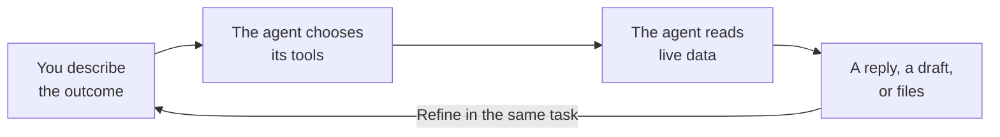

## Overview

<Note>
The Global Agent is an Early Access feature. If the Global Agent does not appear in your dashboard, contact your Customer Success Manager (CSM) to request access.
</Note>

The Global Agent is a Merlin AI agent that MoEngage builds and maintains. The Global Agent serves the entire platform as one shared agent, is available to every user in your workspace, and requires no configuration before your first task.

The Global Agent accepts a plain-language description of the outcome you want. From that description, the Global Agent selects the MoEngage data to read, chooses the tools to run, and produces the output. Each task the Global Agent runs is scoped to your own workspace's campaigns, segments, content, and analytics. Your [Custom Agents](/user-guide/ai-and-intelligence/merlin-ai/custom-agents/custom-agents-overview) appear in the same agent list and share the same task list.

This article outlines the capabilities and use cases the Global Agent covers, how the Global Agent processes a task, where to reach the Global Agent in your workspace, and the permissions and availability that apply.

## Capabilities and Use Cases

The Global Agent suits work that crosses more than one screen in the dashboard, and work you are still shaping into a repeatable process.

- **Audience and segmentation:** Turns a targeting question into a saved segment, and reports the segment's size and reachability. You can check how many users match a condition before you commit to a campaign, and save the segment when the size matches your plan.
- **Campaign creation:** Builds push and email drafts, including one-time, periodic, event-triggered, and business-event-triggered, with A/B variants and locales. You can describe the audience, channel, and message, then review the draft in the campaign builder. SMS drafts need SMS campaign creation enabled.
- **Content and creative:** Writes personalized copy, email HTML, Jinja tokens with fallbacks, locales, and content blocks. You can produce push copy in your house style, or the same message across every locale you send to.
- **Quality control:** Audits a campaign, draft, or flow, and returns a go, go with fixes, or no-go verdict. You can check audience, links, locale parity, and delivery settings before you send the campaign.
- **Campaign discovery and reporting:** Finds campaigns across channels and reports on a window, a period-over-period comparison, or a repeatable digest. You can pull last week's push and email results against the week before, and read the numbers in one reply instead of one campaign report at a time.
- **Analysis and diagnosis:** Runs behavior, funnel, retention, and user analyses. You can ask why open rates fell after a send, and the agent works down the funnel, from sent to impressions to clicks to conversions, and reports where the number changed.
- **Flows:** Reads flow structure and reports trips, engaged versus control, and conversions. You can review how a live flow is performing before you change the flow. Flow authoring stays in the flow builder.

The agent is instructed to compute counts and rates in code, then check the draft reply against those figures before sending the reply. The check reduces wrong numbers rather than removing them, so verify any figure that drives a decision.

To start your first task, refer to [Run Tasks with the Global Agent](/user-guide/ai-and-intelligence/merlin-ai/global-agent/run-tasks-with-the-global-agent).

## How the Global Agent Works

Each task follows the same cycle, and you repeat the cycle by sending another message in the same task.

1. **You describe the outcome.** State what you want, the time window, and the channels or campaigns involved.
2. **The agent chooses its tools.** The agent reads your request and decides which MoEngage data to query, so you describe the outcome rather than choosing a feature or a report type.
3. **The agent reads live data.** The agent looks up campaign status, audience counts, and performance figures when you ask, so a reply reflects the current state of your workspace.
4. **The agent returns the work.** A reply in the task, a campaign draft in the builder, or files you download from the task.

<Frame>
  
</Frame>

Within a task, the agent remembers every earlier message and result, so each new question builds on the earlier replies and you avoid restating the background. Between tasks, the agent draws on workspace memory. For more information, refer to [Global Agent Memory](/user-guide/ai-and-intelligence/merlin-ai/global-agent/run-tasks-with-the-global-agent#global-agent-memory).

## Access the Global Agent

Hover over **Merlin AI** in the left menu. Two items reach the Global Agent, and both open the **Merlin AI Agents** hub:

- **New task** opens the composer, where you describe the work.
- **Home** opens the hub, which lists your custom agents, your recent tasks, and the templates available to you.

Every task runs on one agent, so select an agent before you send the first message.

<Frame>
  
</Frame>

Your tasks and your colleagues' tasks appear in the same task list, where you filter, search, pin, and reopen the tasks. For more information, refer to [Manage and Share Global Agent Tasks](/user-guide/ai-and-intelligence/merlin-ai/global-agent/manage-and-share-global-agent-tasks).

## Permissions and Safeguards

The Global Agent writes to your workspace. On your instruction, the agent:

- **Creates and edits campaign drafts.**
- **Changes the status of an existing campaign or flow.** The agent pauses, resumes, or stops a campaign, and pauses, resumes, stops, retires, or archives a flow.
- **Writes content.** The agent sends test messages and writes content blocks, email templates, and catalog items.

Two steps stay with you:

- **Publishing a campaign.** The agent is instructed not to publish a campaign, so you publish from the standard MoEngage campaign builder.
- **Approving a creative.** The agent is instructed to publish a generated creative only after you approve the creative. Publishing adds the image to your workspace library at a permanent public URL, so approve a creative only when the image is ready to be public.

A task reads only the workspace the task runs in, so your data stays inside that workspace.

For the complete permission and governance model, refer to [Custom Agent Essentials: Permissions and Security](/user-guide/ai-and-intelligence/merlin-ai/custom-agents/custom-agents-essentials-permission-and-security).

## Availability

The Global Agent is an Early Access feature, and MoEngage enables the Global Agent for one workspace at a time. The Global Agent appears in the agent list as soon as your workspace has access. To request access, contact your MoEngage Customer Success Manager (CSM) or [raise a support ticket](/user-guide/contact-support/raise-a-support-ticket-through-moengage-dashboard).

The capabilities available to you also depend on the tools enabled for your workspace, so a capability listed on this page may not be enabled for your workspace.

## FAQs

<AccordionGroup>
  <Accordion title="Do I need to keep the dashboard open while a task runs?">
    Tasks run in the background. You work elsewhere in the dashboard and return to the task later. A running task shows a pulsing dot, and an unread task shows an orange dot.
  </Accordion>

  <Accordion title="Can the Global Agent publish a campaign for me?">
    The agent prepares campaigns as drafts and is instructed not to publish. Publishing stays a step you complete in the standard MoEngage campaign builder.
  </Accordion>

  <Accordion title="Who can see the tasks I run with the Global Agent?">
    Global Agent tasks are visible to your workspace by default, and the task owner changes a task's visibility at any time. For more information, refer to [Change Task Visibility](/user-guide/ai-and-intelligence/merlin-ai/global-agent/manage-and-share-global-agent-tasks#change-task-visibility).
  </Accordion>

  <Accordion title="Can I continue a task that a colleague started?">
    You read a colleague's task in full, including the transcript and the task outputs. The task owner continues the conversation.
  </Accordion>

  <Accordion title="How long do my tasks stay available?">
    MoEngage keeps every task and its output files, and archives nothing automatically. A task stays resumable for 30 days after its last activity. After 30 days, the task stays readable, and you start a new task to continue the work. An archived task opens once you restore the task, and a task leaves the task lists once its Custom Agent is deleted.
  </Accordion>

  <Accordion title="Which mode should I select for a task?">
    Each task runs in **Fast**, **Balanced**, or **Expert** mode, and **Balanced** is the default. Select the mode that matches the reasoning the task requires. The Global Agent sets the mode for each task, and a Custom Agent sets the mode on the agent instead.
  </Accordion>
</AccordionGroup>

## Next Steps

<CardGroup cols={3}>
  <Card title="Run Your First Task" icon="play" href="/user-guide/ai-and-intelligence/merlin-ai/global-agent/run-tasks-with-the-global-agent">
    Start a task, attach files, choose a mode, and review the output files the agent produces.
  </Card>
  <Card title="Manage and Share Tasks" icon="list-check" href="/user-guide/ai-and-intelligence/merlin-ai/global-agent/manage-and-share-global-agent-tasks">
    Filter the task list, pin and rename a task, control who sees a task, and archive the tasks you no longer need.
  </Card>
  <Card title="Build a Custom Agent" icon="wrench" href="/user-guide/ai-and-intelligence/merlin-ai/custom-agents/custom-agents-overview">
    Turn a job you repeat into an agent with its own instructions, tools, and schedule.
  </Card>
</CardGroup>
