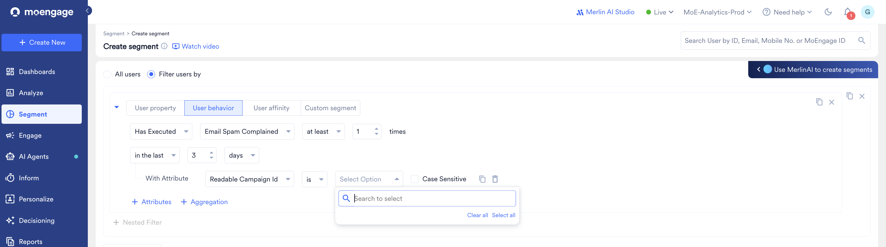
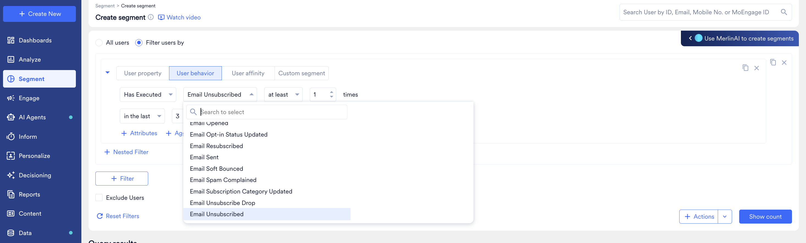

# Overview

_Suppression Updates_ helps maintain your global email subscription list. You can use this feature to ensure that users who should not be contacted are restricted from receiving emails. This is essential for maintaining compliance and protecting your sender reputation.

Suppression blocks promotional and marketing campaigns only. Campaigns tagged as transactional — sent from delivery channels or via Inform — still reach suppressed users. Bounce is the one exception: it blocks all campaign types, including transactional.

<Info>
  If you use MoEngage Managed Email, reachability updates are automatically propagated to SendGrid. However, if you integrate your own SendGrid account, this automatic sync is not supported; you must manage suppression updates directly within your SendGrid dashboard.
</Info>

# Unsubscribe vs. Suppression

Unsubscribe and suppression are related but distinct concepts. Confusing the two can lead to incorrect suppression management and compliance risk.

**Unsubscribe** is a user action. When a user unsubscribes, MoEngage sets the standard unsubscription attribute on their profile to `True`. This is one of several reasons a user can end up suppressed.

**Suppression** is a platform-side outcome. MoEngage suppresses a user — that is, stops sending them non-transactional campaigns — when any of the following is true for their profile:

- Any of the BUC attributes (Bounce, Unsubscribe, or Complaint) is set to `True`
- Frequency Capping (FC) limits are reached
- Do Not Disturb (DND) settings apply
- The user has opted out of a Subscription Category
- Double Opt-In (DOI) is unconfirmed

| Aspect | Unsubscribe | Suppression |
|---|---|---|
| **Trigger** | User action — the user clicks unsubscribe, setting the Unsubscribe attribute (one of the three BUC attributes) to `True` on their profile | Platform action — occurs when any BUC attribute, FC, DND, Subscription Category, or DOI condition is met |
| **Scope** | Sets an attribute on the user profile | Blocks promotional/marketing campaigns only. Campaigns tagged as transactional, or sent via Inform, still reach the user. Bounce is the one exception — it blocks all campaign types, including transactional |
| **Reversibility** | Reversible — the attribute can be reset via resubscribe flows | Reversible depending on the trigger, but removing the suppression condition does not restore explicit consent (see compliance note below) |
| **Who controls it** | The end user, directly | MoEngage based on profile attributes. Brands can influence these attributes using the methods below |

## How Brands Manage Suppression

There is no single "suppression list" in MoEngage email. Suppression is determined by attributes on the user's profile, which brands can update in two ways:

1. **Data ecosystem updates** — User Import or the Server-to-Server (S2S) Data API. These overwrite the relevant standard attributes directly but do not generate events. (Exception: updates made through the user's profile page in the dashboard go through email APIs and do generate events.)
2. **Email-based updates** — the Suppression Management section in email settings, or the Resubscribe API, Subscription Category API, or Double Opt-In API. These update the corresponding standard attributes and generate events against the user's profile, giving you a traceable record of the consent change.

If you need an audit trail of consent changes, use the email-based methods.

<Note>
  Suppression is not the same as a suppression list. MoEngage email doesn't maintain a suppression list natively — this is a MoEngage-side decision made per send request. For a promotional campaign, if the user is bounced, complained, or unsubscribed, MoEngage suppresses the send and doesn't forward the request to your sender. For a transactional campaign, MoEngage suppresses the send only if the user is bounced; for a complaint or unsubscribe, MoEngage still submits the send request to your sender (for example, SendGrid).
</Note>

# Use Cases

- **Migrate from legacy email marketing platforms or ESPs**: Bulk import historical suppression lists (bounces/unsubscribes/spams) when moving to MoEngage to protect your sender reputation from day one.
- **Automate SendGrid sync:** Automatically propagate suppression updates to SendGrid to keep your non-transactional senders compliant without manual work. This applies only if you select [**SendGrid Tracking**](/partner-guide/messaging-channels/email-providers/configure-sendgrid#configure-unsubscribe-settings-and-list-unsubscribe-email) in **Unsubscribe Settings** while configuring an email sender in MoEngage.
- \*\*Protect critical emails: \*\*Maintain a global suppression list for marketing campaigns without blocking essential transactional alerts, such as one-time passwords (OTPs) or password resets.
- **Manage suppression requests independently**: Unsubscribe or resubscribe users in [self-service](/user-guide/campaigns-and-channels/email/getting-started-with-email/self-service-for-email-onboarding) enabled workspaces, eliminating the need to raise support tickets for individual status updates.

# Bulk Import of Users

A primary function of _Suppression Updates_ is to import existing subscription lists in bulk. This is a critical step during email onboarding, especially when migrating from a previous email marketing platform or ESP.

Use this feature to upload CSV lists of users who have previously:

- Experienced email bounces.
- Unsubscribed from your communications.
- Marked your emails as spam (complained).

## CSV File Requirements

To ensure your subscription list is imported correctly, your CSV file must follow these requirements:

- The CSV file must strictly follow the column sequence listed below. While column headers are case-insensitive, the sequence must not be altered to ensure successful processing.
  - Identifier column: Label this column _Email ID_, _MoEngage ID,_ or _Email ID/MoEngage ID_. Note that if PII tokenization is enabled for your workspace, you must label this column _ID_.
  - _Unsubscribe_
  - _Bounce_
  - _Spam_
- For each user, the CSV should specify _true_ or _false_ (case-insensitive) for the columns: Unsubscribe, Bounce, and Spam. For example, a user who unsubscribed but never bounced or marked the email as spam would have the following values:
  - _Unsubscribe_: true
  - _Bounce_: false
  - _Spam_: false
- Your CSV file must not contain duplicate email entries. If duplicates are found, MoEngage processes only the last entry in the file and skips all preceding duplicates. 
- A user is considered resubscribed only when MoEngage updates their status from true (suppressed) to false (active) for all three suppression categories. If the user's current status for all three entries is already false, no update is performed.
- A user becomes reachable if all three suppression categories are set to false, and the user is suppressed if any of the three categories is set to true.
- You can use the same CSV file to unsubscribe or resubscribe a user, depending on the value specified in the _Unsubscribe_ column. To make a previously unsubscribed user reachable, upload a file with the _Unsubscribe_ value set to _false_. If _Bounce_ and _Complaint_ are also _false_, the user is eligible to receive emails again.
- MoEngage generates the following events when the status of BUC attributes (Bounce, Unsubscribe, or Complaint) changes:

<table>
  <thead>
    <tr>
      <th>BUC attributes</th>
      <th>Status Change</th>
      <th>Generated Event Name</th>
    </tr>
  </thead>
  <tbody>
    <tr>
      <td rowspan="2"><b>Bounce</b></td>
      <td>False to True</td>
      <td>Email Bounced</td>
    </tr>
    <tr>
      <td>True to False</td>
      <td>Email Bounce Reset</td>
    </tr>
    <tr>
      <td rowspan="2"><b>Unsubscribe</b></td>
      <td>False to True</td>
      <td>Email Unsubscribed</td>
    </tr>
    <tr>
      <td>True to False</td>
      <td>Email Resubscribed</td>
    </tr>
    <tr>
      <td rowspan="2"><b>Complaint</b></td>
      <td>False to True</td>
      <td>Email Complained</td>
    </tr>
    <tr>
      <td>True to False</td>
      <td>Email Complain Reset</td>
    </tr>
  </tbody>
</table>

<Warning>
  Removing a suppression condition (for example, re-adding a previously unsubscribed user through Bulk Import) does not restore that user's consent. Suppression and consent are tracked separately — clearing the suppression flag only makes the user eligible for sends again; it doesn't mean they've re-opted in. Confirm you have valid consent before resuming sends to a previously suppressed or unsubscribed user.
</Warning>

## Upload the Subscription Update File

- If self-serve for email onboarding is enabled for your workspace, you can manage the suppression as described [here](/user-guide/campaigns-and-channels/email/getting-started-with-email/self-service-for-email-onboarding#manage-email-suppression).
- If self-serve for email onboarding is not enabled for your workspace, you can manage the suppression as described [here](/user-guide/campaigns-and-channels/email/getting-started-with-email/configure-email-channel#subscription-management-tab). 

# Segment Users Who Bounced, Complained, or Unsubscribed

To isolate users for suppression, list hygiene, or investigating a spike in complaints, create a **User behavior** segment based on the email event that matches the user group:

| User group | Event to select | When MoEngage tracks it |
| --- | --- | --- |
| Hard bounces | **Email Bounced** | MoEngage detects that the recipient's email address does not exist. |
| Soft bounces | **Email Soft Bounced** | A temporary delivery issue prevents delivery. |
| Spam complaints | **Email Spam Complained** | The user reports one of your emails as spam. |
| Unsubscribes | **Email Unsubscribed** | The user unsubscribes from your emails. |

MoEngage tracks hard bounces and soft bounces uniquely for each user, based on the user ID.

## Create the Segment

1. **(Optional)** To find users affected by a specific campaign, open the campaign's analytics page and copy its **Campaign ID**.

   

2. On the sidebar menu in MoEngage, hover over **Segment** and click **Create New**. The **Create segment** page appears.
3. Select **Filter users by**, then click the **User behavior** tab.
4. Leave the condition as **Has Executed**, then select the event from the event dropdown, such as **Email Spam Complained**.

   

5. Set how many times and over what period the event occurred:
   - Choose a frequency comparator, such as **at least**, and enter the number of times, such as **1**.
   - Choose a time window, such as **in the last 3 days**. Increase the window to capture events further back.
6. **(Optional)** Narrow the segment to a specific campaign or condition:
   - Click **+ Attributes**.
   - Select an attribute, such as **Readable Campaign Id**, from the dropdown.
   - Set the condition, such as **is**, and search for or select the value, such as the campaign ID you copied, in the **Select Option** field. The match is case-insensitive.
7. **(Optional)** Refine the segment further:
   - Click **+ Filter** to add another condition, and combine the conditions with **AND** or **OR**.
   - Select **Exclude Users** to use this as an exclusion rule instead of an inclusion rule, for example, to exclude spam complainers from a campaign's target audience.
   - Click **+ Nested Filter** to group conditions.
8. Click **Show count** to preview how many users match the segment.
9. Name and save the segment.

The event dropdown also lists **Email Resubscribed**, **Email Subscription Category Updated**, **Email Unsubscribe Drop**, and **Email Opt-in Status Updated**. Use these to build segments around re-engagement or preference changes instead of suppression.

To export the users in the segment or access their user profiles, refer to [User Data Exports](/user-guide/analyze/analytics/user-data-exports).

## Combine Hard and Soft Bounces

To find every user whose email bounced, add one filter for **Email Bounced** and another for **Email Soft Bounced**, and set the condition between them to **OR** instead of **AND**.

For example, the following segment combines two filters, each with **Readable Campaign Id** matching the same campaign ID:

- The first filter finds users who had at least one hard bounce in the last 30 days.
- The second filter finds users who had at least one soft bounce in the last 30 days.

The resulting segment includes users who had either a hard bounce or a soft bounce for that campaign in the last 30 days.

## Uses for These Segments

- **Suppression and list hygiene**: Use the segment with **Exclude Users** to keep recent spam complainers, bounces, or unsubscribes out of upcoming campaigns.
- **Root-cause investigation**: Narrow by **Readable Campaign Id** to check whether complaints are concentrated around a specific send, so you can review its content, frequency, or targeting.
- **Compliance reporting**: Track complaint volume over a rolling window, such as the last 3, 7, or 30 days, to monitor whether your complaint rate is trending toward mailbox provider thresholds.

# FUP Limits

To maintain system stability and prevent excessive load on the Suppression Management service, the following constraints are enforced at the workspace level:

- **File size limit**: Uploads are strictly limited to 75 MB per file.
- **Duplicate file name validation**: To avoid redundant processing, MoEngage checks for existing filenames. If a file with the same name has already been processed, the upload request is rejected.
- **Limit upload frequency**: To ensure equitable resource availability, file uploads are subject to the following frequency limits:
 
  | Time Window | Maximum Allowed Uploads |
  | :--- | :--- |
  | 5 Minutes | 5 uploads |
  | 15 Minutes | 10 uploads |
  | 1 Hour | 20 uploads |
  | 24 Hours | 50 uploads |

<AccordionGroup>
  <Accordion title="How do I control Bounces, Unsubscribes, and Complaints (BUC) when migrating to MoEngage from another ESP?">
    When moving to MoEngage from a previous ESP, you must use the Bulk Import feature within Subscription Management. You will export your existing suppression list (users who bounced, unsubscribed, or complained) from your old provider and upload it to MoEngage as a CSV file. This ensures that MoEngage respects your historical data and permanently restricts these users from receiving emails, protecting your reputation from day one.
  </Accordion>

  <Accordion title="Why is it critical to import my old subscription list?">
    Importing your list is essential for maintaining compliance (honoring previous opt-outs) and protecting your sender reputation. Sending emails to users who have previously bounced or marked you as spam can severely damage your deliverability and cause ISPs to block your future emails.
  </Accordion>

  <Accordion title="Can I use this feature to temporarily pause emails to a group of users?">
    No. Subscription Management is designed for permanent restrictions (like legal opt-outs or hard bounces). If you want to temporarily exclude a group (e.g., "Unengaged Users"), you should create a specific Segment (Suppression List) and exclude it during campaign creation, rather than altering their global BUC status.
  </Accordion>

  <Accordion title="Does the suppression list block transactional emails (like password resets or OTPs)?">
    If a campaign is tagged as a "transactional" type or an inform alert is sent, the suppression list ignores the unsub/complaint flag. However, if a user is marked as bounced, the email is not sent.
  </Accordion>

  <Accordion title="Can I use the Bulk Import file to resubscribe users?">
    Yes. You can make a user reachable again by setting their attribute values to false. A user is considered "suppressed" if any of these are set to true.
    To resubscribe, upload a CSV where the **Bounce**, **Unsubscribe**, and **Complaint** columns are all set to false for that user.
    <Warning>
     **Compliance note on resubscribing users:** Removing a user from the suppression list (setting Unsubscribe to false) only lifts MoEngage's send-block — it does not restore consent. Before resuming marketing emails to a previously unsubscribed user, confirm you have valid, up-to-date consent as required under applicable regulations (e.g., CAN-SPAM, GDPR, CCPA). Re-adding a user without fresh consent can result in compliance violations even though MoEngage will technically deliver the email.
    </Warning>
  </Accordion>

  <Accordion title="What happens if I leave a cell blank (empty) in the CSV file?">
    If a cell is left empty, MoEngage makes no change to that specific attribute for that user. The attribute will simply retain whatever value currently exists in the user's profile.
  </Accordion>

  <Accordion title="How does MoEngage identify which user profiles to update during a Bulk Import?">
    MoEngage identifies users by matching the email addresses in your CSV file against the user property configured in your Email General Settings.
    Specifically, MoEngage looks at the attribute defined in the **User property that stores the email address** field and compares every email ID in your uploaded CSV against this attribute across your user base. Any user profile containing a matching email address in that attribute will be updated.
  </Accordion>

  <Accordion title="What happens if there are multiple profiles with the same email address when I unsubscribe or resubscribe a user?">
    If the "Unsubscribe based on email ID" capability is set, all user profiles associated with that email address will be unsubscribed or resubscribed accordingly.
  </Accordion>

  <Accordion title="How can I audit changes made in Suppression Management?">
    To ensure complete traceability, all modifications are automatically recorded in your [Audit Logs](/user-guide/settings/account/audit-logs/audit-logs#email-suppression-updates).
  </Accordion>
</AccordionGroup>
