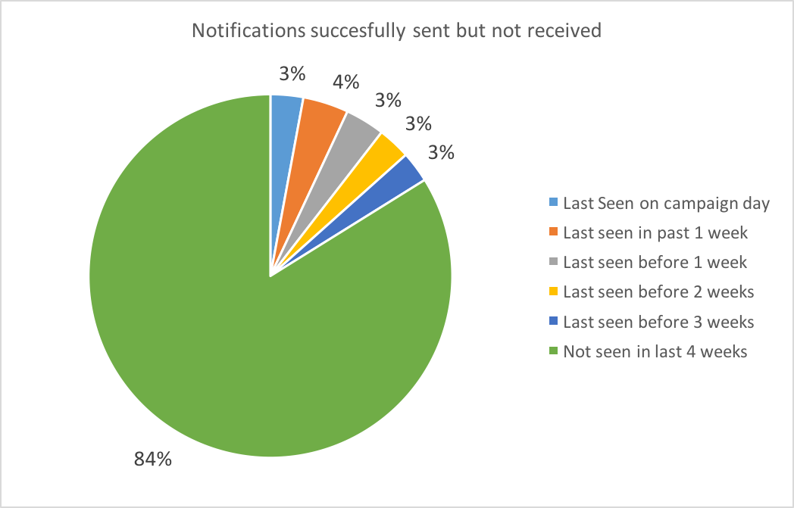
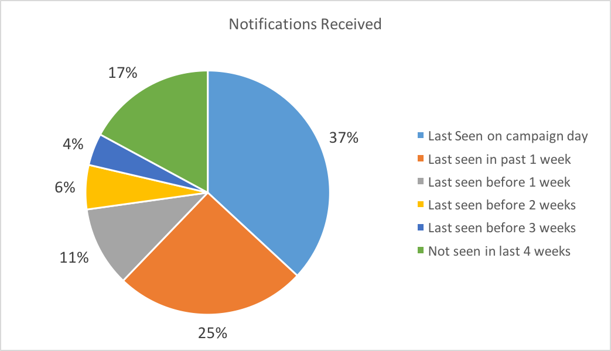

Use this page to diagnose mobile push issues that don't show an error code. For errors listed in a campaign's failure breakdown, see [Troubleshoot Common Push Errors](/user-guide/campaigns-and-channels/mobile-push/troubleshooting-and-faqs-mobile-push/troubleshoot-common-push-errors).

## Delivery

### Users Not Receiving Push Notifications

Some users don't receive notifications even though Firebase Cloud Messaging (FCM) or Apple Push Notification Service (APNS) accepted them. The cause usually falls into one of these categories:

- **User and device settings**
  - **Blocked notifications**: Users can turn off notifications for an app at the operating system (OS) level. FCM and APNS don't invalidate the device token in this case, and they don't tell MoEngage that the user blocked notifications.
  - **Battery and app optimization**: Devices with aggressive battery-saving features or Doze mode (for example, on Motorola phones) can restrict background app activity, which prevents delivery when the app isn't in use. Some battery-saving apps also force-stop background processes.
- **Network and server-side issues**
  - **Network connectivity**: A device must keep a persistent connection to Google's or Apple's servers to receive push notifications. If a user is offline for a long time, the push service can't deliver the notification, and it may never arrive if the Time to Live (TTL) expires first. Google estimates that up to 15% of users may not be connected to FCM at any given time.
  - **TTL expiration**: If FCM or APNS can't reach the device within the TTL, the notification expires without delivery.
  - **Token inactivation lag**: After an app is uninstalled, FCM or APNS takes some time to mark the device token inactive. MoEngage can send a notification to an uninstalled app during this window, but the user never receives it.
- **Manufacturer-specific issues**: Some manufacturers' power-saving or memory-management features interfere with delivery. Newer OS updates resolve some of these issues, but they can persist on older devices. MoEngage has observed failure rates of 90–99% on specific Lenovo, Micromax, and ASUS models. These issues are outside MoEngage's control.
- **Corporate firewalls**: A network's outer firewall can reject incoming packets because of strict security settings, which blocks push notifications for devices on that network.

#### Push Benchmark Report

This report shows benchmark data for push campaign **Delivery Rate**, **Click-Through Rate (CTR)**, and **Conversion Rate (CVR)**:

<Info>
The iOS delivery rate benchmarks don't account for impression tracking or a device's opt-in status. The data is from Q3 2020 (July 1 to September 30, 2020) and was last updated on November 2, 2020.
</Info>

#### User Activity

A large share of notifications that push services accept are never delivered. The following chart breaks down these undelivered notifications by when the user was last seen:

MoEngage couldn't establish direct causality, but there is a strong correlation between user inactivity and deliverability: the longer a user is inactive, the harder it is for FCM or APNS to reach their device. Among users who received notifications, recency (how recently they engaged with the app) also correlates positively with reachability.

#### User Devices

<Info>
This analysis covers Android only. After FCM accepts a notification, MoEngage has no visibility into why it wasn't delivered, so the following reasons are hypotheses based on observed data.
</Info>

Across multiple customer campaigns, some Android device models show much lower delivery rates than others:

- Lenovo A6020 and A6000: failure rates of 98–99%.
- Micromax Canvas series: failure rates of 90–95%.
- ASUS devices (models Z00AD, Z010D, Z008D, Z00UD, and Z00LD): delivery rates below 4%.
- Vivo devices (models Y11, Y15S, Y27L, Y28, Y57L, and V1): delivery rates of 2–3%.

These low rates usually come from aggressive battery optimization by the manufacturer and the Android OS. For example, Doze mode on Motorola phones and the App Standby feature put apps into deep sleep when the device is idle, which can block delivery. Similar issues are common on many Android Marshmallow devices.

### Push Notifications Fail When the Android App Is Killed

Push notifications work when the app is in the foreground or background, but not when the app is killed. This happens with Hybrid SDK integrations.

<Warning>
This is a known limitation when you use React Native methods to pass the push payload to MoEngage.
</Warning>

The most common cause is incorrect SDK initialization. To fix it:

- If you use React Native methods to pass the push payload, let MoEngage handle the payload, or pass it to the MoEngage SDK using Android native methods.
- Initialize the MoEngage SDK in the `onCreate()` method of the Application class, on the main thread and not on a worker thread. For more information, see [SDK Initialization](/developer-guide/android-sdk/sdk-integration/basic-integration/sdk-initialization).

### Android Users Receive Blank Notifications

This usually happens when your app, not MoEngage, controls notification display and doesn't handle the silent push notifications that MoEngage sends to track uninstalls.

1. Confirm the cause by [testing the silent push notification](/user-guide/settings/analytics-and-segmentation/uninstall-tracking). If the silent push shows up as a blank notification, go to **Settings** \> **Analytics and Data** \> **Uninstall tracking** and turn off the **Android Uninstall Tracking** toggle.
   
2. Handle the silent push notification as described in [Push Display Handled by Application](/developer-guide/android-sdk/push/advanced/push-display-handled-by-application). After all your users are on the app version that includes the change, turn the **Android Uninstall Tracking** toggle on again.

Blank notifications also appear when your app receives push notifications from multiple servers, providers, or in-house services and doesn't handle each correctly. Make sure the app doesn't try to show a notification when the push is from MoEngage.

For further help, contact your MoEngage Customer Success Manager (CSM) or the Support team.

### Test Push Fails for a Mobile Number

When you send a test push notification, it fails with the following message:

`Installed User not found for Mobile Number = 0000000000`

To fix this, send the test to the unique **ID** of a reachable user instead of the Mobile Number attribute. MoEngage uses the unique ID to determine whether the user can receive push notifications. You can find it on the user profile, labeled **ID**.

### Users Not Receiving an Event-Triggered Push Campaign

Users can trigger the event but not receive the push notification when they are in a Do Not Disturb (DND) period, have reached a frequency cap, or are within the campaign's minimum delay. The campaign's error breakdown shows these reasons. For details, see the internal errors in [Troubleshoot Common Push Errors](/user-guide/campaigns-and-channels/mobile-push/troubleshooting-and-faqs-mobile-push/troubleshoot-common-push-errors#internal-errors).

To find the cause:

- Make sure the user is part of the campaign's segment. For steps, see [Troubleshooting](/user-guide/segment/create-segments/manage-segments#troubleshooting) in Manage Segments.
- Make sure the campaign isn't stopped or paused.
- Check the campaign's trigger criteria for nested filters. Nested AND/OR filters work in the target audience, but they aren't supported in the trigger criteria of event-triggered campaigns. For more information, see [Combining Segments](/user-guide/segment/create-segments/rule-based-filter-segments#combining-segments).

## Rendering and Images

### Push Templates Render Differently on Android

Push template notifications look slightly different from default notifications.

| Notification Type | Height in Collapsed Mode | Height in Expanded Mode |
| --- | --- | --- |
| Native notification (Basic) | 100 dp | ~300 dp |
| Custom notification: SDK version below 11.4.02 and Push templates module version below 2.4.0 | 64 dp | 256 dp |
| Custom notification: SDK version 11.4.02 and above and Push templates module version 2.4.0 and above | 100 dp | 287 dp |

#### Push Templates With 64 dp Height

The dimensions for custom push notifications follow the [Android guidelines for custom notifications](https://developer.android.com/training/notify-user/custom-notification). Custom notifications taller than 64 dp failed on some devices, and dynamic layouts aren't feasible, so MoEngage restricts the height to the Android guidelines. As a result, default notifications are taller than custom ones.

In expanded mode, the area available for an image is:

| Available Image Height | Buttons Present |
| --- | --- |
| 192 dp | No |
| 152 dp | Yes |

Because of this restricted space, images can get cropped even when they look fine in native notifications.

#### Push Templates With 100 dp Height

- Push templates with the larger area are available from SDK version 11.4.02 and Push templates module version 2.4.0. Their font size, spacing, and padding are similar to basic notifications.
- MoEngage supports customizing the app name and color.
- 100 dp notifications work only on whitelisted original equipment manufacturers (OEMs), because OEM skin customizations stop the layout from rendering properly on all devices. Google, OnePlus, Samsung, Oppo, Vivo, and Motorola are whitelisted. MoEngage is testing more OEMs to add to this list.
- You can whitelist more OEMs, or remove a whitelisted one, for your workspace. Contact your MoEngage Customer Success Manager (CSM) or the Support team to change the list.
- MoEngage tests the latest three skin versions of each OEM, which cover Android 11, 10, and 9. Android 12 isn't included because its notification layout is very different. If 100 dp renders correctly on all three versions, MoEngage whitelists the OEM. Otherwise, MoEngage considers the OEM case by case.
- If 100 dp isn't supported on a device or OEM, the 64 dp custom notification is shown.

#### Image Guidelines

For the best image rendering in all notifications:

- Use the aspect ratio recommended for your template. The ratio differs by template and by whether the notification has buttons, for example 2.9:1 or 2.8:1 for basic notifications and 1.4:1 or 1.3:1 for the Image banner with text overlay template. The campaign builder shows the recommended ratio below the image field, and [Push Templates](/user-guide/campaigns-and-channels/mobile-push/create/push-templates) lists it for each template.
  Cropping is minimal near the recommended ratio, but some devices still crop because of varying Android screen sizes and OEM customizations. For example, Redmi devices add padding around push notifications, which crops the notification and image further.
- Center-align the image content so the main content stays visible even if the margins are cropped.

#### Stylized Notifications Appear Without a Background Color

When a push template notification has HTML text (bold, italic, underline, strikethrough, or text color), a background color, and an image, the SDK renders it in this order:

1. Renders a basic push notification with the HTML text fields and app icon.
2. Draws the custom layout with the background color and, if configured, downloads the image in parallel.

The SDK has about 10 seconds to render the notification. On a poor network, the background or image rendering can fail. If both fail, the notification shows only the stylized text without a background color:

- If the text color is white and the device uses light mode, users see a blank notification.
  
- If the text color is black and the device uses dark mode, users see a blank notification.
  

To avoid this:

- Use text colors that contrast with both light and dark backgrounds.
- Check the campaign preview in both dark and light modes.

#### Colors Are Inverted in Dark Mode

Some colors in stylized push notifications are inverted in dark mode. This has been observed only on a few Oppo devices running Android 10 and is caused by a bug in ColorOS, which is outside MoEngage's scope.

#### Personalization Failure Stops the Notification

If you personalize both the template and the backup notification without adding a personalization fallback, a personalization failure in either one stops the notification for all users. The template and backup are part of one payload, so MoEngage has no alternate message to send. Always add a personalization fallback. For more information, see [Common Personalization Errors and FAQs](/user-guide/campaigns-and-channels/getting-started/message-personalization/common-personalization-errors-and-faqs).

### Android Push Notification Image Not Displayed

- **Image download failure**: This is the most common cause. Check that:
  - The image URL is valid and publicly accessible. If it isn't public, replace it with a public link.
  - The image file is within the allowed size (about 25 KB).
  - The image uses a supported format.
  - The device has a stable internet connection.
- **Push Amplification™ Plus (Huawei Push)**: Notifications sent through HMS Push Kit don't support images.

### Rich Push Images Show Extra Space Compared to the Preview

Images in rich push notifications, including carousels, can show extra space on devices that doesn't appear in the template preview in MoEngage.

- Check that the rich notification dependency is added to your app-level `build.gradle` file. For setup steps, see [Push Templates](/developer-guide/android-sdk/push/optional/push-templates) in the Android SDK documentation.
- If the integration is correct and the device runs Android 12 or later, this is expected behavior. For details on notification layouts and customizable areas, see [Behavior changes: Apps targeting Android 12](https://developer.android.com/about/versions/12/behavior-changes-12).

### Template Backup Content Shows Instead of the Basic Rich Push Content

When you add content to a basic rich push template, the template backup content appears instead.

<Info>
This happens when the MoEngage rich notification dependency isn't added to the app-level `build.gradle` file.
</Info>

The content shown depends on the device and its OS version. To make sure the right content appears:

1. Add campaign content in both the **Basic details** and **Template Backup** sections.
   
2. On the preview screen, the message title and body update when you change the basic details.
   
3. Customize the backup content in the **Template Backup** section.
   
4. Add the MoEngage rich notification dependency to the app-level `build.gradle` file. For setup steps, see [Push Templates](/developer-guide/android-sdk/push/optional/push-templates) in the Android SDK documentation.

## Impressions

### Android Impressions Are Dropping

Possible causes:

- The app doesn't send *notification received* events because of an integration issue.
- Campaigns with lower impressions use different segmentation criteria.
- Fewer notifications were sent.
- The app or SDK version changed.
- The mix of device models changed.
- Users blocked notifications at the OS level.
- Network issues stop devices from connecting to FCM.
- The notification's TTL expired before delivery.
- FCM hasn't yet marked uninstalled devices as inactive.
- An external firewall rejects incoming packets because of its security settings.

## Deep Links

### Deep Links in Push Notifications Not Working on Android

MoEngage uses the native deep link functions that Android provides. To check whether the issue is in your app's implementation:

1. Open the same deep link URL used in the campaign from a third-party app, such as WhatsApp, Slack, or a web browser. If the app doesn't open, the issue is in the app's deep link implementation. For more information, see the Android documentation:
   - [Create Deep Links to App Content](https://developer.android.com/training/app-links/deep-linking)
   - [Handling Android App Links](https://developer.android.com/training/app-links)
2. In some hybrid frameworks, apps navigate with routes that work only inside the app, not when opened from outside it. Follow the Android documentation above to integrate deep links.
3. If deep links work from third-party apps but not from MoEngage push notifications:
   - If the MoEngage SDK creates the notification, it may be using an outdated deep link URL format that appends MoEngage data to the URL and breaks parsing. Contact your MoEngage CSM or the Support team.
   - If the MoEngage SDK doesn't create the notification, check the deep link handling in your app code.

### Deep Links Not Copied From Android to iOS

This is expected behavior. Android requires a deep link value, but it's optional for iOS, and many apps use different deep links on each platform. So **Copy from Android** under **Copy content** copies everything except the deep link.

Set a deep link for iOS, or don't use **Copy from Android**. If you don't set the iOS deep link in copy mode, validation shows an error when you try to go to the next step.

## Tokens and Subscription

### Push Token Drop on Android

A token drop is when MoEngage doesn't have push tokens for all your app users. For example, if 100 new users install your app every day but MoEngage has tokens for only 60 of them, the token drop is 40%. You can't send push notifications to users without a token.

Common causes:

- Poor or no internet connectivity, so the Firebase SDK doesn't generate a token.
- The Google Play services version on the device isn't compatible with the Firebase version in the app.
- The app uses an internal check or flag to decide whether to pass the token to the MoEngage SDK, and the flag is off when the token is generated.
- An integration error stops the token from being passed to the MoEngage SDK.

For steps to fix it, see [How to Fix Token Drop](/developer-guide/android-sdk/troubleshooting-and-faqs/how-to-fix-installation-id-drop#how-to-fix-token-drop).

### Push Token Drop on iOS

A token drop on iOS has the same meaning as on Android. Common causes:

- **Token not passed to the MoEngage SDK**: Push notifications aren't implemented correctly.
- **Push permission not granted**: The user selects **Don't Allow** when the app asks for push notification permission.
  
- **Network connectivity**: The device is on a slow network or not connected. This is a rare cause.

To resolve it:

1. Check that push notifications are implemented correctly, as described in [Push Notification Implementation](/developer-guide/ios-sdk/push/basic/ios-push-integration-tutorial). Make sure the app registers for remote notifications, receives the device token, and passes it to the MoEngage SDK.
2. Send a test campaign to the device. If it fails with an error, look it up in [Troubleshoot Common Push Errors](/user-guide/campaigns-and-channels/mobile-push/troubleshooting-and-faqs-mobile-push/troubleshoot-common-push-errors).
3. If the test campaign is sent but the device doesn't receive it, check whether notifications are turned off for the app in the device settings.

If you still can't find the cause, contact the MoEngage Support team.

### Unsubscribed to Push Event Not Triggered

On Android 13 and above, the notification permission dialog appears the first time a user opens the app:

- **User grants permission**: The app must tell the MoEngage SDK right away so the SDK triggers the *Subscribed to Push* event.
- **User denies permission**: The SDK doesn't trigger the *Unsubscribed to Push* event. The default permission state on Android 13 and above is denied, so there's no change in state to record.

<Info>
On Android 12 and below, the permission state is granted by default. Users don't actively subscribe or unsubscribe, so no related events are generated.
</Info>
