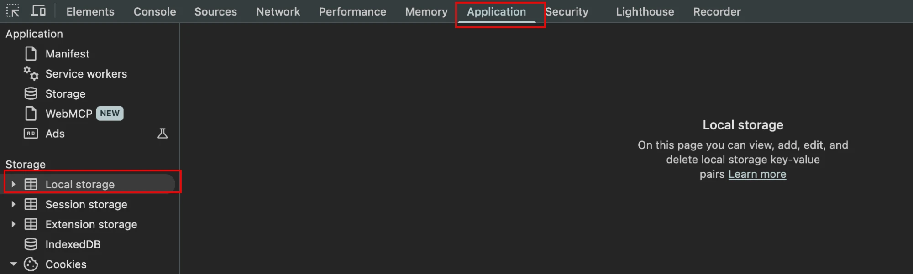

This article provides instructions to clear opt-in permission from the website on Google Chrome. MoEngage supports web push only on HTTPS sites. HTTP sites are not supported.

1. Visit your HTTPS site, right-click the browser and go to **Inspect** > **Application** > **Local storage**. Clear everything present in the local storage.

   <Frame>
     
   </Frame>

2. Click the Lock icon (Secure) in the address bar and change Notifications to "Use global default". You will be prompted to reload the page, after entering the website.
3. Reload the page. You should be able to see an opt-in prompt now.