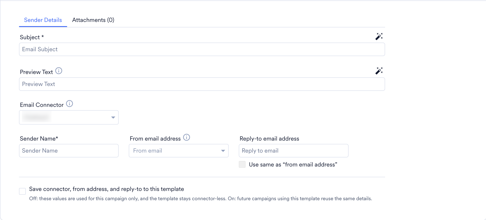
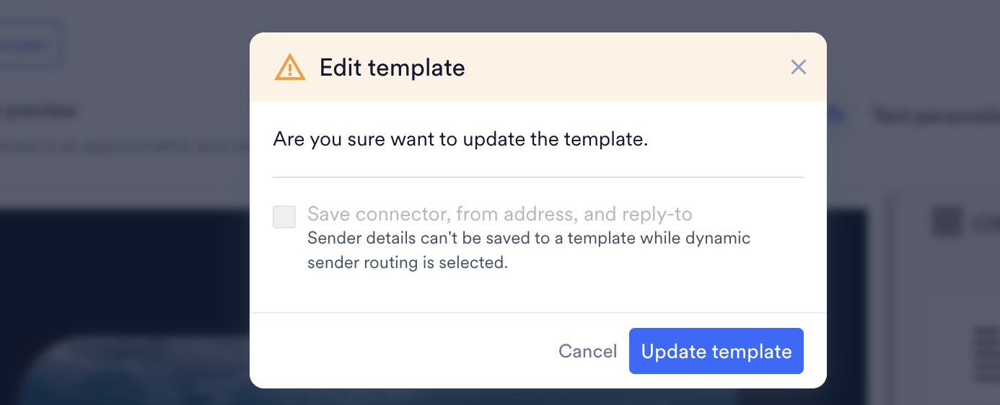
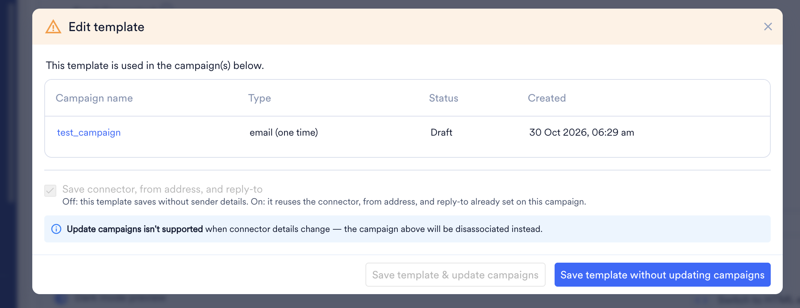

import { AcademyCourse } from "/snippets/academy-course.jsx";
import FeatureAvailability from '/snippets/feature-availability.mdx';

<AcademyCourse
  title="Templates"
  href="https://academy.moengage.com/student/activity/3134515-templates" />

<FeatureAvailability />

# Introduction

The _Templates_ feature of MoEngage streamlines content creation and management by providing effective tools. Managing templates ensures consistency in branding, saves time and effort in organizing them, and helps in team collaboration.

This _Templates_ page is a central hub for all your template dependencies where you can collectively organize and manage all your templates for multiple channels in one place and retrieve them without any hassle.

This feature facilitates you to perform the following:

- Create templates for different channels.
- Edit templates to your requirements using the **Drag and drop** editor or **Custom HTML editor**.
- Manage templates in folders and share folders across teams.
- Share templates individually across teams.
- Preview templates before sending them to users.
- Duplicate and customize templates for personalized communications.
- View and sort templates based on your preferences.
- Check the version history of your template.

# Manage Templates

## Create Template

You can create templates for different channels and manage them in one place.

<Info>
  The **Template** feature is supported only for Email and On-site channels.
</Info>

1. On the sidebar menu in MoEngage, hover over the Content menu item  . The **Content** menu appears.
2. Click **Templates**.  The Templates page appears.
3. Click **\+** **Create template** in the upper right corner of the window. You can create templates for **Email** and **On-site.** Select the channel for which you want to create a template. 

<Tabs>
  <Tab title="Create templates for Email">
    1. **Choose Template:** You can choose a template from the pre-built templates or from saved templates based on the following editors: [**Drag and drop**](/user-guide/campaigns-and-channels/email/create/create-content-with-the-drag-and-drop-editor) editor or [**Custom HTML editor**](/user-guide/campaigns-and-channels/email/create/create-content-with-custom-html-editor).
    2. **Template details:** Provide the following **Template details**.
       <ol style={{ listStyleType: 'decimal' }}>
         <li>**Name:** Enter the name of your template.</li>
         <li>**Tag:** In the **Tags** list, you can select the tags to add to your template.</li>
         <li>**Message Type:** Select the message type as **Promotional/Marketing** or **Transactional** based on which you want to send to your users.</li>
         <li>**Team:** Select the teams that can access this template.</li>
         <li>**Destination to save:** Select the destination to save this template. You can save it within folders or save it directly without folders.</li>
         <li>**Communication Type:** Select the communication type, **Engage** or **Inform.**</li>
       </ol>
    3. **Email details:** Provide the following **Email details**.
    4. **Sender Details:** Provide the following sender details for the email.
       <ol style={{ listStyleType: 'decimal' }}>
         <li>**Preview text:** Enter the preview text that appears in your user's inbox.</li>
         <li>**Email connector:** Select the email connector to use for this template, for example, a SendGrid or Amazon SES connector. The list shows the connectors configured in your email settings. For more information, refer to [Configure Email Channel](/user-guide/campaigns-and-channels/email/getting-started-with-email/configure-email-channel).</li>
         <li>**Sender name:** Enter the sender's name.</li>
         <li>**From email address:** In the **From email address** list, select an email address mapped to the selected connector.</li>
         <li>**Reply-to email address:** Enter the email address where replies should be sent. To use the from address as the reply-to address, select the **Use same as from address** checkbox.</li>
         <li>**Save connector, from address, and reply-to to this template:** Select this checkbox to save the email connector, from email address, and reply-to email address with the template. Campaigns that use this template then reuse the same details. If you clear this checkbox, these values are used only for testing, and the template is saved without connector details.</li>
       </ol>
       

       <Note>
         Saving connector details with a template is being rolled out in phases and may not be available in your workspace yet. If your template shows only the **From email address** field, the address is read from your default connector and is used only to test your template. To enable saving connector details, contact your MoEngage Customer Success Manager (CSM) or the Support team.
       </Note>

       When you save connector details with a template, the following rules apply:
       * **All fields are saved together:** The email connector, from email address, and reply-to email address are saved as a set. You cannot save only some of them.
       * **Validation:** When you save the template, MoEngage checks that:
         * The selected connector exists in your workspace.
         * The from email address is mapped to the selected connector.
         * The from email address is verified.

         <Note>
           If you personalize the from email address, MoEngage skips the mapping and verification checks for it. This applies to templates saved from the dashboard and through the API.
         </Note>
       * **Connector details can be updated but not removed:** After you save connector details with a template, you can change them, but you cannot remove them from that template. To create a version without connector details, use **Save as new and Publish** and clear the **Save connector, from address, and reply-to to this template** checkbox.
       * **Dynamic Sender Routing (Inform):** If you select a connector with [Dynamic Sender Routing](/user-guide/inform/advanced-concepts/dynamic-sender-routing) while setting up an Inform email alert, the following applies when you save the template:
         * **Template has no connector details:** You can save the template, but the connector details are not saved. All other fields are saved.
         * **Template already has connector details:** If you change the connector to a Dynamic Sender Group connector, you cannot save the template. A saved connector cannot be replaced with a Dynamic Sender Group connector.

         
    5. **Attachments:** You can add attachments from **Local file**, **URL** of your attachments, or add **Personalized attachments**. For more information, refer [here.](/user-guide/campaigns-and-channels/email/create/personalize-email-content) You can hide the email details by clicking this <Icon icon="list" /> icon. 
    6. **Template Editor:** Configure your template using the provided tools. For more information, refer [here](/user-guide/campaigns-and-channels/email/create/create-content-with-the-drag-and-drop-editor). 
    7. Click **Preview** in the upper right corner of the template editor window to preview your template and its personalization. For more information, refer [here](/user-guide/campaigns-and-channels/getting-started/message-personalization/personalized-preview). 
    8. **Test Campaigns:** You can test your campaigns to ensure the templates are displayed as you configured them before sending them to your users. 
       1. Test the campaign you created by selecting **Custom Segment** or by entering multiple email addresses separated by a comma.
       2. To test whether the personalized data is rendering correctly for users, you must test the template with the custom segment.
          <Info>
            Test campaigns with any custom segment will target a maximum of 50 users from the chosen custom segment.
          </Info>
       3. To use the sample data you personalized in your template for testing, turn the **Use sample data from the personalized preview for the text** toggle on. 
    9. Click **Save and Publish** to use this template in campaigns, or click **Save as draft** to continue editing later.

    <Info>
      Templates that are in drafts cannot be used in campaigns
    </Info>
  </Tab>
  <Tab title="Create templates for On-site Messaging">
    When selecting On-site, you will be prompted to choose Web, Mobile Web, or both as your preferred platform. 

    1. **Choose Template:** You can create a template from scratch or modify the existing template.
    2. Provide the following  **Template details**.
       1. **Name:** Enter the name of your template.
       2. **Tags:** You can add **Tags** to your template if needed.
       3. **Platforms:** Select the targeted platforms of your template. The available platforms are the Web, Mobile Web, and TV.
          <Info>
            If the TV platform is unavailable in your dashboard, contact your MoEngage Customer Success Manager (CSM) or the Support team[.](/user-guide/contact-support/raise-a-support-ticket-through-moengage-dashboard)
          </Info>
       4. **Team:** Select the teams that can access this template.
       5. **Destination to save:** You can choose the destination folder to which your template should be saved. 
    3. **Template Editor:** You can create a template using the **Drag & drop editor** or **Custom** **HTML editor**. For more information, refer here. 
    4. **Display Settings:** This option allows you to configure the display settings for your campaign.  
       <Info>
         Setting options may vary based on the template type, and the description for each setting is explained in the following table.
       </Info>
       | Display Setting | Template Type | Description |
       | --- | --- | --- |
       | **Show this message if another campaign is already displayed on the webpage.** | Popups, Nudges, and Banners | Selecting this checkbox allows you to show this OSM campaign even if another OSM has already been displayed on the page. Note: For this to work, the campaign events that trigger the OSMs should be different. |
       | **Keep this message in place on scroll.** | Banner | Selecting this checkbox allows you to keep the Banner static. |
       | **This message will push the contents of the page down.** | Banner | Selecting this checkbox allows the banner to occupy the space at the top of the website without overlapping with the website's content. For this to work, the banner chosen should be positioned at the top, and the website's headers shouldn't be sticky. |
    5. Click **Save and Publish** to use this template in campaigns, or click **Save as a draft** to continue editing later.

    <Info>
      Templates that are in drafts cannot be used in campaigns.
    </Info>
  </Tab>
</Tabs>

## Sort Templates

You can sort and view templates based on your requirements. The templates will be displayed based on your selection from the following:

- **All:** Shows all the available templates regardless of the channels.
- **Email:** Shows the templates created for Email.
- **On-site:** Shows the templates created for On-site.

1. **View by:** You can view templates by **Folders and templates** or **Templates only**.
   - **Folders and templates:** This option allows you to view templates that are in folders and templates that are not in folders. 
   - **Templates only:** This option allows you to view all the templates regardless of the folders. 
2. **Sort by:** You can sort templates by **Name** and **Last modified**.
   - **Name:** This option aligns the template by template names in alphabetic order. Using this <Icon icon="arrow-down-arrow-up" /> icon, you can choose ascending (A-\>Z) or descending (Z-\>A).
     - **Ascending (A-\>Z):** This sorting option shows your templates in ascending order based on the template names.
     - **Descending (Z-\>A):** This sorting option shows your templates in descending order based on the template names. 
   - **Last Modified:** This option aligns the template based on the recent modification made to any template. Using this <Icon icon="arrow-up-arrow-down" /> icon, you can choose the modifications from Old to New or New to Old to sort the templates.
     - **Old to New:** This sorting option shows the templates based on the changes made in the past (Old) to recent changes (New).
     - **New to Old:** This sorting option shows the templates based on the changes made recently (New) to the changes made in the past (Old). 

## Filters

You can segregate templates as required using the following filters: 

1. **Template source:** You can select the template source from which you want to filter templates. You can filter templates from All templates, Saved templates, and API templates.
2. **Tags:** You can select the tags associated with the template you want to filter.
3. **Message Type (Only for Email):** You can filter templates based on the message type.
4. **Status:** You can select the status of the template which you want to filter.
5. **Last updated by:** You can fetch the template based on users who updated it recently.
6. **Team:** You can filter templates based on the team that has access to the template.
7. **Communication type:** You can filter communication from the following options: **All, Engage,** and **Inform.**
8. **Editor:** You can filter templates based on the editor in which your template has been created.
9. **Platform (only for On-site):** You can filter templates based on platforms such as **Web, Mobile,** and **TV.**
10. **Content (only for On-site):** You can filter templates based on their content, such as Timers, carousels, etc.
11. **Template type (only for On-site):** You can filter templates based on the template type, such as Banner, pop-up, etc.
12. **Use case (only for On-site):** You can filter templates based on the use cases with which they are associated.
13. **Show shared items only:** Enabling this option allows you to filter the templates and folders shared with other teams.

## Template actions

You can perform the following actions in templates by clicking this <Icon icon="ellipsis-stroke-vertical" />icon in the folder.

Click this <Icon icon="ellipsis-stroke-vertical" />icon in the template. The following actions will be populated.

1. **Preview:** When you select the preview action, the left window pane lists an array of templates, which you can preview by selecting one. You can change the template by clicking the arrow <Icon icon="circle-chevron-right" />  icon beside it. On the right side of the window, you can check details like version history, creator details, and so on. You can also preview templates by directly clicking on the existing templates displayed on the main screen. 
2. **Share:** This option allows you to share templates with multiple teams. Sharing folders/templates with multiple teams will allow them to access and use your templates and duplicate them to edit further for their requirements. While sharing your templates with other teams, the team members will receive an email regarding your template being shared.
3. **Edit:** You can edit templates by choosing the existing templates you created or from the pre-built templates available.
   1. Select a template that you want to edit. You can edit the template details, such as Name, Tags, Teams, Destination, and Platform.
   2. If it is an email template, edit the email details, such as **Sender details** (including connector details, if saved with the template) and **Attachments.** For more information, refer [here](/user-guide/campaigns-and-channels/email/create/create-an-email-campaign). 
   3. If it is an On-site template, you can edit it using the tools provided. For more information, refer [here](/user-guide/campaigns-and-channels/on-site-message/create/osm-editor). 
   4. Click **Save as new and Publish** to save it as a new template, or click **Update and Publish** to update the template with your changes.
      <Note>
        If the template already has connector details saved, the **Save connector, from address, and reply-to to this template** checkbox is selected and cannot be cleared when you click **Update and Publish**. You can still change the connector, from email address, and reply-to email address. To save the template without connector details, click **Save as new and Publish** and clear the checkbox.
      </Note>
   5. **Editing templates associated with campaigns:** If the template is part of any active, scheduled, or draft campaign, the **Edit template** dialog lists the associated campaigns. Choose one of the following:
      * **Save template & update campaigns:** Saves the template and applies your changes to the associated email campaigns.
      * **Save template without updating campaigns:** Saves the template without changing the associated campaigns.

      <Warning>
        If you change the connector details of a template, **Save template & update campaigns** is disabled. When you click **Save template without updating campaigns**, the associated campaigns are disassociated from the template. They keep their current connector details, and later updates to the template are no longer applied to them. Changes to any other field, such as content, subject, or sender name, can still be applied to the associated campaigns with **Save template & update campaigns**.
      </Warning>

      <Info>
        In On-site messaging, you cannot edit templates associated with any active or scheduled campaigns
      </Info>
      
4. **Duplicate:** This option allows you to duplicate templates and make further edits. You can manage multiple versions of your current template. For example, you can manage multiple versions of the same template to target customers based on their region, with their local languages and occasional themes.
5. **Rename:** This option allows you to rename the template.
6. **Move:** This option allows you to move the template to a folder and between folders.
7. **Delete:** This option allows you to delete templates. If you delete templates that are not part of any active campaigns, your folder gets deleted directly.
   - **Delete templates associated with the email campaigns:** If you try to delete templates associated with any active and scheduled campaign, a prompt will appear with details of the campaign and ask you to stop the corresponding template before deleting it.
     <Info>
       In On-site messaging, you cannot delete templates that are associated with any active or scheduled campaigns.
     </Info>
     

# Manage Folders

You can create folders to manage templates for separate campaigns and channels and share them across teams. For example, to send promotional messages from an email campaign, you can choose promotions as a message type, create templates, and manage them under a folder named _email_. You can also manage another subfolder for transactional templates.

<Info>
  You can manage only one level of subfolder in a folder
</Info>

1. Click **Create folder** from the title bar. 
2. Provide the following details in the **Create folder** dialog box:
   1. Enter the name of your folder.
   2. In the **Teams list,** select your teams.
   3. In the **Tag(s)** list, select tags for your folder and click **Create**. 

## Folder Actions

You can perform the following  actions in folders by clicking this <Icon icon="ellipsis-stroke-vertical" />icon in the folder. 

1. **Share:** This option allows you to share the folder with multiple teams. Sharing folders with multiple teams will allow them to access the folders of your templates and duplicate them to edit further for their requirements. When you share any folder with other teams, the members of the team will get an email notification regarding the folder.
2. **Edit:** This option allows you to edit the folder name and tags associated with the folder.
3. **Move:** This option allows you to move the current folder to another folder.
4. **View details:** This option allows you to check the details of the folder.
5. **Delete:** This option allows you to delete the folder. When you delete any folders that are not part of any active campaigns, your folder gets deleted directly.
   - **Deleting folders associated with email campaigns:** If any template you attempt to delete is part of any active or scheduled campaign, it will prompt the campaign's details and ask you to stop the campaign before deleting. You can remove templates associated with any active or scheduled campaigns from the folder and manage them under **Templates** by selecting the **Move above templates outside and delete folder** check box.
     <Info>
       In On-site messaging, you cannot delete a folder associated with any active or scheduled campaigns.
     </Info>

# Use of Templates in Campaign Creation

The **Templates** feature serves a significant purpose with its template creation and management capabilities while creating campaigns. For more information, refer [here](/user-guide/campaigns-and-channels/email/create/create-an-email-campaign). 

- The templates you have created for that respective channel will be shown while creating campaigns. It also shows the templates that have the tags you add to your campaign. For example, If you add the tag, _New customer_ while creating an email campaign, it will show the email templates with the tag, _New customer_.
- You can filter templates based on the available options for your respective channels.
- While creating campaigns, you can select the templates based on the editor in which they were created.
- The **Templates** feature also manages the templates you have created while creating a campaign. You can fetch and edit the templates created via the campaign creation flow from the **Templates.**

<Info>
  The permissions to edit, delete, save, and publish templates are determined based on the role. For more information, refer [here](/user-guide/settings/account/team-management/access-roles).
</Info>

# FAQs

<AccordionGroup>
  <Accordion title="Can I use a template that is saved as a draft in a campaign?" icon="sparkles">
    No. Templates in drafts cannot be used in campaigns. To use a template in campaigns, click **Save and Publish**.
  </Accordion>
  <Accordion title="Who can edit, delete, save, or publish templates?" icon="sparkles">
    Permissions to edit, delete, save, and publish templates are determined by your role. For more information, refer to [Access Roles](/user-guide/settings/account/team-management/access-roles).
  </Accordion>
  <Accordion title="What sender details can I save with an email template?" icon="sparkles">
    You can save the email connector, from email address, and reply-to email address by selecting the **Save connector, from address, and reply-to to this template** checkbox. Campaigns that use the template then reuse the same details. If you clear the checkbox, the values are used only for testing, and the template is saved without connector details.
  </Accordion>
  <Accordion title="Can I save only the connector or only the from email address?" icon="sparkles">
    No. The email connector, from email address, and reply-to email address are saved as a set.
  </Accordion>
  <Accordion title="What does MoEngage check when I save sender details with a template?" icon="sparkles">
    MoEngage checks that the connector exists in your workspace, and that the from email address is mapped to that connector and verified. If you personalize the from email address, MoEngage skips the mapping and verification checks for it.
  </Accordion>
  <Accordion title="Why don't I see the Email connector field?" icon="sparkles">
    Saving connector details with a template is being rolled out in phases. If your template shows only the **From email address** field, the address is read from your default connector and is used only to test your template. To enable saving connector details, contact your MoEngage Customer Success Manager (CSM) or the Support team.
  </Accordion>
  <Accordion title="Can I remove sender details after saving them with a template?" icon="sparkles">
    No. You can change them, but you cannot remove them. To create a version without connector details, click **Save as new and Publish** and clear the **Save connector, from address, and reply-to to this template** checkbox.
  </Accordion>
  <Accordion title="Can I save a Dynamic Sender Routing connector with a template?" icon="sparkles">
    No. If the template has no connector details, you can save it, but the connector details are not saved. If the template already has connector details, you cannot save it with a Dynamic Sender Group connector.
  </Accordion>
  <Accordion title="How do I test an email template before using it?" icon="sparkles">
    Test it with a custom segment or with email addresses separated by commas. To check that personalized data renders correctly, test with a custom segment. A test with a custom segment targets a maximum of 50 users from that segment.
  </Accordion>
  <Accordion title="What is the difference between Save as new and Publish and Update and Publish?" icon="sparkles">
    **Save as new and Publish** saves your changes as a new template. **Update and Publish** updates the existing template with your changes.
  </Accordion>
  <Accordion title="Why is Save template & update campaigns unavailable?" icon="sparkles">
    You changed the connector details of the template. Click **Save template without updating campaigns**. The associated campaigns are disassociated from the template and keep their current connector details. Changes to other fields, such as content, subject, or sender name, can still be applied with **Save template & update campaigns**.
  </Accordion>
  <Accordion title="Can I edit or delete On-site templates that are used in campaigns?" icon="sparkles">
    No. In On-site messaging, you cannot edit or delete templates associated with any active or scheduled campaigns.
  </Accordion>
  <Accordion title="How do I share templates with other teams?" icon="sparkles">
    Use **Share** on a template or folder. The teams can then access and use your templates and duplicate them to edit further. Team members receive an email when a template or folder is shared with them.
  </Accordion>
  <Accordion title="How many levels of folders can I create?" icon="sparkles">
    You can manage only one level of subfolder in a folder.
  </Accordion>
  <Accordion title="Can I find templates that I created during campaign creation?" icon="sparkles">
    Yes. Templates created in the campaign creation flow are also managed in **Templates**, where you can fetch and edit them.
  </Accordion>
</AccordionGroup>
