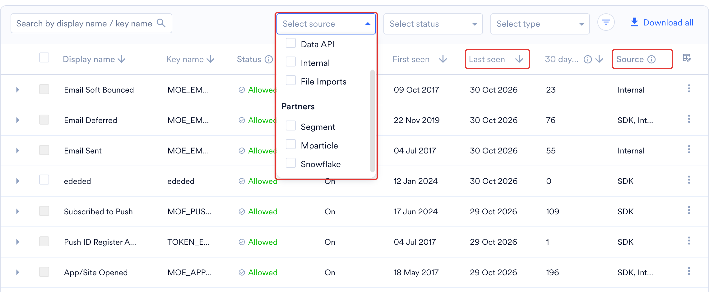
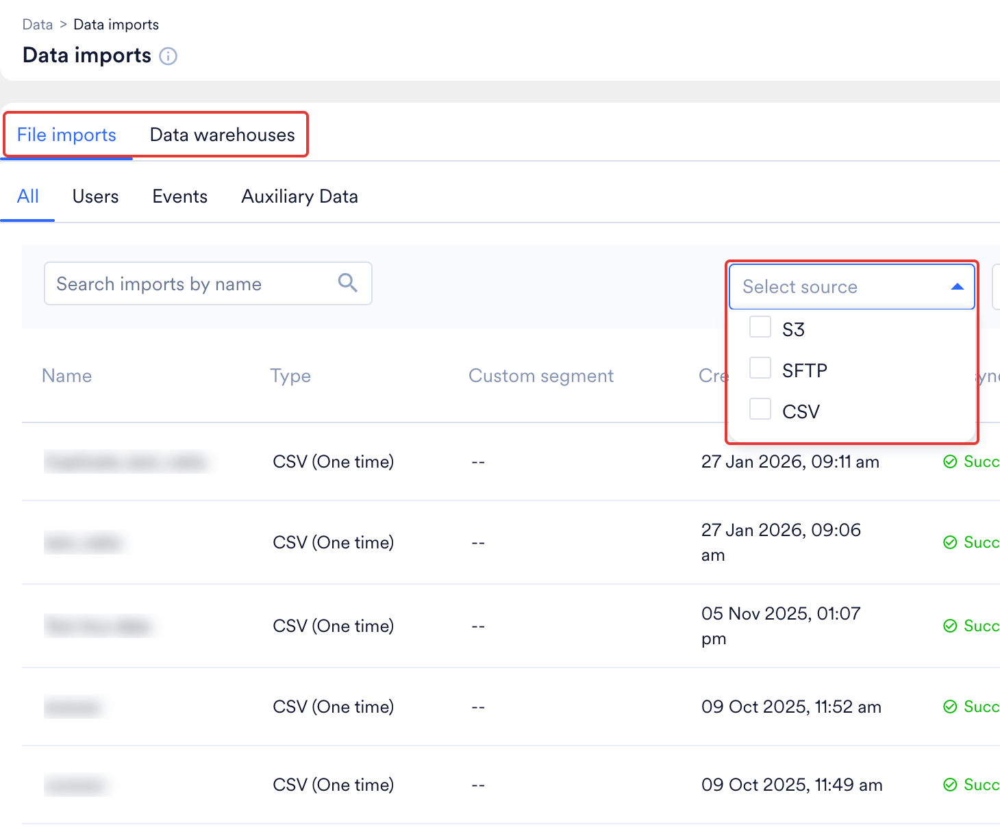
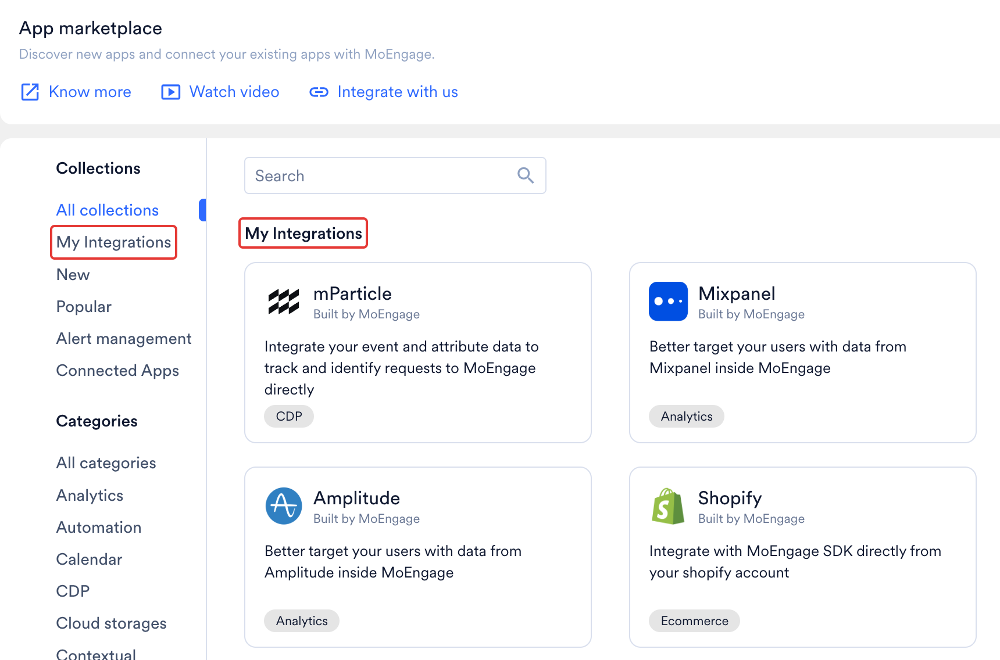
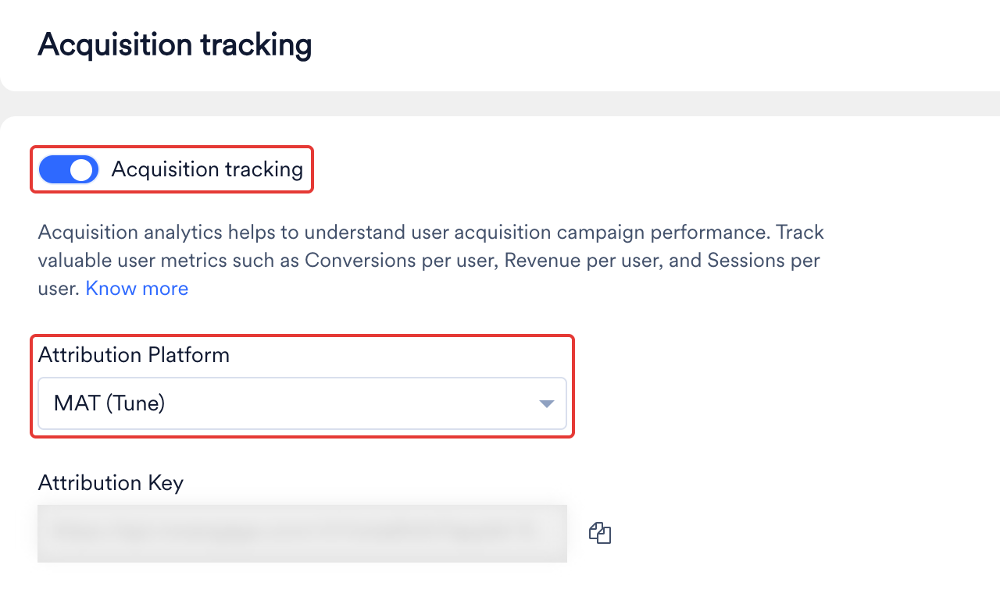
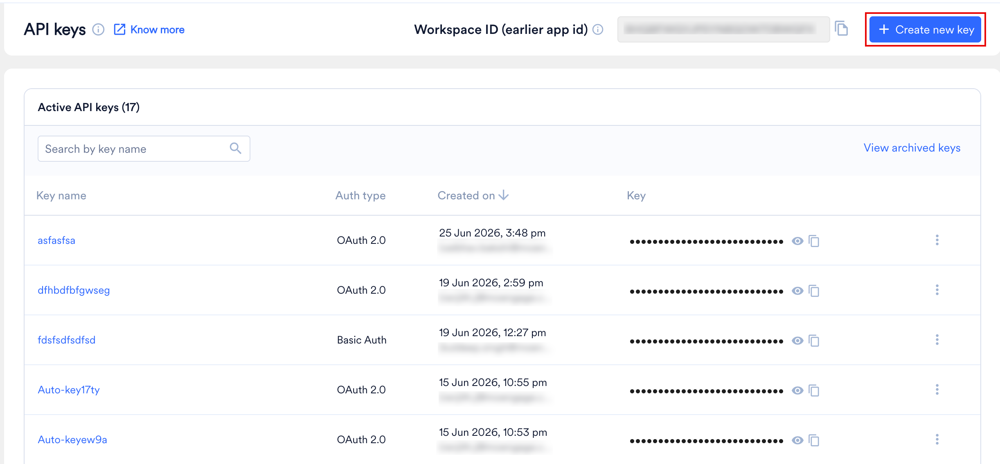
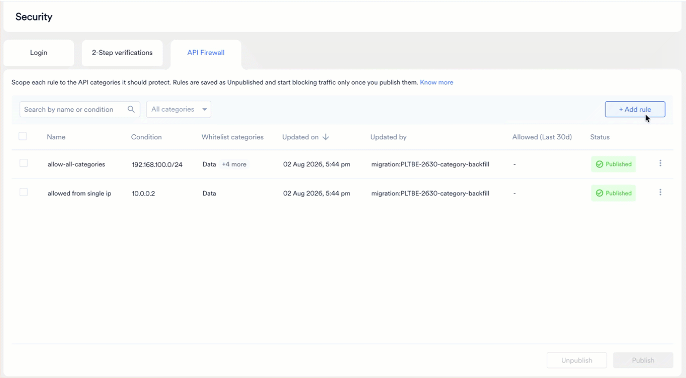
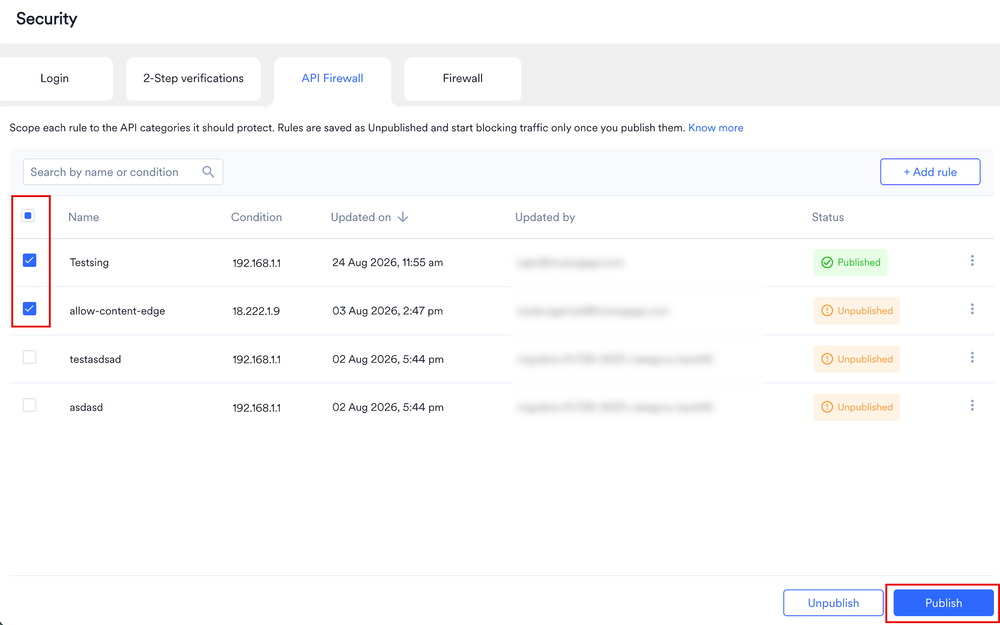

After you publish an [API Firewall](/user-guide/settings/account/security/api-firewall) rule, MoEngage blocks every API call from an IP address that isn't on your whitelist, including calls from your own partners. This guide shows you how to find every partner and server that calls MoEngage, collect their IP addresses, and publish rules without breaking your data flow.

Use this guide if any of the following apply to you:

- Your security team wants API access to MoEngage restricted by IP address.
- You're about to turn on the API Firewall.
- A partner tool already gets `403` errors from MoEngage.

<Info>
The API Firewall is off by default. Until you publish a rule for a category, MoEngage accepts calls to that category from any IP address. MoEngage documentation calls this practice "IP whitelisting". Many security teams call it "IP allowlisting", which means the same thing.
</Info>

## Overview

This guide covers traffic coming into MoEngage: the calls your servers and partners make to MoEngage APIs. The IP addresses belong to those callers, not to MoEngage, so you collect them from each owner and enter them in the API Firewall.

Keep a worksheet, such as a spreadsheet, as you go. Record each caller, its owner, the API category it uses, its IP addresses, where each IP address came from, and the date you got it.

The process has six steps:

1. [Find your data center and API host](#step-1-find-your-data-center-and-api-host). Partners and developers must call the host that matches your data center.
2. [Find the partners that send data into MoEngage](#step-2-find-the-partners-that-send-data-into-moengage). The dashboard shows each partner type in a different place.
3. [Find your own servers and tools that call MoEngage](#step-3-find-your-own-servers-and-tools-that-call-moengage). Your developers know their outbound IP addresses.
4. [Match each caller to an API category](#step-4-match-each-caller-to-an-api-category). You set rules per category, not per API key.
5. [Get the IP addresses from each owner](#step-5-get-the-ip-addresses-from-each-owner). No single person holds every IP address.
6. [Create the rules, then publish them together](#step-6-create-the-rules-then-publish-them-together). A workspace Admin does this in the dashboard.

## Step 1: Find Your Data Center and API Host

Your data center decides the API host that partners and developers must call. Check the address you use to log in to MoEngage. It reads `dashboard-0X.moengage.com`, where `0X` is your data center number.

| Dashboard URL | Data center | API host | Region |
| --- | --- | --- | --- |
| `dashboard-01.moengage.com` | DC-01 | `api-01.moengage.com` | US |
| `dashboard-02.moengage.com` | DC-02 | `api-02.moengage.com` | EU |
| `dashboard-03.moengage.com` | DC-03 | `api-03.moengage.com` | India |
| `dashboard-04.moengage.com` | DC-04 | `api-04.moengage.com` | US |
| `dashboard-05.moengage.com` | DC-05 | `api-05.moengage.com` | Singapore |
| `dashboard-06.moengage.com` | DC-06 | `api-06.moengage.com` | Indonesia |

Record the API host in your worksheet. Every caller in the following steps must use the host of your data center. A partner that points at the wrong host fails for a reason that has nothing to do with the API Firewall. For more information, refer to [Data Centers in MoEngage](/user-guide/data/key-concepts/data-centers-in-moengage).

<Note>
**Your own outbound firewall is a separate setting.** If your network blocks your servers from reaching MoEngage, allow the domain `api-0X.moengage.com` for the Data API instead of MoEngage's IP addresses. MoEngage is multi-tenant and its IP addresses change often, so don't cache them. The API Firewall in Step 6 works in the other direction: it controls which callers MoEngage accepts.
</Note>

## Step 2: Find the Partners That Send Data Into MoEngage

Partners connect to MoEngage in two ways, and each leaves a different trail, so check both. Menu names can differ slightly between the current and the new MoEngage UI.

### Partners You Set Up in MoEngage

MoEngage shows each partner type in a different part of the dashboard. Use the following table to find them.

| Partner type | Where imports show up (into MoEngage) | Where exports show up (out of MoEngage) | Needs an API Firewall entry? |
| --- | --- | --- | --- |
| Attribution partners, such as AppsFlyer, Adjust, Singular, Branch, and Airbridge | **Settings** > **Analytics** > **Acquisition tracking** shows whether tracking is on and which partner is selected in **Attribution Platform**. Some workspaces show it under **Settings** > **Analytics and Data** > **Acquisition tracking**. | Not applicable | Ask your CSM. The **Partner Integration** category includes the Track App Install API. AppsFlyer Audiences is listed in [Impact on Partner Integrations](/user-guide/settings/account/security/api-firewall#impact-on-partner-integrations). |
| CDP and analytics partners, such as Hightouch, RudderStack, Segment, mParticle, Amplitude, and Mixpanel | **Settings** > **Data** > **Data management** lists every event and user property that arrives, with first and last seen dates. | **App marketplace** in the left navigation | Many do. Check the partner's name in [Impact on Partner Integrations](/user-guide/settings/account/security/api-firewall#impact-on-partner-integrations). |
| Connected sources, such as Punchh, RevenueCat, and Unbounce | **Settings** > **Data** > **Data management**, as above. These partners send data to an endpoint that MoEngage sets up for them. | Not applicable | No |
| Data warehouses, such as Snowflake, BigQuery, and Databricks | **App marketplace** holds the connection. The **Data warehouses** tab under **Data** > **Data imports** lists each import. | **App marketplace** | No. MoEngage pulls the data. |
| Cloud storage, such as Amazon S3 and SFTP | **App marketplace** holds the connection. **Data** > **Data imports** lists each file import. | **App marketplace** | No. MoEngage pulls the data. |
| Connected channels, such as ad platforms and messaging apps | **App marketplace** | **App marketplace**, and the Connector campaigns you create | No. MoEngage sends the data. |

The following sections show where to check each route in the table.

#### Data Management

In [Data management](/user-guide/settings/data-management/overview-data-management), open the **Events** tab. In **Select source**, select **Data API** or a partner listed under **Partners**, and then sort by **Last seen**. An event that still arrives from a partner has a recent date, which tells you the connection is live. The **Source** column shows where each event comes from.

<Frame></Frame>

#### Data Imports

The **Data imports** page lists your import jobs by name on the **File imports** and **Data warehouses** tabs. Use the **Select source** filter on the **File imports** tab to separate Amazon S3, SFTP, and CSV imports, and use the import names to tell partners apart.

<Frame></Frame>

#### App Marketplace

In **App marketplace**, select **My Integrations** to see the partners connected to your workspace.

<Frame></Frame>

#### Acquisition Tracking

The **Attribution Platform** field shows which attribution partner your workspace uses.

<Frame></Frame>

### Partners That Connect From Their Own Side

Many partners, such as Hightouch, Zapier, and Konnectify, are set up inside the partner's own tool. Someone on your team pastes your Workspace ID and Data API key into that tool, so MoEngage may show no tile or setting for the partner. Use the following methods to find these partners:

- **Open Settings > Account > APIs.** This page shows your Workspace ID and one API key per API group, such as Data, Push, Inform, Campaigns and catalog, and Personalize. Ask who copied each key and where they pasted it.
- **Use the API Key Dashboard if you have it.** With this Early Access feature, an Admin can create several named keys under **Settings** > **Account** > **API keys**, each limited to chosen APIs. Audit Logs record who created, updated, or archived each key. Creating one key per vendor is the easiest way to see who calls MoEngage. For more information, refer to [API Key Dashboard](/user-guide/settings/account/api-and-api-keys/api-key-dashboard).
  <Frame></Frame>
- **Ask Support which IP addresses MoEngage already sees.** [Raise a support ticket](/user-guide/contact-support/raise-a-support-ticket-through-moengage-dashboard) to request the IP addresses from which MoEngage received successful API requests for your workspace. Ask for a period long enough to include your longest job cycle, such as a month. Every IP address in the list should belong to a server or partner in your worksheet. Before you publish rules, find an owner for any IP address you don't recognize. The list shows only successful requests, so it can miss a caller that already fails or that runs rarely.
- **Ask the teams that own data tools.** Your data, growth, CRM, and analytics teams know which tools list MoEngage as a destination.
- **Check from the partner's side.** Look for a MoEngage entry in the destinations or connected apps list of your CDP, reverse ETL, automation, and CRM tools.
- **Use the partner impact list as a checklist.** For each partner in [Impact on Partner Integrations](/user-guide/settings/account/security/api-firewall#impact-on-partner-integrations), ask whether your team uses it.

### Record the Partners

1. Open each location above and record every partner in your worksheet, with the vendor name, the owner, and a contact.
2. Mark whether the partner calls MoEngage from its own servers. The [Impact on Partner Integrations](/user-guide/settings/account/security/api-firewall#impact-on-partner-integrations) table tells you which named partners do.
3. Ask your CSM about any partner you can't place. Your CSM can see the same partner list and can walk through it with you.

## Step 3: Find Your Own Servers and Tools That Call MoEngage

Partners are only part of the picture. Anything of yours that uses a MoEngage API key is also blocked after you publish a rule, so ask your developers and IT team to list every caller. Share the following table with them.

| Type of caller | Examples | What to collect |
| --- | --- | --- |
| Production backends | Services that send user attributes and events to MoEngage as users act | The static public IP address, or the NAT gateway IP address, they send from |
| Data pipelines and scheduled jobs | Nightly syncs, bulk imports, and report downloads | The IP address of the machine or runner that makes the call |
| Internal tools and scripts | Admin panels, support tools, and one-off scripts | The owner of each one, and the IP address it calls from |
| Staging and QA | Test environments that use a staging workspace | The IP addresses of the test systems, kept in separate rules in the staging workspace |
| Agencies and contractors | Anyone who holds one of your API keys | Their outbound IP addresses, from them |
| Automation and BI tools | Workflow tools and dashboards that read analytics through the API | The tool's published IP address list, or the IP addresses of the server that runs it |

Your developers can find these callers in two ways:

- Search code, scheduled jobs, and configuration for your MoEngage API host from Step 1.
- Review the API keys under **Settings** > **Account** > **APIs**, and in the API Key Dashboard if you have it, then ask each key's owner what uses it.

Keep the following in mind before you collect IP addresses:

- **Fixed IP addresses only.** The API Firewall accepts single IP addresses and IP ranges, not domain names or wildcards. A caller with no fixed outbound IP address, such as a serverless function, must first route its traffic through a NAT gateway or proxy that has one.
- **Mobile and web apps aren't affected.** The API Firewall covers server-to-server API traffic and doesn't affect SDK traffic from your app or website, so you don't list user devices.
- **Both IP versions work.** You can enter IPv4 and IPv6 addresses, CIDR ranges, and IPv4 ranges with a start and an end address.

## Step 4: Match Each Caller to an API Category

API Firewall rules apply per API category across the whole workspace, so for each caller in your worksheet, you need to know which category its calls fall into. There are five fixed categories.

| Category | What it covers |
| --- | --- |
| Data | User profiles, event tracking, bulk import, device management, GDPR and CCPA requests, and analytics dashboard data |
| Segmentation | File segments, filter segments, and archiving or unarchiving segments |
| Campaigns | Campaign management, test sends, stats and reports, business events, subscriptions, push (V2.1), cards, Inform alerts, Live Activities, Personalize, message archival, and flows |
| Partner Integration | Cohort sync, partner file imports, app install tracking, and the connection test |
| Content | In-app, on-site, SMS, email, and push templates, content blocks, recommendations, coupons, catalog, and offerings |

Ask your developers which API each of their calls uses, then place it in a category. For the full list of APIs in each category, refer to [API Categories](/user-guide/settings/account/security/api-firewall#api-categories).

Keep the following exceptions in mind:

- **The legacy push API isn't covered.** The [Send Push Notification (Legacy)](/api/push/push-api-legacy) v2 API ignores whitelist rules. To restrict push requests by IP address, move to [Send Push Notification (V2.1)](/api/push/push-api).
- **A few accounts are exempt for Inform.** The API Firewall supports the Send Transactional Alert (Inform) API, except for a small number of accounts. If you think your account is exempt, contact your CSM.
- **Rules apply per category, not per API key.** You can't limit one key to one IP address. Any caller on the whitelist can use any key for that category.
- **Workspace-to-workspace traffic needs MoEngage's IP addresses.** If you use Connected Segments, Streams, or Connector campaigns to send data from one MoEngage workspace to another, add MoEngage's own IP addresses to the receiving workspace's rules. For the list, refer to [IP Whitelisting in MoEngage](/user-guide/settings/account/security/ip-whitelisting-in-moengage).

## Step 5: Get the IP Addresses From Each Owner

No single person holds every IP address, so send each request to the owner of that caller. Send one complete message per owner so they can answer without a follow-up.

| Who | What they own | What to ask them |
| --- | --- | --- |
| Your developers, DevOps, or IT security team | Your servers, NAT gateways, proxies, and CI tools | The static outbound IP addresses or CIDR ranges of every caller in Step 3 |
| Each partner vendor | The servers the partner calls MoEngage from | The public IP addresses or CIDR ranges it uses, and whether they're fixed |
| Your MoEngage CSM or the Support team | Account-level answers | The IP addresses from which MoEngage received successful API requests (through a support ticket), which of your partners are affected, whether your account is exempt for Inform, and help if a partner can't give fixed IP addresses |

### Find a Partner's IP Addresses

- **Search the partner's help center** for "IP allowlist", "IP whitelist", "static IP", "egress IP", or "webhook IPs". Many vendors publish a page.
- **Read the partner's MoEngage integration guide** in the [Partner Guide](/partner-guide/introduction).
- **Ask the partner's support team or account manager** for the IP addresses it calls MoEngage from.
- **Ask your developers about middleware or tools you host yourself.** They can give you the public IP address of your NAT gateway or load balancer from your cloud console. A NAT gateway is the single public address that many internal servers share when they call out to the internet.
- **Record every IP address in your worksheet** with its source and the date you got it.

### What to Expect From Vendors

- **Some vendors publish fixed lists.** Klaviyo, Iterable, and Optimove publish IP address lists for the traffic they send, and Iterable lets you fetch its list programmatically.
- **Some vendors give shared regional ranges only.** Twilio Segment publishes ranges by region and doesn't offer dedicated IP addresses to individual customers.
- **Some vendors gate fixed IP addresses by plan.** Segment's IP allowlisting for Functions traffic is on its Business tier.
- **Some vendors can't give fixed IP addresses for all traffic.** Iterable tells customers to allow domains, not IP addresses, for API and CDN traffic.

<Warning>
If a partner can't give you fixed IP addresses, talk to your CSM before you publish a rule for that partner's category. Once the rule is published, MoEngage blocks the partner's calls from any IP address that isn't in the rule.
</Warning>

## Step 6: Create the Rules, Then Publish Them Together

The main risk is blocking your own traffic, so add every rule first and turn on enforcement last. You must be a workspace Admin to add rules.

### Create the Rules

1. On the left navigation menu in the MoEngage dashboard, go to **Settings** > **Account** > **Security**, and select the **API firewall** tab.
2. Select **Enable API Firewall**. The **Add API firewall rule** dialog box opens.
3. In **Rule name**, enter a name that says who the rule is for, such as "Production backend" or "Hightouch".
4. Under **Whitelist categories**, select every category that the caller uses from Step 4. You must select at least one.
5. In **Condition**, select the type that matches the IP address you have: a single IPv4 or IPv6 address, a CIDR range, or an IPv4 range.
6. In **Value**, enter the IP address or range, and then select **Add rule**.
7. Repeat these steps for every caller in your worksheet. To add more rules, select **+ Add rule** on the API firewall list page.

<Frame></Frame>

MoEngage saves each new rule as **Unpublished**, which means it's recorded but not enforced. For field details and screenshots, refer to [Create and Publish API Firewall Rules](/user-guide/settings/account/security/api-firewall#create-and-publish-api-firewall-rules).

### Publish the Rules

Publishing a rule enforces it for every category it covers, and MoEngage applies it within about 15 minutes. From then on, a call from an IP address that isn't in a published rule for that category gets a `403` response.

Before you publish, confirm the following:

- Every caller from Steps 2 and 3 has a rule.
- Every partner marked **Yes** in [Impact on Partner Integrations](/user-guide/settings/account/security/api-firewall#impact-on-partner-integrations) that you use has its IP addresses in a rule for the right category.
- Every rule is saved as **Unpublished**.
- You read the **First rule for this category** warning in the dialog box and checked that no caller is missing.
- Your team knows the publish time, and someone watches for `403` errors from your servers and partners that day.
- Your worksheet lists each IP address with its source and date.

Then select all the unpublished rules and publish them in one action, not one at a time, so no caller is blocked while its rule waits.

<Frame></Frame>

MoEngage doesn't send a dashboard notification when it blocks a request. The blocked caller sees the `403` response directly, so ask your developers and partners to set up alerts for it.

### Roll Back and Review

To stop enforcing a rule, select it and then select **Unpublish**. If you unpublish every rule for a category, that category accepts calls from any IP address again. Deleting the last published rule for a category has the same effect, and the dashboard warns you first.

[Audit Logs](/user-guide/settings/account/audit-logs/audit-logs) record every rule change, with who made it, when, and from which IP address.

If the API Firewall itself has an internal failure, it's designed to fail open. It lets traffic through so that data collection continues.

## Troubleshooting

| What you see | Likely cause | What to do |
| --- | --- | --- |
| A partner tool gets `403` errors from MoEngage. | Its IP addresses are missing from a published rule, or the rule covers the wrong category. | Get the partner's IP addresses, add them to a rule for the category from Step 4, and publish it. |
| Your own server gets `403` errors after you publish. | The server's public IP address, often a NAT gateway, isn't in a published rule for that category. | Ask your developers for the real outbound IP address, add it, and allow about 15 minutes after publishing. |
| Calls worked for a while, and then started failing. | The partner or your infrastructure changed its IP addresses. | Ask the owner for the new IP addresses, add them, and publish the rule. |
| One category works and another fails. | A published rule exists for only one of the categories the caller uses. Categories with no published rule stay open, and covered categories are enforced. | Add the caller's IP addresses to a rule for the failing category. |
| You added a rule, but calls from other IP addresses still succeed. | The rule is saved as **Unpublished**, so it doesn't affect traffic. | Check the rule's status, and publish it if you meant to enforce it. |
| Calls are blocked with no dashboard alert. | MoEngage doesn't notify the dashboard when it blocks a request. | Check the logs on the caller's side for the `403` response. |
| You need to restrict one API key to one IP address. | Rules apply per category for the workspace, not per key. | [Submit a product idea](/user-guide/contact-support/suggest-a-feature) from **Need help** in the dashboard. |
| A partner can't give fixed IP addresses. | The vendor shares or rotates its IP addresses. | Talk to your CSM before you publish a rule for that partner's category. |
| Push requests aren't restricted. | The Send Push Notification (Legacy) v2 API ignores whitelist rules. | Move to [Send Push Notification (V2.1)](/api/push/push-api). |
| Your servers see time-out or network errors when they call MoEngage. | Your own outbound firewall blocks the MoEngage address, or it allows an old IP address that has since changed. | Allow the domain `api-0X.moengage.com` for your data center instead of MoEngage IP addresses, and don't cache IP addresses. |

## FAQs

<AccordionGroup>

<Accordion title="Do I have to turn on the API Firewall?">
  No. The API Firewall is inactive by default, and MoEngage accepts API calls from any IP address until you publish a rule for a category.
</Accordion>

<Accordion title="Who can create rules?">
  A workspace Admin. Developers and partners can supply the IP addresses, but an Admin enters and publishes the rules.
</Accordion>

<Accordion title="Can I enter a domain name or a wildcard?">
  No. Rules accept single IP addresses, CIDR ranges, and IPv4 ranges only.
</Accordion>

<Accordion title="Does the API Firewall affect my mobile app or website?">
  No. The API Firewall applies to server-to-server API traffic and doesn't affect SDK traffic from end users.
</Accordion>

<Accordion title="Why should I add all rules before I publish them?">
  Publishing enforces each category within about 15 minutes. If you publish rules one at a time, a caller whose rule isn't published yet can get `403` errors.
</Accordion>

<Accordion title="Will I know if the API Firewall blocks something?">
  Not from the dashboard. The blocked caller receives a `403` response, so monitor for it on the caller's side.
</Accordion>

<Accordion title="Where can I see who changed a rule?">
  In [Audit Logs](/user-guide/settings/account/audit-logs/audit-logs), which record each rule change, who made it, when, and from which IP address.
</Accordion>

<Accordion title="Who do I contact if I don't have a CSM?">
  Contact the MoEngage Support team.
</Accordion>

<Accordion title="A partner is set up in its own tool and I can't find it in MoEngage. What do I do?">
  Refer to [Partners That Connect From Their Own Side](#partners-that-connect-from-their-own-side). Check **Settings** > **Account** > **APIs**, the API Key Dashboard if you have it, and the destinations list in the partner's own tool.
</Accordion>

</AccordionGroup>
